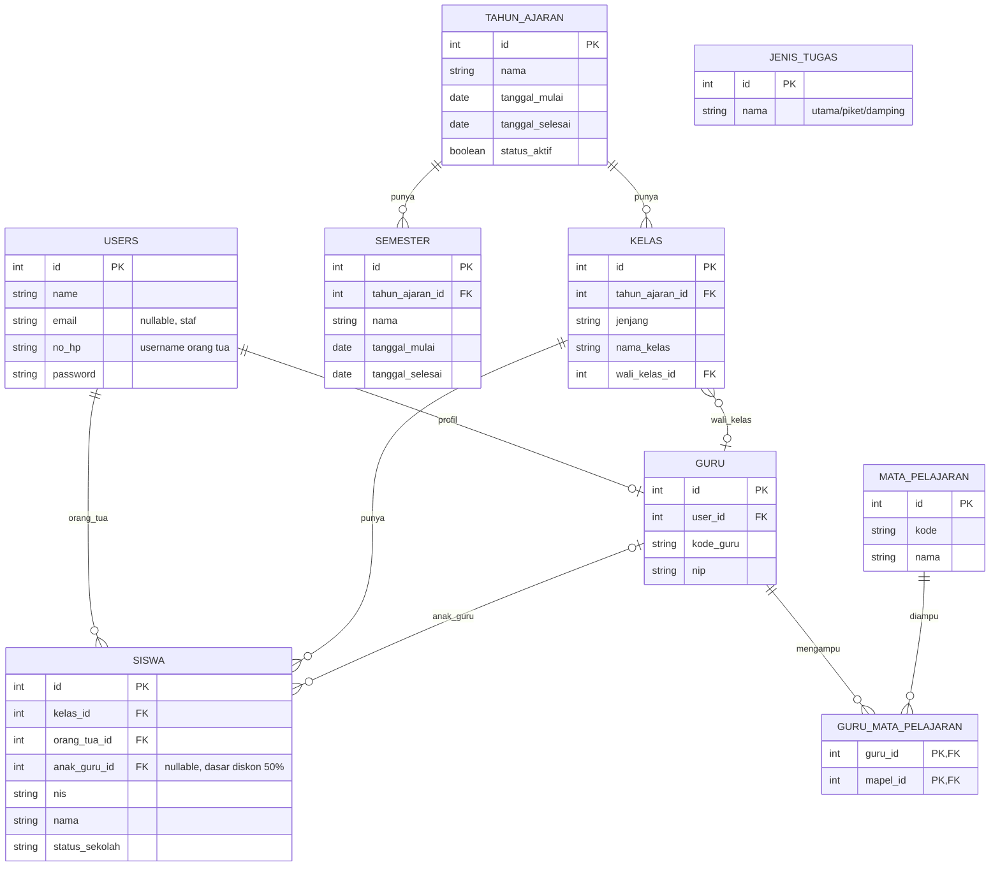
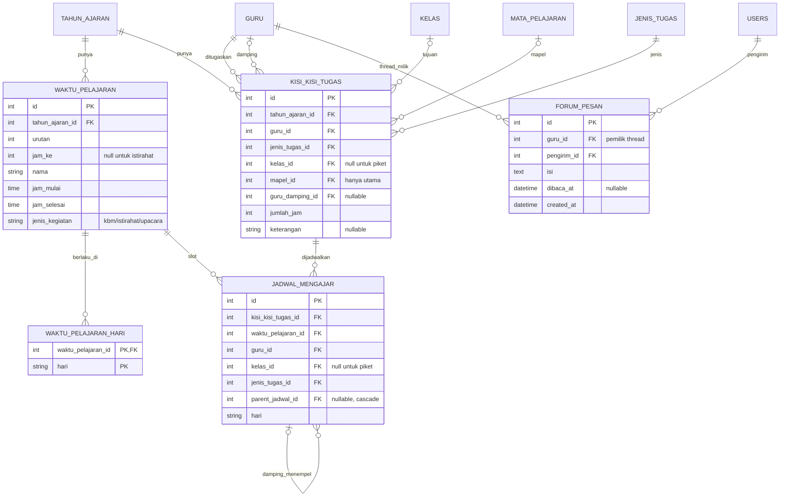

# Product Requirement Document (PRD)
## Aplikasi Jurnal Guru, Jadwal Guru, dan Les Tambahan & Ekstrakurikuler
**Klien:** SD Plus Gembala Baik — Yayasan Pendidikan Gembala Baik, Pontianak
**Versi:** 1.7 — menyempurnakan ERD: dipecah menjadi 3 diagram sesuai pembagian kerja dua pengembang (data master bersama, Modul Les & Ekstrakurikuler, Modul Jadwal Guru + Jurnal Guru); menambah tabel yang sebelumnya hanya disebut di teks atau belum ada (tagihan, periode laporan, honor, semester, jadwal ekskul, dll.); serta menyelaraskan teks PRD dengan ERD baru
**Tanggal:** 27 Oktober 2026
**Tim Pengembang:** 2 orang (pembagian modul dijelaskan di Bagian B)

---

## Ringkasan Perubahan v1.7

| # | Perubahan | Bagian terdampak |
|---|---|---|
| 1 | ERD dilengkapi dan dipecah menjadi 3 diagram: (1) data master bersama, (2) Modul Les & Ekstrakurikuler, (3) Modul Jadwal Guru + Jurnal Guru — agar tiap pengembang punya ERD sendiri | A4, B.3 |
| 2 | Tabel baru: `semester`, `periode_pendaftaran`, `jadwal_ekskul`, `tagihan`, `alokasi_transaksi`, `periode_laporan`, `laporan_harian`, `honor_kegiatan`, `honor_detail` (sebelumnya belum ada atau hanya disebut namanya) | A4 |
| 3 | `tagihan` + `alokasi_transaksi` memisahkan kewajiban bayar dari uang yang masuk; `transaksi` tidak lagi menunjuk satu pendaftaran (satu transfer bisa melunasi banyak tagihan) | A4 (Catatan v1.7), B.1 FR-9, FR-15, FR-21–23 |
| 4 | `pendaftaran` memakai dua FK nullable (`les_tambahan_id`, `ekstrakurikuler_id`) dengan CHECK tepat satu terisi, menggantikan `tipe_kegiatan` + `kegiatan_id` polimorfik | A4, Catatan v1.3, B.1 FR-27 |
| 5 | `siswa.anak_guru_id` sebagai dasar diskon 50% anak guru (FR-9) | A4 |
| 6 | `users.role` dihapus; role memakai `spatie/laravel-permission` (multi-role) | A3, A4, A6 #15, A7 |
| 7 | `periode_laporan` menggantikan "bulan" untuk laporan bulanan, tutup buku, dan status "Sudah Diketahui" honor; `penyesuaian_dana` memakai FK periode; `skema_honor.berlaku_sejak` | A4, B.1 |
| 8 | Penamaan tabel diselaraskan dengan ERD: `pendaftaran_les_ekskul` → `pendaftaran`, `transaksi_pembayaran` → `transaksi`, `ekstrakurikuler_pengajar` → `ekskul_pengajar`; `honor_pengajar` tidak jadi tabel (rekap dihitung dari `honor_detail`) | Seluruh dokumen |
| 9 | Kepemilikan tabel per pengembang dan pola kerja dua pengembang (satu repo, fondasi dulu, branch per orang) | A4, A5 |
| 10 | Keputusan terbuka baru A6 #17–#20; A6 #7 dan #15 diperbarui | A6 |

---

## Ringkasan Perubahan v1.6

| # | Perubahan | Bagian terdampak |
|---|---|---|
| 1 | Laporan bulanan hanya bisa di-approve Bendahara jika **seluruh** transaksi transfer periode itu sudah `terverifikasi` TU **dan** `disetujui` Bendahara (menutup A6 #10) | A3, A4 (Catatan v1.6), B.1 FR-14b, A6 |
| 2 | Role baru **Waka Kurikulum** mengelola Modul Jadwal Guru; Bendahara tidak lagi mengelola jadwal (menutup A6 #12) | A2, A3, A4 (`users.role`), A7, B.3 |
| 3 | TU **tidak mengunggah bukti transfer** ke aplikasi (hemat penyimpanan database); kolom `bukti_transfer` dihapus | A2, A3, A4, B.1 FR-7 |
| 4 | 4 jenis honor flat dinyatakan final (menutup A6 #11) | A6 |
| 5 | Draf skema database Modul Jadwal Guru berdasarkan 4 mockup Pengembang 2; kuota jam kelas dihitung dari `waktu_pelajaran` | B.3 |
| 6 | Keputusan terbuka baru A6 #13–#16 | A6 |
| 7 | Koreksi kecil: "4 modul utama" di A2 menjadi "3 modul utama" (tabelnya memang berisi 3 modul) | A2 |

---

# BAGIAN A — FONDASI BERSAMA

## A1. Latar Belakang & Tujuan

Yayasan Pendidikan Gembala Baik saat ini menjalankan beberapa proses secara manual di SD Plus Gembala Baik:

- Pencatatan transaksi harian & rekap bulanan untuk les tambahan dan ekstrakurikuler masih menggunakan buku tulis dan Excel terpisah.
- Verifikasi pembayaran transfer dilakukan lewat chat pribadi antar staf, rawan bukti transfer hilang atau tidak terkirim.
- Pendaftaran les tambahan & ekstrakurikuler menggunakan Google Form, rawan pendaftaran dobel dan sulit melacak revisi data.
- Belum ada kanal resmi bagi guru untuk menyampaikan masukan/keluhan ke kepala sekolah.
- Sistem jadwal mengajar guru dari vendor sebelumnya hanya mendukung jam mengajar utama, tidak mendukung jam piket dan jam damping.

Tujuan aplikasi ini adalah mendigitalisasi keempat proses di atas dalam satu sistem terpadu, dengan validasi otomatis untuk mengurangi kesalahan pencatatan manual.

## A2. Ruang Lingkup

**3 modul utama:**

| Modul | Deskripsi Singkat | Penanggung Jawab |
|---|---|---|
| Les & Ekstrakurikuler | Pendaftaran + pencatatan transaksi & rekap bulanan | Pengembang 1 |
| Jurnal Guru | Forum privat guru–kepala sekolah + lihat jadwal pribadi | Pengembang 1 |
| Jadwal Guru | Kisi-kisi tugas mengajar + penjadwalan (utama, piket, damping) — dikelola oleh role Waka Kurikulum (lihat A3 & Catatan v1.6) | Pengembang 2 |

**Out of scope untuk versi ini:**
- Pembayaran langsung di aplikasi (payment gateway) — direncanakan fase berikutnya
- **Unggah bukti transfer ke aplikasi** *(baru, v1.6)* — TU tidak mengunggah bukti transfer ke aplikasi demi menghemat penyimpanan database; bukti dari orang tua diperiksa di luar aplikasi, aplikasi hanya mencatat status verifikasi/approval
- Notifikasi real-time / chat langsung pada forum guru
- Auto-scheduling untuk jam piket & damping (cukup manual di versi ini)
- **Bina Karakter & Pramuka** — kegiatan wajib, auto-assign per jenjang kelas (bukan pilihan pendaftaran), dibiayai dari kas sekolah terpisah; honor flat penerimanya kini **dapat diatur di aplikasi** oleh Kepala Sekolah (lihat FR-25b, baru v1.5) meski dananya tetap dari kas sekolah terpisah — **tidak** tercatat di `pendaftaran` sama sekali, murni tampilan informasi di sisi orang tua — lihat A4 & FR-24
- Perhitungan/pembagian honor flat non-persentase (Pramuka, Bina Karakter, Olimpiade, Pembuat Soal Les) tidak memakai skema persentase — nominal & penerima diatur manual oleh Kepala Sekolah di halaman Skema Honor (lihat FR-25b, baru v1.5), namun keputusan *berapa* nominalnya tetap kebijakan sekolah di luar logika aplikasi

## A3. Role & Permission

| Role | Les & Ekskul – Pendaftaran | Les & Ekskul – Transaksi | Les & Ekskul – Honor | Jurnal Guru | Jadwal Guru |
|---|---|---|---|---|---|
| **Kepala Sekolah** | Lihat semua | Lihat laporan (read-only) | Atur skema persen honor, atur honor flat (Olimpiade/Bina Karakter/Pramuka/Pembuat Soal Les — nominal & guru penerima, lihat FR-25b), tentukan guru pendamping per ekstrakurikuler, lihat rekap honor 3-layer & tandai "Sudah Diketahui" | Lihat & balas semua thread | Lihat semua jadwal |
| **TU** | Input & kelola pendaftaran, kelola status berhenti/pindah & penyesuaian dana | Input transaksi (cash/transfer; tanpa unggah bukti transfer — lihat Catatan v1.6), ajukan laporan untuk approval | – | – | – |
| **Bendahara** | – | Approve transaksi transfer secara individual (rekonsiliasi mutasi rekening, di luar verifikasi TU — lihat FR-8b), tambahkan transaksi transfer yang belum tercatat TU ke tanggal tertentu (lihat FR-8c), lihat rincian transaksi per hari dalam laporan bulanan (lihat FR-13), approve laporan bulanan **hanya setelah seluruh transaksi transfer periode tsb selesai — lihat FR-14b** (memicu tutup buku) | Approval bulanan memicu perhitungan honor otomatis; tidak ada input manual dari Bendahara di sini | – | – *(v1.6: dipindah ke Waka Kurikulum)* |
| **Waka Kurikulum** *(baru, v1.6)* | – | – | – | – | **Kelola penuh** — isi Master Waktu Pelajaran, susun Kisi-Kisi Tugas (matriks guru×kelas×mapel), lakukan Pembagian Jadwal (drag-drop penjadwalan utama/damping/piket), lihat Hasil Jadwal per kelas/guru — lihat Catatan v1.6 & B.3 |
| **Guru** | – | – | – | Kirim pesan privat ke kepala sekolah, lihat thread sendiri | Lihat jadwal mengajar sendiri |
| **Orang Tua** | Daftarkan anak, lihat status pendaftaran | Lihat status pembayaran & tunggakan anak | – | – | – |

*Catatan v1.7: role dikelola lewat `spatie/laravel-permission` (kolom `users.role` dihapus), sehingga satu pengguna dapat memegang lebih dari satu role — lihat A4 dan A6 #15.*

## A4. ERD & Data Entitas *(v1.7: dilengkapi)*

ERD dibagi menjadi **3 diagram** agar terbaca dan sesuai pembagian kerja dua pengembang. Relasi lintas diagram memakai nama tabel yang sama. Diagram digambar di akhir bagian ini; daftar kolom per tabel ada di bawah.

| Diagram | Isi | Pemilik |
|---|---|---|
| 1. Data master bersama | `users`, `guru`, `mata_pelajaran`, `guru_mata_pelajaran`, `tahun_ajaran`, `semester`, `kelas`, `siswa`, `jenis_tugas` | Fondasi bersama — dikerjakan lebih dulu; perubahan skema hanya lewat kesepakatan kedua pengembang (lihat A5) |
| 2. Modul Les & Ekstrakurikuler | pendaftaran, tagihan, transaksi, laporan, dan honor | Pengembang 1 |
| 3. Modul Jadwal Guru + Jurnal Guru | tabel jadwal (B.3) dan `forum_pesan` (B.2) | Pengembang 2 untuk tabel jadwal; Pengembang 1 untuk `forum_pesan` |

### Diagram 1 — Data master bersama

- **users** — id, name, email (nullable, untuk staf), no_hp (username untuk role orang_tua), password. *(v1.7: kolom `role` dihapus. Role — kepala_sekolah / tu / bendahara / waka_kurikulum / guru / orang_tua — dikelola `spatie/laravel-permission`, satu pengguna boleh memegang lebih dari satu role; lihat A6 #15)*
- **guru** — id, user_id (FK), kode_guru, nip
- **mata_pelajaran** — id, kode, nama
- **guru_mata_pelajaran** *(pivot N–N, PK komposit)* — guru_id (FK), mapel_id (FK)
- **tahun_ajaran** — id, nama, tanggal_mulai, tanggal_selesai, status_aktif
- **semester** *(baru, v1.7)* — id, tahun_ajaran_id (FK), nama (mis. Semester 1 / Semester 2), tanggal_mulai, tanggal_selesai *(dipakai FR-10 untuk menentukan "pergantian semester" dan "bulan pertama semester berjalan")*
- **kelas** — id, tahun_ajaran_id (FK), jenjang, nama_kelas, wali_kelas_id (FK → guru, nullable)
- **siswa** — id, kelas_id (FK), orang_tua_id (FK → users), **anak_guru_id** (FK → guru, nullable — *baru, v1.7*; diisi hanya jika siswa adalah anak guru SD Plus, menjadi dasar diskon 50% di FR-9; NULL untuk siswa lain, termasuk anak guru unit yayasan lain dan anak pengajar ekskul eksternal), nis, nama, status_sekolah (aktif/pindah_sekolah/lulus)
- **jenis_tugas** — id, nama (Mengajar Utama, Piket, Damping) — dimiliki Diagram 1 tetapi dipakai oleh Modul Jadwal Guru

### Diagram 2 — Modul Les & Ekstrakurikuler (Pengembang 1)

*Kegiatan & pendaftaran:*

- **periode_pendaftaran** *(baru, v1.7)* — id, tahun_ajaran_id (FK), tanggal_mulai, tanggal_selesai *(jendela pendaftaran orang tua, mis. 15–22 Juli pada mockup; pengaruhnya pada input manual TU (FR-6) lihat A6 #19)*
- **les_tambahan** — id, kelas_id (FK), tahun_ajaran_id (FK), biaya *(pengajar = wali_kelas dari kelas terkait, tidak disimpan terpisah; tanpa kolom kuota)*
- **ekstrakurikuler** — id, nama, biaya, kuota, tahun_ajaran_id (FK), guru_pendamping_id (FK → guru, nullable), kategori_pendamping (seni/olahraga, nullable — diisi manual oleh Kepala Sekolah per kegiatan), **parent_ekstrakurikuler_id** (FK → `ekstrakurikuler.id` sendiri, nullable — diisi hanya jika baris ini adalah kelas paralel dari kegiatan induk; baris induk selalu NULL di kolom ini — lihat A4 catatan kelas paralel & B.1 FR-26/FR-27), **wajib_otomatis** (boolean, default false — true khusus untuk kegiatan seperti Bina Karakter/Pramuka yang auto-assign per jenjang kelas, lihat FR-24), **jenjang_wajib** (nullable, format rentang kelas mis. "1-3"/"4-6" — hanya diisi jika `wajib_otomatis` = true, menentukan kelas mana yang otomatis di-assign), **honor_flat** (boolean, default false — true untuk kegiatan seperti Olimpiade yang tetap terdaftar & berkuota tapi honornya di luar `skema_honor` persentase, ditentukan manual Kepala Sekolah — lihat FR-25)
- **jadwal_ekskul** *(baru, v1.7)* — id, ekstrakurikuler_id (FK), hari, jam_mulai, jam_selesai, jenjang (nullable, format rentang mis. "1-3" — diisi jika jam berbeda per jenjang, mis. Basket), lokasi *(satu kegiatan bisa punya lebih dari satu baris; dipakai FR-5 untuk deteksi bentrok jadwal)*
- **pengajar_ekskul** — id, nama, jenis (internal/eksternal), guru_id (FK → guru, nullable), no_hp
- **ekskul_pengajar** *(pivot N–N, PK komposit)* — ekstrakurikuler_id, pengajar_ekskul_id *(satu kegiatan bisa punya lebih dari 1 pengajar, mis. English Club 6 orang; honor pengajar dibagi rata sesuai jumlah baris di sini)*
- **pendaftaran** *(sebelumnya `pendaftaran_les_ekskul`)* — id, siswa_id (FK), les_tambahan_id (FK, nullable), ekstrakurikuler_id (FK, nullable) — **CHECK tepat satu dari keduanya terisi** *(v1.7: menggantikan `tipe_kegiatan` + `kegiatan_id` polimorfik)*, tanggal_daftar, status (aktif/berhenti/pindah), tanggal_efektif_berhenti (nullable), pindah_ke_id (FK ke `pendaftaran.id` sendiri, nullable, diisi hanya jika status = pindah). *Satu siswa bisa memiliki banyak baris sekaligus — contoh: les tambahan + ekstra basket + ekstra renang + ekstra English Club, masing-masing baris independen dengan status sendiri-sendiri.*
- **penyesuaian_dana** — id, pendaftaran_id (FK → `pendaftaran`), jenis_penyesuaian (alih_kegiatan/kelebihan_transfer/kegiatan_tidak_berlangsung/refund_berhenti), periode_asal_id (FK → `periode_laporan`), periode_tujuan_id (FK → `periode_laporan`, nullable, kosong jika jenisnya refund), nominal, status (selesai/proses/berhasil — makna berbeda tergantung `jenis_penyesuaian`: alih_kegiatan & kegiatan_tidak_berlangsung selalu langsung "selesai", refund_berhenti bisa "proses" dulu baru "berhasil"), tanggal_proses, diproses_oleh (FK → users, TU yang input), keterangan (nullable, catatan bebas)

*Tagihan, transaksi & laporan:*

- **tagihan** *(baru, v1.7)* — id, pendaftaran_id (FK), periode_laporan_id (FK), nominal (biaya kegiatan untuk periode tsb), diskon (potongan yang berlaku, mis. 50% anak guru — FR-9), status (belum/lunas) *(satu baris per pendaftaran per periode; yang harus dibayar = nominal − diskon; arti kolom `nominal` dan `diskon` masih usulan, lihat A6 #19; kapan baris dibuat, lihat A6 #17)*
- **periode_laporan** *(baru, v1.7 — menggantikan istilah "bulan" pada laporan bulanan & tutup buku)* — id, tanggal_mulai, tanggal_selesai (periode custom, mis. 22 Jul–22 Agu), status (terbuka/diajukan/ditutup), ditutup_oleh (FK → users, Bendahara), ditutup_at, honor_diketahui_oleh (FK → users, nullable, Kepala Sekolah), honor_diketahui_at *(status "Sudah Diketahui" FR-20 disimpan di sini karena berlaku sekaligus untuk 3 layer rekap honor)*
- **laporan_harian** *(baru, v1.7)* — id, periode_laporan_id (FK), tanggal, status (draft/diajukan/disetujui/ditolak), diajukan_oleh (FK → users, TU), disetujui_oleh (FK → users, Bendahara, nullable) *(satu baris per hari per periode; FR-12)*
- **transaksi** *(sebelumnya `transaksi_pembayaran`; v1.7: tidak lagi menunjuk satu pendaftaran, terhubung ke tagihan lewat `alokasi_transaksi`)* — id, siswa_id (FK), laporan_harian_id (FK — laporan harian untuk tanggal transaksi; untuk transaksi retroaktif FR-8c lihat A6 #20), tanggal, metode (cash/transfer), nominal, status (terverifikasi/pending — cash selalu langsung `terverifikasi`; transfer mulai dari `pending` sampai diverifikasi TU), catatan_transfer (nullable, teks pendek — *usulan v1.6, belum dikonfirmasi, lihat A6 #14*; menggantikan kolom `bukti_transfer` yang dihapus karena bukti tidak lagi diunggah ke aplikasi), diinput_oleh (FK → users), **sumber_input** (tu/bendahara — default `tu`; diisi `bendahara` khusus untuk transaksi transfer yang ditambahkan langsung oleh Bendahara dari hasil cek mutasi rekening, lihat FR-8c), **status_approval_bendahara** (belum_dicek/disetujui, nullable — hanya relevan untuk metode transfer, lihat FR-8b; NULL untuk transaksi cash karena cash tidak melalui lapisan approval ini), **tanggal_approval_bendahara** (nullable), **diapprove_oleh** (FK → users, nullable, staf Bendahara yang approve)
- **alokasi_transaksi** *(pivot, baru, v1.7)* — transaksi_id (FK), tagihan_id (FK), nominal; PK komposit *(satu transaksi bisa melunasi beberapa tagihan — beberapa kegiatan sekaligus atau bayar di muka multi-bulan; satu tagihan bisa dilunasi beberapa transaksi)*

*Honor:*

- **skema_honor** — id, tipe_kegiatan (ekstrakurikuler/les_tambahan), jenis_pengajar (internal/eksternal, nullable — khusus ekstrakurikuler), persen_pengajar, persen_guru_pendamping (nullable), persen_kas_sekolah, persen_yayasan (nullable — khusus les_tambahan), persen_penanggung_jawab, persen_bendahara, persen_admin_tu, persen_admin_it, **berlaku_sejak** *(baru, v1.7 — tanggal mulai berlaku; perubahan persen menambah baris baru sehingga riwayat tersimpan)* *(dikelola Kepala Sekolah, bisa diubah kapan saja; perubahan hanya berlaku untuk perhitungan bulan berikutnya karena bulan yang sudah dihitung tersimpan sebagai snapshot — lihat `honor_kegiatan` di B.1)*
- **honor_kegiatan** *(baru, v1.7 — sebelumnya hanya disebut nama)* — id, periode_laporan_id (FK), tipe_kegiatan (ekstrakurikuler/les_tambahan), kegiatan_id (id kegiatan induk — polimorfik tanpa FK, lihat A6 #18), total_pendapatan, snapshot_persen (json — salinan persentase `skema_honor` yang dipakai) *(satu baris per kegiatan per periode; dibuat otomatis setelah approval laporan bulanan, FR-16)*
- **honor_detail** *(baru, v1.7)* — id, honor_kegiatan_id (FK, nullable), honor_flat_pengaturan_id (FK, nullable), penerima_user_id (FK → users, nullable), penerima_pengajar_id (FK → pengajar_ekskul, nullable), peran (mis. pengajar, guru_pendamping, kas_sekolah, yayasan, penanggung_jawab, bendahara, admin_tu, admin_it), nominal *(satu baris per penerima per sumber honor. Sumber nominal: persentase (`honor_kegiatan_id`) atau flat (`honor_flat_pengaturan_id`) — tepat satu terisi. Penerima: staf/guru (`penerima_user_id`) atau pengajar eksternal (`penerima_pengajar_id`) — keduanya NULL untuk porsi Kas Sekolah dan Yayasan. Rekap 3 layer FR-19 adalah query dari tabel ini)*
- **honor_flat_jenis** *(baru, v1.5)* — id, nama (Olimpiade / Bina Karakter / Pramuka / Pembuat Soal Les), keterangan (nullable) *(daftar tetap 4 jenis untuk versi ini, ditambah manual di database bila ada jenis baru di masa depan — bukan CRUD dinamis dari UI)*
- **honor_flat_pengaturan** *(baru, v1.5)* — id, honor_flat_jenis_id (FK), tahun_ajaran_id (FK), bulan (nullable — jika NULL berarti nominal berlaku sampai diubah lagi, sama seperti pola `skema_honor`), nominal_per_guru, diatur_oleh (FK → users, Kepala Sekolah) *(satu baris per jenis honor flat per periode; nominal ini yang diisi manual Kepala Sekolah di halaman Skema Honor — lihat FR-25b)*
- **honor_flat_penerima** *(pivot N–N, baru v1.5)* — honor_flat_pengaturan_id (FK), guru_id (FK → guru) *(daftar guru yang dipilih Kepala Sekolah untuk menerima honor flat jenis & periode tsb; setiap guru yang dipilih mendapat `nominal_per_guru` penuh — bukan dibagi rata antar penerima, berbeda dengan honor kelas paralel di FR-16b)*

### Diagram 3 — Modul Jadwal Guru + Jurnal Guru

- **Tabel jadwal:** `waktu_pelajaran`, `waktu_pelajaran_hari`, `kisi_kisi_tugas`, `jadwal_mengajar` — kolom lengkap dan constraint ada di B.3 (Pengembang 2)
- **forum_pesan** — id, guru_id (FK — pemilik thread), pengirim_id (FK → users), isi, dibaca_at (nullable — penanda "pesan baru"), created_at — rincian di B.2 (Pengembang 1)


**Catatan tambahan v1.7 — Penyempurnaan ERD:**

ERD v1.6 belum menggambar sebagian tabel yang disebut di teks, dan belum cukup untuk menghitung beberapa FR (tunggakan, diskon, semester, bentrok jadwal ekskul). Perubahan v1.7:

1. **Tagihan dipisah dari transaksi.** `tagihan` = kewajiban bayar per pendaftaran per periode; `transaksi` = uang yang masuk per siswa; `alokasi_transaksi` menghubungkan keduanya. Satu transfer orang tua bisa melunasi beberapa tagihan (beberapa kegiatan sekaligus, atau bayar di muka multi-bulan), dan `transaksi` tidak lagi menunjuk satu pendaftaran. Pemetaan usulan ke FR: FR-9 membuat dan menghitung `tagihan` (diskon 50% lewat `siswa.anak_guru_id`); FR-15 — tunggakan = tagihan berstatus `belum`, "bulan terakhir dibayar" = periode tagihan lunas terakhir; FR-21 — kelebihan transfer = sisa nominal transaksi yang dialokasikan ke tagihan periode berikutnya (tidak ada saldo mengambang); FR-22 dan FR-23 — dicatat di `penyesuaian_dana` (dengan `periode_asal_id`/`periode_tujuan_id`) dan, bila perlu, dialokasikan ke tagihan periode tujuan. Kapan baris `tagihan` dibuat: lihat A6 #17.
2. **Periode laporan.** `periode_laporan` menggantikan istilah "bulan" pada laporan bulanan dan tutup buku (periode custom, mis. 22 Jul–22 Agu). Statusnya (terbuka/diajukan/ditutup) dipakai FR-14 dan FR-14b. Status "Sudah Diketahui" honor (FR-20) disimpan di tabel ini karena berlaku sekaligus untuk 3 layer rekap. `laporan_harian` (satu baris per hari per periode) memuat transaksi hari itu dan menjadi objek approval TU → Bendahara (FR-12).
3. **Honor.** `honor_kegiatan` menyimpan hasil hitung per kegiatan induk per periode (kelas paralel sudah digabung, FR-16b) beserta snapshot persentase; `honor_detail` memecahnya per penerima, dari sumber persentase atau flat. Rekap 3 layer FR-19 adalah query dari `honor_detail`, sehingga tidak ada tabel `honor_pengajar` terpisah. Porsi Kas Sekolah dan Yayasan tidak punya penerima orang, sehingga kedua kolom penerima pada barisnya NULL.
4. **Pendaftaran dengan dua FK.** `pendaftaran` memakai `les_tambahan_id` dan `ekstrakurikuler_id` (nullable, CHECK tepat satu terisi) menggantikan `tipe_kegiatan` + `kegiatan_id` polimorfik, sehingga integritas FK terjaga. Pemindahan ke kelas paralel (FR-27) berarti mengubah `ekstrakurikuler_id` dari baris induk ke baris kelas paralel.
5. **Jadwal ekskul, semester, periode pendaftaran.** `jadwal_ekskul` menyimpan hari, jam, dan lokasi per kegiatan (dengan `jenjang` bila jamnya berbeda per jenjang, mis. Basket) sebagai dasar deteksi bentrok FR-5. `semester` menjadi dasar aturan "pergantian semester" FR-10. `periode_pendaftaran` menyimpan jendela pendaftaran orang tua (mis. 15–22 Juli pada mockup).
6. **Role lewat spatie.** Kolom `users.role` dihapus; role disimpan di tabel bawaan `spatie/laravel-permission` sehingga satu pengguna bisa memegang lebih dari satu role (lihat A6 #15).
7. **Penyesuaian penamaan.** Nama tabel diselaraskan dengan ERD: `pendaftaran_les_ekskul` → `pendaftaran`, `transaksi_pembayaran` → `transaksi`, `ekstrakurikuler_pengajar` → `ekskul_pengajar`. Penyebutan nama lama di versi sebelumnya (v1.0–v1.6) setara dengan nama baru ini.

**Catatan tambahan v1.6 — Waka Kurikulum sebagai Pengelola Jadwal Guru (menggantikan penetapan Bendahara di v1.5):**

Sejak v1.6, pengelola aktif Modul Jadwal Guru adalah role baru **Waka Kurikulum** (role `waka_kurikulum`), bukan Bendahara. Cakupan hak aksesnya sama dengan yang sempat ditetapkan untuk Bendahara di v1.5: mengisi Master Waktu Pelajaran, menyusun Kisi-Kisi Tugas, melakukan Pembagian Jadwal (jam mengajar utama, alokasi piket, alokasi damping), dan melihat Hasil Jadwal. Bendahara kembali hanya mengelola Modul Les & Ekskul. Ini keputusan klien (menutup A6 #12). Dampak pada mockup: perlu portal/sidebar Waka Kurikulum sendiri (badge role & warna baru, opsi baru di dropdown "Ganti Peran"), keempat halaman jadwal dipindah dari sidebar Bendahara, dan navigasi gabungan di `bendahara-approval.html` dihapus.

**Catatan tambahan v1.6 — Bukti Transfer Tidak Diunggah ke Aplikasi:**

TU tidak mengunggah bukti transfer ke aplikasi, untuk mengurangi beban penyimpanan database. Konsekuensi: (1) kolom `bukti_transfer` dihapus dari `transaksi`; (2) verifikasi TU (FR-8) tetap berjalan, hanya saja bukti yang dikirim orang tua diperiksa di luar aplikasi dan aplikasi hanya mencatat hasilnya (`pending` → `terverifikasi`); (3) rekonsiliasi Bendahara terhadap mutasi rekening (FR-8b/8c) tidak berubah; (4) aplikasi tidak menyimpan jejak bukti — audit hanya lewat status transaksi dan mutasi rekening. Risiko "bukti hilang" (lihat A1) belum sepenuhnya hilang karena bukti tetap berada di luar aplikasi — lihat A6 #14.

**Catatan tambahan v1.6 — Syarat Approval Laporan Bulanan:**

Approval Bendahara di level transaksi (FR-8b) tetap tidak menghalangi TU mengajukan laporan (lihat Catatan v1.4), **tetapi** sejak v1.6 menghalangi Bendahara menyetujui laporan bulanan: approval laporan bulanan (yang memicu tutup buku dan perhitungan honor) hanya dapat dilakukan jika **semua** transaksi transfer pada periode itu sudah `terverifikasi` oleh TU dan `disetujui` oleh Bendahara. Transfer yang masih `pending` di TU juga dihitung sebagai belum selesai. Transaksi cash tidak terdampak. Lihat FR-14b; efek sampingnya (transfer tidak valid dapat mengunci tutup buku) dibahas di A6 #13.

**Catatan tambahan v1.3 — Kelas Paralel Ekstrakurikuler:**

Beberapa ekstrakurikuler (mis. English Club, Dancing Club) memiliki peminat yang banyak sehingga dipecah menjadi beberapa kelas paralel oleh pengajarnya sendiri (mis. English Club → Starter/Mover/Flyer; Dancing Club → Class A/B/C). Pembagian ini **tidak ditentukan di awal oleh sistem**, melainkan oleh pengajar setelah melihat jumlah pendaftar.

- Setiap kelas paralel disimpan sebagai baris `ekstrakurikuler` tersendiri (dengan kuota, jadwal, ruangan masing-masing), yang menunjuk ke baris induk lewat `parent_ekstrakurikuler_id`.
- Baris **induk** (mis. "English Club — Jumat") adalah satu-satunya yang ditampilkan & dipilih orang tua saat pendaftaran; baris **paralel** tidak muncul di form pendaftaran ortu.
- Alur dua tahap: (1) orang tua daftar ke kegiatan induk lewat `pendaftaran.ekstrakurikuler_id` = id induk; (2) TU, setelah koordinasi dengan pengajar, memindahkan `ekstrakurikuler_id` pendaftaran tersebut ke id kelas paralel yang sesuai — lihat FR-26 & FR-27.
- Kuota & cek bentrok jadwal (FR-4, FR-5) dievaluasi di level kelas paralel setelah siswa di-assign; sebelum di-assign, kuota yang relevan adalah total gabungan seluruh kelas paralel di bawah induk yang sama.

**Catatan tambahan v1.3 — Kegiatan Wajib Otomatis vs Kegiatan Berkuota Honor-Flat:**

Ada dua kasus kegiatan di luar skema honor persentase biasa, dengan penanganan sistem yang berbeda:

| | Bina Karakter & Pramuka | Olimpiade (MTK/IPA/IPS) |
|---|---|---|
| Sifat pendaftaran | Wajib, auto-assign per jenjang kelas | Pilihan, ada kuota/limit pendaftar |
| Tercatat di `pendaftaran`? | **Tidak** | **Ya** (biaya = 0) |
| Tampilan di sisi Orang Tua | Read-only, info "Kegiatan Wajib (Otomatis)" | Pilihan aktif seperti ekskul lain, tapi gratis |
| Kolom penanda di `ekstrakurikuler` | `wajib_otomatis` = true, `jenjang_wajib` diisi | `honor_flat` = true, `biaya` = 0 |
| Honor | Flat, di luar `skema_honor`; nominal & guru penerima kini **diatur di aplikasi** oleh Kepala Sekolah lewat `honor_flat_pengaturan` (lihat FR-25b, baru v1.5), dana tetap dari kas sekolah terpisah | Flat, di luar `skema_honor`; nominal & guru penerima diatur di aplikasi yang sama (FR-25b) |

**Catatan tambahan v1.4 — Dua Lapis Verifikasi Transaksi Transfer:**

Transaksi transfer melewati dua lapis pengecekan independen, dengan tujuan yang berbeda:

1. **Verifikasi TU** (FR-8, tidak berubah) — TU mencocokkan bukti transfer yang dikirim orang tua terhadap tagihan, lalu ubah status dari `pending` menjadi `terverifikasi`. Ini terjadi harian, real-time, dan tidak menunggu Bendahara — laporan harian/bulanan TU tetap bisa diajukan seperti biasa.
2. **Approval Bendahara** (FR-8b, baru) — Bendahara mencocokkan transaksi transfer yang sudah `terverifikasi` TU terhadap mutasi rekening bank yang sebenarnya, sebagai pengecekan independen kedua. Ini bisa terjadi kapan saja (rekonsiliasi berkala, tidak harus harian) dan **tidak menghalangi** alur kerja TU — approval Bendahara murni menambah lapisan `status_approval_bendahara` pada transaksi yang sudah ada, tanpa mengubah status `terverifikasi` dari TU.

Kedua lapis ini menjawab kebutuhan berbeda: verifikasi TU mencegah kesalahan input harian (nominal salah, ortu belum bayar tapi klaim sudah), sementara approval Bendahara mendeteksi kasus dimana bukti transfer yang dikirim ortu tidak sesuai/tidak jujur terhadap mutasi rekening asli.

Untuk kasus **transfer yang sama sekali tidak diketahui TU** (ortu transfer tapi tidak mengirim bukti ke TU), Bendahara dapat langsung menambahkan baris `transaksi` baru (FR-8c) ke tanggal transaksi yang sesuai (bisa retroaktif ke tanggal manapun dalam periode berjalan, karena Bendahara biasanya cek mutasi tidak setiap hari). Transaksi ini otomatis muncul di rincian harian TU untuk tanggal tersebut (lihat FR-13), sehingga tetap transparan meski TU tidak menginputnya sendiri.

**Catatan tambahan v1.5 — Perhitungan Honor Kelas Paralel (Digabung Lintas Hari):**

Honor untuk ekstrakurikuler berkelas-paralel (mis. English Club, Dancing Club) **tidak** dihitung per kelas paralel secara terpisah, melainkan digabung dari **seluruh kelas paralel di bawah induk yang sama** — termasuk lintas hari jika kegiatan induknya tersedia di lebih dari satu hari (mis. English Club Jumat + English Club Sabtu tetap satu pool honor yang sama, karena orang tua selalu mendaftar & membayar atas nama "English Club", bukan atas nama kelas paralel spesifik). Alurnya:

1. Jumlahkan seluruh pembayaran dari semua siswa di semua kelas paralel di bawah induk yang sama (lintas hari jika ada).
2. Hitung porsi persentase (`skema_honor`) dari total gabungan tersebut, menghasilkan total porsi pengajar untuk kegiatan tersebut.
3. Bagi rata total porsi pengajar itu ke seluruh pengajar yang mengajar minimal satu kelas paralel di bawah induk tersebut (lihat `ekskul_pengajar` — satu pengajar yang mengajar 2 kelas paralel berbeda tetap dihitung satu kali dalam pembagian, bukan dua kali).

Ini berbeda dengan honor flat (Olimpiade/Bina Karakter/Pramuka/Pembuat Soal Les di FR-25b) yang justru **tidak** dibagi — setiap guru yang dipilih menerima nominal penuh yang sama.

**Catatan tambahan v1.5 — Generalisasi Honor Flat (Pembuat Soal Les ditambahkan):**

Sebelumnya (v1.3) honor flat Bina Karakter/Pramuka/Olimpiade disebut sebagai kasus khusus yang "di luar scope aplikasi". Sejak v1.5, mekanismenya digeneralisasi menjadi satu pola yang sama dan **masuk ke dalam aplikasi** lewat tabel `honor_flat_jenis`/`honor_flat_pengaturan`/`honor_flat_penerima` (lihat A4), mencakup 4 jenis: Olimpiade, Bina Karakter, Pramuka, dan **Pembuat Soal Les** (baru ditambahkan v1.5 — honor untuk guru yang membuat soal ujian les tambahan). Untuk masing-masing jenis, Kepala Sekolah mengatur satu nominal per guru (dengan nilai default yang dapat diubah) dan memilih guru-guru penerimanya lewat multi-select; setiap guru yang dipilih menerima nominal penuh tersebut (flat per guru, bukan dibagi rata) — lihat FR-25b.

Catatan: "Pendamping Ekstra" yang muncul di rekap honor internal sekolah **bukan** jenis honor flat baru — istilah ini merujuk pada peran Guru Pendamping (5%) yang sudah ada di `skema_honor`, hanya berbeda penamaan di laporan rekap.

**ERD v1.7 — lengkap, dibagi tiga diagram sesuai pembagian kerja:**

**Diagram 1: Data master bersama**



**Diagram 2: Modul Les & Ekstrakurikuler**

```mermaid
erDiagram
    TAHUN_AJARAN ||--o{ PERIODE_PENDAFTARAN : punya
    TAHUN_AJARAN ||--o{ LES_TAMBAHAN : berlaku
    TAHUN_AJARAN ||--o{ EKSTRAKURIKULER : berlaku
    KELAS ||--o| LES_TAMBAHAN : punya
    EKSTRAKURIKULER |o--o{ EKSTRAKURIKULER : kelas_paralel
    EKSTRAKURIKULER ||--o{ JADWAL_EKSKUL : jadwal
    EKSTRAKURIKULER }o--o| GURU : pendamping
    EKSTRAKURIKULER ||--o{ EKSKUL_PENGAJAR : diajar
    PENGAJAR_EKSKUL ||--o{ EKSKUL_PENGAJAR : mengajar
    PENGAJAR_EKSKUL }o--o| GURU : jika_internal

    SISWA ||--o{ PENDAFTARAN : mendaftar
    PENDAFTARAN }o--o| LES_TAMBAHAN : salah_satu
    PENDAFTARAN }o--o| EKSTRAKURIKULER : salah_satu
    PENDAFTARAN |o--o| PENDAFTARAN : pindah_ke
    PENDAFTARAN ||--o{ PENYESUAIAN_DANA : punya
    PENDAFTARAN ||--o{ TAGIHAN : ditagih

    PERIODE_LAPORAN ||--o{ TAGIHAN : periode
    PERIODE_LAPORAN ||--o{ LAPORAN_HARIAN : berisi
    LAPORAN_HARIAN ||--o{ TRANSAKSI : memuat
    SISWA ||--o{ TRANSAKSI : membayar
    TRANSAKSI ||--o{ ALOKASI_TRANSAKSI : dialokasikan
    TAGIHAN ||--o{ ALOKASI_TRANSAKSI : dilunasi
    USERS ||--o{ TRANSAKSI : input_approve
    USERS ||--o{ PENYESUAIAN_DANA : diproses

    PERIODE_LAPORAN ||--o{ HONOR_KEGIATAN : menghasilkan
    HONOR_KEGIATAN ||--o{ HONOR_DETAIL : dibagi
    HONOR_FLAT_JENIS ||--o{ HONOR_FLAT_PENGATURAN : diatur
    TAHUN_AJARAN ||--o{ HONOR_FLAT_PENGATURAN : berlaku
    HONOR_FLAT_PENGATURAN ||--o{ HONOR_FLAT_PENERIMA : penerima
    GURU ||--o{ HONOR_FLAT_PENERIMA : menerima
    HONOR_FLAT_PENGATURAN ||--o{ HONOR_DETAIL : hasil_flat
    USERS |o--o{ HONOR_DETAIL : penerima_staf
    PENGAJAR_EKSKUL |o--o{ HONOR_DETAIL : penerima_eksternal

    PERIODE_PENDAFTARAN {
        int id PK
        int tahun_ajaran_id FK
        date tanggal_mulai
        date tanggal_selesai
    }
    LES_TAMBAHAN {
        int id PK
        int kelas_id FK
        int tahun_ajaran_id FK
        decimal biaya
    }
    EKSTRAKURIKULER {
        int id PK
        int tahun_ajaran_id FK
        int parent_ekstrakurikuler_id FK "null = induk"
        int guru_pendamping_id FK "nullable"
        string nama
        decimal biaya
        int kuota
        string kategori_pendamping "seni/olahraga"
        boolean wajib_otomatis
        string jenjang_wajib "mis. 1-3"
        boolean honor_flat
    }
    JADWAL_EKSKUL {
        int id PK
        int ekstrakurikuler_id FK
        string hari
        time jam_mulai
        time jam_selesai
        string jenjang "nullable, mis. Basket 1-3"
        string lokasi
    }
    PENGAJAR_EKSKUL {
        int id PK
        int guru_id FK "nullable"
        string nama
        string jenis "internal/eksternal"
        string no_hp
    }
    EKSKUL_PENGAJAR {
        int ekstrakurikuler_id PK, FK
        int pengajar_ekskul_id PK, FK
    }
    PENDAFTARAN {
        int id PK
        int siswa_id FK
        int les_tambahan_id FK "nullable"
        int ekstrakurikuler_id FK "nullable, CHECK tepat satu terisi"
        int pindah_ke_id FK "nullable"
        date tanggal_daftar
        string status "aktif/berhenti/pindah"
        date tanggal_efektif_berhenti
    }
    PERIODE_LAPORAN {
        int id PK
        date tanggal_mulai
        date tanggal_selesai
        string status "terbuka/diajukan/ditutup"
        int ditutup_oleh FK
        datetime ditutup_at
        int honor_diketahui_oleh FK "nullable"
        datetime honor_diketahui_at
    }
    TAGIHAN {
        int id PK
        int pendaftaran_id FK
        int periode_laporan_id FK
        decimal nominal
        decimal diskon
        string status "belum/lunas"
    }
    LAPORAN_HARIAN {
        int id PK
        int periode_laporan_id FK
        date tanggal
        string status "draft/diajukan/disetujui/ditolak"
        int diajukan_oleh FK
        int disetujui_oleh FK
    }
    TRANSAKSI {
        int id PK
        int siswa_id FK
        int laporan_harian_id FK
        int diinput_oleh FK
        int diapprove_oleh FK "nullable"
        date tanggal
        string metode "cash/transfer"
        decimal nominal
        string status "terverifikasi/pending"
        string sumber_input "tu/bendahara"
        string status_approval_bendahara "nullable, hanya transfer"
        datetime tanggal_approval_bendahara
        string catatan_transfer "nullable, usulan A6 14"
    }
    ALOKASI_TRANSAKSI {
        int transaksi_id PK, FK
        int tagihan_id PK, FK
        decimal nominal
    }
    PENYESUAIAN_DANA {
        int id PK
        int pendaftaran_id FK
        int diproses_oleh FK
        string jenis_penyesuaian
        int periode_asal_id FK
        int periode_tujuan_id FK "nullable"
        decimal nominal
        string status "selesai/proses/berhasil"
        date tanggal_proses
        text keterangan
    }
    SKEMA_HONOR {
        int id PK
        string tipe_kegiatan "ekstrakurikuler/les_tambahan"
        string jenis_pengajar "nullable"
        decimal persen_pengajar
        decimal persen_guru_pendamping
        decimal persen_kas_sekolah
        decimal persen_yayasan
        decimal persen_penanggung_jawab
        decimal persen_bendahara
        decimal persen_admin_tu
        decimal persen_admin_it
        date berlaku_sejak
    }
    HONOR_KEGIATAN {
        int id PK
        int periode_laporan_id FK
        string tipe_kegiatan
        int kegiatan_id "induk, polimorfik"
        decimal total_pendapatan
        json snapshot_persen
    }
    HONOR_DETAIL {
        int id PK
        int honor_kegiatan_id FK "nullable"
        int honor_flat_pengaturan_id FK "nullable"
        int penerima_user_id FK "nullable"
        int penerima_pengajar_id FK "nullable"
        string peran
        decimal nominal
    }
    HONOR_FLAT_JENIS {
        int id PK
        string nama "Olimpiade/Bina Karakter/Pramuka/Pembuat Soal Les"
        string keterangan
    }
    HONOR_FLAT_PENGATURAN {
        int id PK
        int honor_flat_jenis_id FK
        int tahun_ajaran_id FK
        int diatur_oleh FK
        string bulan "nullable"
        decimal nominal_per_guru
    }
    HONOR_FLAT_PENERIMA {
        int honor_flat_pengaturan_id PK, FK
        int guru_id PK, FK
    }
```



**Diagram 3: Modul Jadwal Guru + Jurnal Guru**



*Catatan ERD v1.7:*
- *Tabel bawaan `spatie/laravel-permission` (`roles`, `model_has_roles`, dst.) dibuat otomatis oleh package dan tidak digambar.*
- *Kolom FK ke `users` (mis. `diproses_oleh`, `diatur_oleh`, `ditutup_oleh`, `diajukan_oleh`) tercantum di definisi kolom, tetapi sebagian garis relasinya tidak digambar agar diagram tidak terlalu padat.*
- *`skema_honor` tidak punya garis relasi karena dicocokkan lewat `tipe_kegiatan`/`jenis_pengajar` saat aplikasi berjalan; `honor_kegiatan.kegiatan_id` polimorfik tanpa FK (lihat A6 #18).*
- *`jenis_tugas` dimiliki Diagram 1 tetapi dipakai oleh Diagram 3. Pada Diagram 2 dan 3, entitas yang muncul tanpa atribut (mis. `GURU`, `KELAS`, `SISWA`, `USERS`) didefinisikan di Diagram 1.*
- *Kolom pada pivot yang ditulis `PK, FK` membentuk primary key komposit.*

*Detail kolom dan aturan per tabel ada pada daftar entitas di atas; constraint tambahan (CHECK "tepat satu terisi" pada `pendaftaran` dan `honor_detail`, unique pada tabel jadwal) diterapkan di migration.*

## A5. Arsitektur & Keputusan Teknis

- **Pola arsitektur:** Modular monolith — 1 aplikasi, 1 database, 1 sistem login, tapi kode dipecah per domain (`app/Domains/LesEkskul`, `app/Domains/JurnalGuru`, `app/Domains/JadwalGuru`) agar 2 developer bisa bekerja paralel tanpa saling tabrak.
- **Backend:** Laravel.
- **Frontend:** React, diintegrasikan lewat **Inertia.js** (bukan REST API terpisah) — routing & auth session tetap di Laravel, React hanya sebagai lapisan tampilan. Dipilih karena aplikasi ini adalah website application dan tim baru belajar React.
- **Antisipasi mobile app di masa depan:** logika bisnis tiap modul ditulis di Service/Action class terpisah dari Controller, supaya kalau nanti dibutuhkan API untuk mobile app, tinggal tambah route API + Sanctum tanpa menulis ulang logika bisnis.
- **Role & Permission:** direkomendasikan menggunakan package `spatie/laravel-permission`.
- **Database:** Supabase (hosted Postgres), diakses langsung oleh Laravel via koneksi database standar — bukan lewat fitur Auth/Realtime bawaan Supabase.
  - Free tier Supabase: 500 MB database, 1 GB file storage, 5 GB egress, tanpa backup otomatis, project auto-pause setelah 7 hari tanpa aktivitas.
  - Direkomendasikan menyiapkan backup terjadwal sendiri (mis. `pg_dump` via GitHub Actions) sebelum data produksi sungguhan masuk.
  - Upgrade ke Supabase Pro (untuk backup otomatis & tanpa pause) adalah keputusan biaya operasional yang perlu didiskusikan dengan klien saat aplikasi masuk tahap produksi.
- **Dev environment:** Docker, direkomendasikan mulai dari Laravel Sail.
- **Deployment aplikasi:** direkomendasikan Laravel Cloud atau Render untuk pengalaman deploy pertama kali (minim konfigurasi server manual), tetap bisa terhubung ke database Supabase eksternal. Biaya hosting termasuk hal yang perlu didiskusikan dengan klien.
- **Pola kerja dua pengembang (usulan v1.7):** satu repository dan satu database — bukan dua aplikasi terpisah yang digabung di akhir, supaya migration, login, dan role tidak ditulis dua kali dengan bentuk berbeda.
  1. *Fondasi dulu* (perkiraan 1–2 hari, berdua atau satu orang): migration Diagram 1, seeder data contoh, login, dan role (`spatie/laravel-permission`); di-merge ke branch utama.
  2. *Kerja paralel:* Pengembang 1 di `app/Domains/LesEkskul` dan `app/Domains/JurnalGuru`, Pengembang 2 di `app/Domains/JadwalGuru`; satu Git branch per orang, merge ke branch utama secara rutin (mis. tiap fitur selesai).
  3. *Tabel master* (Diagram 1) hanya diubah lewat kesepakatan kedua pengembang.
  4. *Forum Jurnal Guru* (B.2 FR-2 s/d FR-4) tidak menunggu Modul Jadwal Guru; FR-1 (lihat jadwal sendiri) memakai data seeder sampai skema `jadwal_mengajar` final (A6 #7).

## A6. Daftar Keputusan Terbuka

| # | Item | Perlu Diputuskan Oleh | Status |
|---|---|---|---|
| 1 | ~~Aturan prorata untuk siswa yang berhenti/gabung les tambahan di tengah bulan~~ | Klien | **Selesai — lihat B.1** |
| 2 | ~~Detail aturan "uang ekstra dialihkan ke uang buku"~~ | — | **Dihapus — tidak dibutuhkan, kebutuhan sudah tercakup oleh mekanisme auto-deduct/refund di B.1** |
| 3 | Perlu tidaknya waiting list otomatis untuk ekstrakurikuler yang kuotanya penuh | Klien / Tim | Terbuka |
| 4 | Payment gateway untuk pembayaran transfer (fase 2) | Klien | Terbuka |
| 5 | Upgrade Supabase Pro & pilihan platform hosting produksi | Klien | Terbuka |
| 6 | Detail tambahan Modul Jurnal Guru (mis. lampiran file di forum) | Tim | Terbuka |
| 7 | Detail final Modul Jadwal Guru (B.3 masih draf; draf skema database v1.6 di B.3 sudah disinkronkan ke Diagram 3 (v1.7), menunggu persetujuan Pengembang 2) | Pengembang 2 & Klien | Terbuka |
| 8 *(baru, v1.3)* | Apakah siswa yang belum di-assign TU ke kelas paralel (status transisi, lihat FR-27) tetap dianggap "aktif" & bisa membayar tagihan, atau perlu status sementara terpisah | Tim | Terbuka |
| 9 *(baru, v1.3)* | Apakah kelas paralel bisa berubah jumlah/nama di tengah tahun ajaran (mis. pengajar minta pecah jadi 4 kelas karena makin ramai), dan bagaimana menangani siswa yang sudah ter-assign saat itu terjadi | Klien | Terbuka |
| 10 *(baru, v1.4)* | ~~Apakah laporan bulanan boleh di-approve Bendahara meski masih ada transaksi transfer yang belum di-approve~~ | Klien | **Selesai (v1.6) — tidak boleh; semua transaksi transfer (termasuk yang masih `pending` di TU) harus selesai dulu, lihat FR-14b** |
| 11 *(baru, v1.5)* | ~~Apakah 4 jenis honor flat sudah final~~ | Klien | **Selesai (v1.6) — 4 jenis (Olimpiade/Bina Karakter/Pramuka/Pembuat Soal Les) final** |
| 12 *(baru, v1.5)* | ~~Peran Bendahara sebagai pengelola aktif Jadwal Guru~~ | Klien | **Selesai (v1.6) — dibuat role baru Waka Kurikulum** |
| 13 *(baru, v1.6)* | Jalur penyelesaian transaksi transfer yang tidak valid (mis. ortu mengaku sudah transfer tapi tidak ada di mutasi rekening). Dengan aturan FR-14b, transfer yang tidak pernah `terverifikasi`/`disetujui` akan mengunci tutup buku selamanya. Perlu status tambahan (mis. `ditolak`/`dibatalkan`), siapa yang berwenang menetapkannya, dan bagaimana tagihan siswa kembali menjadi belum lunas | Klien / Tim | Terbuka |
| 14 *(baru, v1.6)* | Tempat & penanggung jawab penyimpanan bukti transfer di luar aplikasi (agar tidak kembali ke masalah "bukti hilang" di A1), serta perlu tidaknya kolom teks opsional `catatan_transfer` (nama pengirim/nomor referensi) di `transaksi` | Klien / Tim | Terbuka |
| 15 *(baru, v1.6)* | Role Waka Kurikulum: (a) apakah satu orang boleh memegang lebih dari satu role (mis. Waka Kurikulum yang juga guru dan punya jadwal sendiri) — *usulan v1.7: ya — kolom `users.role` dihapus dan role dikelola `spatie/laravel-permission` yang mendukung multi-role; perlu konfirmasi klien*; (b) apakah Waka Kurikulum perlu akses ke Jurnal Guru/forum; (c) apakah Kepala Sekolah tetap hanya melihat jadwal | Klien / Tim | Terbuka |
| 16 *(baru, v1.6)* | Apakah waktu pelajaran sama untuk semua jenjang kelas? Skema v1.6 menghitung kuota jam kelas dari slot KBM di `waktu_pelajaran` tanpa dimensi jenjang, sehingga semua kelas otomatis punya kuota yang sama pada hari yang sama | Klien / Pengembang 2 | Terbuka |
| 17 *(baru, v1.7)* | Kapan baris `tagihan` dibuat. Usulan: otomatis saat `periode_laporan` baru dibuka, untuk semua pendaftaran berstatus `aktif`; pendaftaran baru di tengah periode langsung dibuatkan tagihan periode berjalan (bayar penuh, FR-9). Alternatif: dibuat saat TU mencatat pembayaran (lebih sederhana, tetapi tunggakan tidak bisa dihitung untuk siswa yang belum pernah membayar) | Tim | Terbuka |
| 18 *(baru, v1.7)* | `honor_kegiatan.kegiatan_id` dibiarkan polimorfik (tanpa FK) atau dipecah menjadi dua FK nullable (`les_tambahan_id`, `ekstrakurikuler_id`) seperti `pendaftaran`. Tabel ini hanya snapshot hasil hitung sehingga polimorfik masih aman, tetapi dua FK lebih konsisten | Tim | Terbuka |
| 19 *(baru, v1.7)* | Asumsi ERD v1.7 yang perlu dikonfirmasi: (a) `skema_honor.berlaku_sejak` untuk menyimpan riwayat perubahan persen; (b) CHECK "tepat satu terisi" pada `pendaftaran` (kegiatan) dan `honor_detail` (sumber nominal); (c) makna `tagihan.nominal` (biaya penuh) dan `tagihan.diskon`; (d) apakah `periode_pendaftaran` membatasi pendaftaran orang tua (TU tetap boleh input manual, FR-6); (e) pengajar ekskul internal dicatat sebagai penerima honor lewat `penerima_user_id` (user dari guru terkait), eksternal lewat `penerima_pengajar_id` | Tim | Terbuka |
| 20 *(baru, v1.7)* | Transaksi retroaktif Bendahara (FR-8c) ke tanggal yang laporan hariannya sudah `disetujui`: laporan dibuka kembali, atau transaksi masuk ke laporan hari berjalan dengan `tanggal` aslinya | Klien / Tim | Terbuka |

## A7. Glosarium

- **Les Tambahan** — sesi belajar tambahan per kelas, diajar oleh wali kelas kelas tersebut.
- **Ekstrakurikuler** — kegiatan pilihan lintas kelas, bisa diajar guru internal maupun pengajar dari luar sekolah.
- **Piket** — tugas guru di luar mengajar (mis. mengawasi koridor, mengurus siswa terlambat), terikat pada slot waktu tertentu, tidak terikat kelas/mapel.
- **Damping** — guru pendamping yang menemani guru utama di kelas & jam yang sama.
- **Tutup Buku** — mekanisme penutupan pencatatan bulanan, pembayaran setelah tanggal tutup buku dianggap masuk bulan berikutnya.
- **Wali Kelas** — guru penanggung jawab satu kelas, juga bertugas sebagai pengajar les tambahan kelas tersebut.
- **Prorata** — perhitungan biaya secara proporsional sesuai durasi keikutsertaan aktual, bukan tarif bulan penuh. *(Catatan: setelah klarifikasi klien di v1.2, sistem ini **tidak** memakai prorata untuk siswa baru gabung tengah bulan — tetap bayar penuh; istilah ini dipertahankan di glosarium karena masih relevan untuk memahami mengapa aturan itu perlu ditegaskan.)*
- **Skema Honor** — aturan persentase pembagian pendapatan kegiatan les/ekstrakurikuler ke berbagai pihak (pengajar, guru pendamping, kas sekolah, yayasan, penanggung jawab, pengelola), bisa diubah kapan saja oleh Kepala Sekolah.
- **Guru Pendamping (Ekstrakurikuler)** — guru tambahan yang mendampingi kegiatan tertentu (kategori seni atau olahraga), ditentukan manual oleh Kepala Sekolah, mendapat 5% dari total pembayaran kegiatan tersebut.
- **Penanggung Jawab** — porsi 7% (ekstrakurikuler) / 1% (les tambahan) dari total pembayaran untuk pihak penanggung jawab kegiatan.
- **Pengelola** — porsi honor untuk Bendahara, Admin TU, dan Admin IT, masing-masing dengan persentase tersendiri di dalam `skema_honor`.
- **Penyesuaian Dana** — mekanisme sistem untuk menyelesaikan selisih uang akibat kelebihan transfer, pemberhentian, perpindahan kegiatan, atau kegiatan yang tidak berlangsung; selalu diselesaikan lewat pengalihan ke bulan berikutnya atau refund — sistem tidak pernah menyimpan saldo lebih sebagai kredit mengambang.
- **Kegiatan Wajib Otomatis** *(baru, v1.3)* — ekstrakurikuler yang otomatis diikuti seluruh siswa pada jenjang kelas tertentu tanpa proses pendaftaran (mis. Bina Karakter untuk kelas 1-3, Pramuka untuk kelas 4-6); ditandai lewat kolom `wajib_otomatis` & `jenjang_wajib`, tidak tercatat di `pendaftaran`.
- **Kegiatan Berkuota Honor-Flat** *(baru, v1.3)* — ekstrakurikuler gratis (biaya = 0) yang tetap melalui alur pendaftaran & pembatasan kuota normal, namun honor pengajarnya flat dan ditentukan manual Kepala Sekolah, di luar `skema_honor` persentase (mis. Olimpiade MTK/IPA/IPS); ditandai lewat kolom `honor_flat`.
- **Kelas Paralel** *(baru, v1.3)* — pembagian satu ekstrakurikuler induk menjadi beberapa kelas terpisah (jadwal/ruangan/kuota masing-masing) karena jumlah peminat tinggi, ditentukan oleh pengajar kegiatan tersebut; orang tua mendaftar ke kegiatan induk, TU yang kemudian meng-assign siswa ke kelas paralel spesifik. Direpresentasikan lewat kolom `parent_ekstrakurikuler_id` pada tabel `ekstrakurikuler`.
- **Approval Bendahara (Transaksi)** *(baru, v1.4)* — lapisan verifikasi kedua khusus transaksi transfer, terpisah dari verifikasi TU; Bendahara mencocokkan transaksi yang sudah `terverifikasi` TU terhadap mutasi rekening bank yang sebenarnya. Direpresentasikan lewat kolom `status_approval_bendahara` pada tabel `transaksi`, tidak menghalangi alur kerja TU.
- **Honor Flat** *(digeneralisasi, v1.5)* — honor tetap (bukan persentase) untuk 4 jenis kegiatan: Olimpiade, Bina Karakter, Pramuka, dan Pembuat Soal Les; nominal per guru & daftar guru penerima diatur Kepala Sekolah lewat `honor_flat_pengaturan`/`honor_flat_penerima`; setiap guru penerima mendapat nominal penuh (tidak dibagi), berbeda dengan pembagian honor kelas paralel.
- **Pembuat Soal Les** *(baru, v1.5)* — jenis honor flat baru untuk guru yang membuat soal ujian les tambahan; menggunakan mekanisme pengaturan yang sama dengan Olimpiade/Bina Karakter/Pramuka (lihat FR-25b).
- **Pendamping Ekstra** *(baru, v1.5)* — istilah alternatif untuk Guru Pendamping (5%) yang muncul di rekap honor final; bukan jenis honor baru, hanya penamaan berbeda pada laporan.
- **Waka Kurikulum** *(baru, v1.6)* — role baru yang mengelola penuh Modul Jadwal Guru (Master Waktu Pelajaran, Kisi-Kisi Tugas, Pembagian Jadwal, Hasil Jadwal); menggantikan penetapan Bendahara di v1.5. Direpresentasikan lewat role `waka_kurikulum` pada `spatie/laravel-permission` (v1.7).
- **Tagihan** *(baru, v1.7)* — kewajiban bayar satu pendaftaran untuk satu periode laporan (nominal dikurangi diskon); dilunasi lewat `alokasi_transaksi`. Tunggakan = tagihan yang belum lunas.
- **Alokasi Transaksi** *(baru, v1.7)* — pembagian nominal satu transaksi ke satu atau lebih tagihan (mis. satu transfer untuk beberapa kegiatan atau beberapa bulan).
- **Periode Laporan** *(baru, v1.7)* — rentang tanggal custom (mis. 22 Jul–22 Agu) yang menjadi dasar laporan bulanan, tutup buku, tagihan, dan honor; status terbuka/diajukan/ditutup.

---

# BAGIAN B — PER MODUL

## B.1 Modul Les & Ekstrakurikuler (Pengembang 1)

**Deskripsi & Tujuan**
Menangani pendaftaran les tambahan & ekstrakurikuler, plus pencatatan transaksi pembayaran harian dan rekap bulanan — menggantikan pencatatan manual dengan alur tercatat rapi, verifikasi cash/transfer jelas, dan rekap otomatis per periode custom.

**User Flow**

*Sub-alur Pendaftaran:*
Orang tua login (no HP) → pilih anak (atau daftar anak baru) → sistem tampilkan info kegiatan wajib otomatis (Bina Karakter/Pramuka, read-only, sesuai jenjang kelas anak — lihat FR-24) → orang tua pilih ekstrakurikuler/les tambahan tahun ajaran aktif dari kegiatan yang tersedia untuk dipilih, termasuk kegiatan berkuota honor-flat seperti Olimpiade (bisa lebih dari satu kegiatan sekaligus, masing-masing tercatat sebagai baris `pendaftaran` terpisah; untuk ekstrakurikuler yang punya kelas paralel, orang tua hanya melihat & memilih kegiatan induknya — lihat FR-26) → sistem cek duplikasi (siswa + kegiatan yang sama) & cek kuota (khusus ekstrakurikuler, termasuk kegiatan berkuota honor-flat) & cek bentrok jadwal → TU bisa input manual untuk yang telat/luring → khusus kegiatan berkelas-paralel, TU assign siswa dari kegiatan induk ke kelas paralel spesifik setelah koordinasi dengan pengajar (lihat FR-27).

*Sub-alur Transaksi & Rekap:*
Cash di loket → TU input, langsung approved. Transfer → ortu kirim bukti (di luar aplikasi — bukti tidak diunggah, lihat Catatan v1.6) → TU catat status "pending" → TU cocokkan ke mutasi rekening → ubah "verified". Laporan harian: sistem generate laporan untuk approval TU → Bendahara (Kepala Sekolah bisa melihat laporan, bukan approver). Bulanan: rekap per periode custom + mekanisme tutup buku → setelah Bendahara approve laporan bulanan (hanya bisa jika seluruh transaksi transfer periode itu sudah terverifikasi TU dan disetujui Bendahara — FR-14b), sistem otomatis hitung pembagian honor per kegiatan berdasarkan `skema_honor` yang berlaku (termasuk penggabungan lintas kelas paralel, lihat FR-16b), lalu rekap per orang menggabungkan honor persentase dan honor flat (Olimpiade/Bina Karakter/Pramuka/Pembuat Soal Les, lihat FR-25b) dalam 3 layer tampilan → Kepala Sekolah lihat rekap honor & tandai "Sudah Diketahui" (tanpa opsi tolak di aplikasi; koreksi dilakukan langsung ke Bendahara secara luring). Orang tua login untuk cek status & tunggakan.

*Sub-alur Pemberhentian, Perpindahan & Penyesuaian Dana:*
TU mengubah status baris `pendaftaran` siswa dari `aktif` menjadi `berhenti` atau `pindah` sesuai aturan tiap tipe kegiatan (lihat FR-10 & FR-11). Setiap kali perubahan ini berdampak pada uang yang sudah dibayar (alih kegiatan, kegiatan tidak berlangsung, kelebihan transfer, atau refund akibat berhenti), sistem mencatat satu baris baru di `penyesuaian_dana` yang terhubung ke pendaftaran terkait, sehingga riwayat penyesuaian dana per siswa per kegiatan selalu bisa ditelusuri tanpa perlu tabel riwayat terpisah.

**Functional Requirements**

- FR-1: Orang tua registrasi (no HP) & login
- FR-2: Daftarkan anak ke les tambahan (otomatis sesuai kelas) dan/atau ekstrakurikuler pilihan — satu anak bisa terdaftar di banyak kegiatan sekaligus (les tambahan + beberapa ekstrakurikuler berbeda)
- FR-3: Deteksi duplikasi pendaftaran anak ke kegiatan yang sama (kombinasi siswa + kegiatan); izinkan anak berbeda dengan no HP sama, dan izinkan satu anak terdaftar di banyak kegiatan berbeda
- FR-4: Cegah pendaftaran ekstrakurikuler yang sudah penuh kuota (berlaku juga untuk kegiatan berkuota honor-flat seperti Olimpiade; untuk kegiatan berkelas-paralel, kuota yang dicek sebelum di-assign TU adalah kuota gabungan seluruh kelas paralel di bawah kegiatan induk yang sama — lihat FR-26)
- FR-5: Deteksi bentrok jadwal ekstrakurikuler untuk anak yang sama
- FR-6: TU input pendaftaran manual (kasus telat/luring)
- FR-7: TU catat transaksi cash (auto-approved) atau transfer (status pending; bukti transfer **tidak** diunggah ke aplikasi — lihat Catatan v1.6)
- FR-8: TU ubah status transfer pending → verified
- FR-8b *(baru, v1.4)*: Bendahara dapat meng-approve transaksi transfer secara individual (`status_approval_bendahara` dari `belum_dicek` menjadi `disetujui`) sebagai lapisan verifikasi kedua di luar verifikasi TU (lihat FR-8 dan Catatan v1.4), berdasarkan pengecekan mandiri ke mutasi rekening bank; hanya berlaku untuk transaksi transfer yang statusnya sudah `terverifikasi` TU; tidak berlaku untuk transaksi cash (auto-approved, tidak melalui lapisan ini); approval ini dapat dilakukan kapan saja dan tidak menghalangi TU mengajukan laporan
- FR-8c *(baru, v1.4)*: Bendahara dapat menambahkan transaksi transfer baru secara langsung ke tanggal tertentu (retroaktif dalam periode berjalan), untuk kasus transfer yang tidak dikirimkan buktinya ke TU sama sekali; transaksi ini ditandai `sumber_input` = `bendahara` dan otomatis berstatus `terverifikasi` + `status_approval_bendahara` = `disetujui` (karena sumbernya sudah dari mutasi rekening asli); transaksi ini akan muncul di rincian transaksi harian pada tanggal yang dipilih, sehingga tetap terlihat oleh TU (lihat FR-13)
- FR-9: Hitung tagihan otomatis per anak, termasuk diskon 50% untuk anak dari guru yang bekerja di SD Plus (berlaku untuk les tambahan **dan** ekstrakurikuler; tidak berlaku untuk guru unit yayasan lain maupun pengajar ekskul eksternal); siswa yang baru gabung di tengah bulan tetap membayar penuh 1 bulan (tanpa prorata)
- FR-10: Tangani pemberhentian les tambahan/ekstrakurikuler:
  - **Les tambahan** — dapat diberhentikan kapan saja; jika diberhentikan pada bulan yang sudah dibayar, pembayaran bulan tersebut hangus (tidak direfund)
  - **Ekstrakurikuler** — pemberhentian/perpindahan hanya efektif pada pergantian semester, **kecuali** di bulan pertama semester berjalan, di mana pemberhentian/perpindahan tengah semester masih diizinkan
- FR-11: Tangani perpindahan kegiatan (les tambahan maupun ekstrakurikuler, mengikuti batasan waktu di FR-10):
  - Jika biaya kegiatan lama dan kegiatan baru **sama**, dan bulan berjalan sudah lunas dibayar → saldo bulan tersebut langsung dialihkan ke kegiatan baru
  - Jika biaya kegiatan lama dan kegiatan baru **berbeda** → tidak dapat langsung pindah bulan itu juga; kegiatan lama harus diselesaikan/dilunasi dulu sampai akhir bulan berjalan, kegiatan baru baru efektif mulai bulan berikutnya
- FR-12: Generate laporan harian untuk approval TU → Bendahara, dapat dilihat Kepala Sekolah
- FR-13: Generate rekap bulanan periode custom + honor pengajar — ditampilkan sebagai rincian per hari (bukan satu baris ringkasan), setiap hari dapat dibuka untuk melihat transaksi individualnya (konsisten dengan tampilan yang sudah ada di sisi TU); total pemasukan bulanan dihitung otomatis dari penjumlahan transaksi yang tercatat, **tidak** dapat diedit manual sebagai angka bebas — koreksi hanya dilakukan lewat transaksi individual (lihat FR-8b, FR-8c)
- FR-14: Mekanisme tutup buku bulanan
- FR-14b *(baru, v1.6)*: Bendahara hanya dapat meng-approve laporan bulanan (dan memicu tutup buku, FR-14) jika **seluruh** transaksi transfer pada periode tersebut sudah selesai, yaitu berstatus `terverifikasi` oleh TU **dan** `status_approval_bendahara` = `disetujui`. Transaksi transfer yang masih `pending` di TU atau masih `belum_dicek` di Bendahara menghalangi approval; tombol "Setujui & Tutup Buku" dinonaktifkan beserta keterangan jumlah transaksi yang tersisa. Transaksi cash tidak terdampak. Lihat A6 #13 untuk jalur transfer yang tidak valid
- FR-15: Orang tua lihat status pembayaran & tunggakan
- FR-16: Sistem hitung otomatis pembagian honor per kegiatan (ekstrakurikuler & les tambahan) berdasarkan `skema_honor` yang berlaku, dipicu setelah Bendahara approve laporan bulanan
- FR-16b *(baru, v1.5)*: Untuk ekstrakurikuler berkelas-paralel, sistem menjumlahkan pembayaran dari seluruh kelas paralel di bawah induk yang sama (termasuk lintas hari bila induk tersedia di lebih dari satu hari) sebelum menghitung persentase `skema_honor`, lalu membagi rata porsi pengajar dari hasil tersebut ke seluruh pengajar unik yang mengajar minimal satu kelas paralel di bawah induk itu (satu pengajar yang mengajar lebih dari satu kelas paralel tetap dihitung sekali dalam pembagian) — lihat Catatan v1.5
- FR-17: Kepala Sekolah atur persentase `skema_honor` per tipe kegiatan (dan jenis pengajar internal/eksternal untuk ekstrakurikuler), berlaku sejak diubah — tidak mengubah perhitungan bulan-bulan sebelumnya
- FR-18: Kepala Sekolah tentukan guru pendamping (opsional) & kategori seni/olahraga per ekstrakurikuler, secara manual per kegiatan
- FR-19: Sistem rekap honor per orang per bulan, menggabungkan seluruh peran orang tersebut (pengajar di satu atau lebih kegiatan, guru pendamping, dan/atau posisi pengelola) — ditampilkan dalam **3 layer** *(diperjelas, v1.5)*: (1) rekap per kegiatan dengan breakdown persentase, (2) rekap per orang per kegiatan (matrix, menunjukkan kontribusi tiap kegiatan sebelum digabung), (3) rekap final per orang (total seluruh kategori honor termasuk honor flat, siap untuk pencairan)
- FR-20: Kepala Sekolah lihat rekap honor per kegiatan & per orang (3 layer, lihat FR-19), lalu tandai "Sudah Diketahui" (murni acknowledgment, tanpa opsi tolak/revisi di aplikasi) — satu status konfirmasi berlaku untuk seluruh 3 layer sekaligus, bukan per layer
- FR-21 *(baru)*: Sistem deteksi kelebihan pembayaran transfer (nominal masuk lebih besar dari tagihan) → kelebihan tersebut otomatis mengurangi tagihan bulan berikutnya untuk kegiatan yang sama; tidak ada opsi refund tunai untuk kasus ini
- FR-22 *(baru)*: Sistem proses refund untuk pembayaran di muka (multi-bulan) saat siswa berhenti di tengah periode yang sudah dibayar — bulan-bulan **setelah** bulan pemberhentian yang sudah terlanjur dibayar akan direfund; bulan pemberhentian itu sendiri tidak direfund (mengikuti aturan hangus di FR-10). Refund memiliki status proses (`proses` → `berhasil`) yang dikelola TU
- FR-23 *(baru)*: TU dapat menandai satu kegiatan spesifik (satu les tambahan atau satu ekstrakurikuler tertentu, bukan per kategori) sebagai "tidak berlangsung" pada bulan tertentu → pembayaran yang sudah dilakukan untuk kegiatan tersebut di bulan itu otomatis dialihkan menjadi pelunasan bulan berikutnya; kegiatan lain yang tetap berjalan normal pada bulan yang sama tidak terpengaruh
- FR-24 *(baru, v1.3)*: Sistem tampilkan kegiatan wajib otomatis (Bina Karakter untuk kelas 1-3, Pramuka untuk kelas 4-6) sebagai informasi read-only di halaman orang tua, berdasarkan `jenjang_wajib` pada baris `ekstrakurikuler` yang `wajib_otomatis` = true dan kelas anak yang login; kegiatan ini **tidak** memerlukan aksi pendaftaran dari orang tua dan **tidak** menghasilkan baris di `pendaftaran`
- FR-25 *(baru, v1.3)*: Sistem tangani kegiatan berkuota honor-flat (mis. Olimpiade MTK/IPA/IPS) dengan alur pendaftaran, deteksi duplikasi, dan cek kuota yang identik dengan ekstrakurikuler biasa (lihat FR-2 s/d FR-5), dibedakan hanya lewat `biaya` = 0 dan `honor_flat` = true pada baris `ekstrakurikuler`-nya; kegiatan ini **tetap** tercatat di `pendaftaran` dan ikut proses laporan/rekap pendaftaran, namun **tidak** ikut perhitungan otomatis `skema_honor` (FR-16) — nominal honornya diatur lewat mekanisme terpisah di FR-25b
- FR-25b *(baru, v1.5)*: Kepala Sekolah dapat mengatur honor flat untuk 4 jenis kegiatan (Olimpiade, Bina Karakter, Pramuka, Pembuat Soal Les) di halaman Skema Honor: untuk masing-masing jenis, isi satu nominal per guru (dengan nilai default yang dapat diubah) dan pilih guru-guru penerima lewat multi-select checkbox; setiap guru yang dipilih menerima nominal penuh tersebut (flat per guru, bukan dibagi rata antar penerima — berbeda dengan FR-16b); perubahan nominal/penerima tersimpan sebagai `honor_flat_pengaturan` per periode, mengikuti pola snapshot yang sama seperti `skema_honor` (lihat FR-17)
- FR-26 *(baru, v1.3)*: Untuk ekstrakurikuler yang memiliki kelas paralel (mis. English Club, Dancing Club), sistem hanya menampilkan & mengizinkan pendaftaran ke baris `ekstrakurikuler` induk (`parent_ekstrakurikuler_id` = NULL) di sisi orang tua; baris-baris kelas paralel (`parent_ekstrakurikuler_id` menunjuk ke induk) tidak muncul di form pendaftaran orang tua
- FR-27 *(baru, v1.3)*: TU dapat memindahkan pendaftaran siswa dari kegiatan induk berkelas-paralel ke salah satu kelas paralel spesifiknya (mengubah `pendaftaran.ekstrakurikuler_id` dari id induk menjadi id kelas paralel terpilih), dengan validasi kuota kelas paralel tujuan; dilakukan lewat modal/section tambahan pada halaman Kelola Pendaftaran TU

**Data yang Dimiliki:** `periode_pendaftaran`, `les_tambahan`, `ekstrakurikuler`, `jadwal_ekskul`, `pengajar_ekskul`, `ekskul_pengajar`, `pendaftaran` (kini mencakup status aktif/berhenti/pindah), `penyesuaian_dana` (mencatat alih kegiatan, kelebihan transfer, kegiatan tidak berlangsung, dan refund berhenti), `tagihan`, `transaksi`, `alokasi_transaksi`, `laporan_harian`, `periode_laporan` (termasuk status tutup buku dan status "Sudah Diketahui" honor), `skema_honor`, `honor_kegiatan` (snapshot hasil hitung per kegiatan per periode), `honor_detail` (honor per penerima — sumber rekap 3 layer), `honor_flat_jenis`/`honor_flat_pengaturan`/`honor_flat_penerima` — selengkapnya di Diagram 2 (A4)

**Dependency:** ke data master bersama (Diagram 1 di A4: users, guru, siswa, kelas, tahun_ajaran, semester) — tidak ada dependency ke 2 modul lain

**Kasus Khusus:**
- Siswa berhenti/masuk tengah bulan (lihat FR-9, FR-10)
- Pindah ekstra dengan biaya sama vs berbeda (lihat FR-11)
- Anak guru SD Plus bayar 50% (les tambahan & ekstrakurikuler)
- Kelebihan transfer & kombinasi kelebihan transfer + pemberhentian dalam satu siklus pembayaran (lihat FR-21, FR-22) — sistem tidak pernah menyimpan saldo mengambang, selalu diselesaikan lewat auto-deduct bulan berikutnya atau refund
- Ortu tidak kirim bukti transfer sama sekali ke TU, tapi uang tetap masuk rekening — ditangani lewat FR-8c (Bendahara input manual retroaktif dari mutasi rekening)
- Transaksi transfer sudah `terverifikasi` TU tapi ternyata tidak cocok dengan mutasi rekening asli (bukti dipalsukan/salah) — perlu ditelusuri manual oleh Bendahara di luar aplikasi; sistem hanya menampilkan status `belum_dicek` selama belum di-approve Bendahara, tidak ada mekanisme otomatis mendeteksi ketidakcocokan
- Bendahara belum sempat approve transaksi transfer individual sebelum TU mengajukan laporan bulanan — TU tetap boleh mengajukan laporan (lihat Catatan v1.4), tetapi Bendahara baru dapat menyetujui laporan bulanan setelah semua transfer periode itu selesai (lihat FR-14b)
- Transfer yang tidak valid (tidak ada di mutasi rekening) tidak pernah bisa `terverifikasi`/`disetujui` sehingga mengunci tutup buku — belum ada jalur penyelesaiannya (lihat A6 #13)
- Ekstrakurikuler dengan lebih dari 1 pengajar (honor dibagi rata); khusus kegiatan berkelas-paralel, pembagian dihitung dari total gabungan seluruh kelas paralel lintas hari, bukan per kelas paralel sendiri-sendiri (lihat FR-16b)
- `skema_honor` diubah di tengah tahun ajaran (tidak memengaruhi bulan yang sudah dihitung karena tersimpan sebagai snapshot)
- Kegiatan spesifik libur/tidak berlangsung sebulan penuh sementara kegiatan lain tetap berjalan normal (lihat FR-23) — granularitas per kegiatan, bukan per kategori les/ekskul
- Kegiatan wajib otomatis (Bina Karakter/Pramuka) tidak pernah muncul di rekap pendaftaran/transaksi karena memang tidak tercatat di `pendaftaran` (lihat FR-24), namun honornya tetap muncul di rekap honor lewat mekanisme honor flat (FR-25b)
- Kegiatan berkuota honor-flat (Olimpiade) muncul di rekap pendaftaran seperti ekskul biasa, tapi dikecualikan dari perhitungan `skema_honor` persentase (FR-16) — honornya masuk lewat jalur honor flat terpisah (FR-25b) di layer rekap final (FR-19)
- Siswa terdaftar di kegiatan induk berkelas-paralel tapi belum di-assign TU ke kelas paralel manapun (status transisi sebelum FR-27 dijalankan) — perlu indikator jelas di UI TU supaya tidak terlewat
- Satu guru menerima honor flat dari lebih dari satu jenis sekaligus dalam periode yang sama (mis. jadi pengajar Bina Karakter sekaligus Pembuat Soal Les) — rekap final (FR-19 layer 3) menjumlahkan seluruh jenis honor flat yang diterima orang tersebut, ditampilkan sebagai kolom terpisah per jenis sebelum dijumlah ke total akhir

**Out of Scope versi ini:** payment gateway (lihat A6 #4), waiting list otomatis (lihat A6 #3)

---

## B.2 Modul Jurnal Guru (Pengembang 1)

**Deskripsi & Tujuan:** Forum privat guru ↔ kepala sekolah, plus tampilan jadwal mengajar pribadi guru.

**User Flow:** Guru login → lihat jadwal mengajarnya (read-only, dari Modul Jadwal Guru) → tulis pesan/keluhan ke forum privatnya. Kepala sekolah login → lihat semua thread per guru → balas.

**Functional Requirements**

- FR-1: Guru lihat jadwal mengajarnya sendiri
- FR-2: Guru kirim pesan ke forum privat
- FR-3: Kepala sekolah lihat & balas semua thread
- FR-4: Guru hanya akses thread miliknya sendiri

**Data yang Dimiliki:** `forum_pesan` (id, guru_id — pemilik thread, pengirim_id, isi, dibaca_at, created_at); digambar di Diagram 3 (A4)

**Dependency:** butuh baca data jadwal dari Modul Jadwal Guru — format integrasi (query langsung/service) perlu disepakati dengan Pengembang 2

**Kasus Khusus:** belum ada detail lain dari wawancara — kemungkinan perlu digali lagi bila ada requirement tambahan

**Out of Scope:** notifikasi real-time/chat langsung — cukup model post & reply dulu (lihat A6 #6)

---

## B.3 Modul Jadwal Guru (Pengembang 2, dioperasikan oleh role Waka Kurikulum — lihat Catatan v1.6) — draf; skema database v1.6 menunggu persetujuan Pengembang 2

**Deskripsi & Tujuan:** Kisi-kisi pembagian tugas + penjadwalan aktual, ditambah jenis tugas baru (piket & damping) yang tidak didukung sistem vendor lama. Sejak v1.6, seluruh alur kerja modul ini dioperasikan oleh role Waka Kurikulum di sisi UI (lihat A3).

**User Flow (referensi vendor lama + penyesuaian):** Waka Kurikulum login → isi Waktu Pelajaran → isi Kisi-Kisi Mengajar Utama (guru×kelas×mapel×jam) → isi alokasi Piket (guru×slot waktu, tidak terikat kelas/mapel) → isi alokasi Damping (guru pendamping×kelas/jam yang sudah ada guru utama) → jadwal manual/auto-scheduling khusus jam mengajar utama → lihat Hasil Jadwal per kelas/guru.

**Functional Requirements**

- FR-1: Master data waktu pelajaran per tahun ajaran
- FR-2: Kisi-kisi mengajar utama, tervalidasi kuota jam per kelas (kuota dihitung otomatis dari jumlah slot KBM mingguan di `waktu_pelajaran`, tidak disimpan di tabel `kelas` — lihat draf skema di bawah)
- FR-3: Alokasi piket per guru per slot waktu, terpisah dari kuota jam mengajar
- FR-4: Alokasi damping per guru per kelas/jam yang sudah ada guru utama, tanpa melanggar aturan "1 guru 1 kelas per jam" untuk jam utama
- FR-5: Penjadwalan manual & auto-scheduling untuk jam mengajar utama
- FR-6: Validasi anti-bentrok guru pada jam mengajar utama
- FR-7: Export/import Excel sebagai checkpoint *(opsional)*

**Data yang Dimiliki:** `waktu_pelajaran`, `waktu_pelajaran_hari`, `kisi_kisi_tugas`, `jadwal_mengajar` *(usulan v1.6: `alokasi_piket` dan `alokasi_damping` digabung ke `kisi_kisi_tugas` + `jadwal_mengajar` — lihat draf skema di bawah)*

**Dependency:** dibaca oleh Modul Jurnal Guru; pakai data master guru/kelas/mapel/jenis_tugas dari fondasi bersama

**Kasus Khusus:** guru dengan banyak mapel di kelas sama/beda; guru damping "menumpuk" di slot yang sudah terisi guru utama

**Out of Scope:** auto-scheduling untuk piket & damping (lihat A6 #7)

**Status Mockup UI:** 4 halaman (Waktu Pelajaran, Kisi-Kisi Tugas, Pembagian Jadwal, Hasil Jadwal) sudah dibuat pihak Pengembang 2. Pada v1.5 sempat diintegrasikan ke portal Bendahara; sejak v1.6 perlu dipindah ke portal Waka Kurikulum (badge role & warna baru, opsi dropdown "Ganti Peran", sidebar sendiri, hapus navigasi gabungan di `bendahara-approval.html`). Pemindahan ini belum dikerjakan per dokumen ini.

### Draf Skema Database Modul Jadwal Guru *(baru, v1.6 — disusun dari 4 mockup, menunggu persetujuan Pengembang 2)*

```
waktu_pelajaran
  id, tahun_ajaran_id (FK), urutan, jam_ke (null untuk istirahat/upacara),
  nama ("Jam 1", "Istirahat 1"), jam_mulai, jam_selesai,
  jenis_kegiatan (kbm / istirahat / upacara)
  -- durasi tidak disimpan, dihitung dari jam_mulai & jam_selesai

waktu_pelajaran_hari
  waktu_pelajaran_id (FK), hari (senin..jumat)
  unique(waktu_pelajaran_id, hari)

kisi_kisi_tugas                      -- isi matriks guru x kelas (Kisi-Kisi Tugas)
  id, tahun_ajaran_id (FK), guru_id (FK), jenis_tugas_id (FK: utama/damping/piket),
  kelas_id (FK, null untuk piket), mapel_id (FK, hanya untuk utama),
  jumlah_jam, guru_damping_id (FK ke guru, null; hanya di baris utama),
  keterangan (null; mis. "Piket Umum", "Koridor Lt. 1")
  unique(tahun_ajaran_id, guru_id, jenis_tugas_id, kelas_id, mapel_id)

jadwal_mengajar                      -- hasil drag-drop di Pembagian Jadwal
  id, kisi_kisi_tugas_id (FK), waktu_pelajaran_id (FK), hari,
  guru_id (disalin dari kisi-kisi), kelas_id (null untuk piket), jenis_tugas_id,
  parent_jadwal_id (FK ke diri sendiri, null; diisi pada baris damping, onDelete cascade)
  unique(guru_id, hari, waktu_pelajaran_id)
  unique(kelas_id, hari, waktu_pelajaran_id, jenis_tugas_id)
```

*ERD Modul Jadwal Guru: lihat Diagram 3 di A4 (disinkronkan dengan draf skema di atas pada v1.7).*

**Aturan turunan (tidak disimpan sebagai kolom):**
- *Sisa alokasi* kartu = `jumlah_jam` di `kisi_kisi_tugas` dikurangi jumlah baris `jadwal_mengajar` yang menunjuk ke baris tersebut.
- *Kuota jam kelas* (mis. "48/53 Jam") = jumlah slot KBM per minggu di `waktu_pelajaran` (dihitung lewat `waktu_pelajaran_hari`); jumlah terjadwal dihitung dari `jadwal_mengajar`. Isi kisi-kisi ditolak jika melebihi kuota.
- *Slot "Kosong"* pada Hasil Jadwal per guru = slot di `waktu_pelajaran` yang tidak punya baris `jadwal_mengajar` untuk guru tersebut.
- Hapus baris utama menghapus baris damping yang menempel (`parent_jadwal_id` cascade), meniru perilaku mockup Pembagian Jadwal.
- Modul Jurnal Guru (B.2 FR-1) membaca jadwal pribadi guru langsung dari `jadwal_mengajar` (hari, slot waktu, kelas, jenis tugas).

**Hal yang perlu dibahas dengan Pengembang 2:**
1. Persetujuan menggabungkan `alokasi_piket` dan `alokasi_damping` ke `kisi_kisi_tugas` + `jadwal_mengajar` (menyimpang dari draf nama tabel di PRD v1.5).
2. Data mockup tidak konsisten dengan aturan kuota: header kelas menulis 53 jam, sedangkan total Hasil Jadwal kelas 1A hanya 49 jam; halaman Waktu Pelajaran juga baru berisi 3 slot KBM. Mockup perlu diselaraskan dengan `waktu_pelajaran` sebagai satu-satunya sumber (lihat juga A6 #16).
3. Waktu istirahat berbeda antar mockup (Waktu Pelajaran: 08:45–09:15 setelah jam 3; Hasil Jadwal: 08:10–08:40 setelah jam 2).
4. Area piket: cukup teks `keterangan` atau perlu tabel master area piket (mockup memakai "Koridor Lt. 1", "Koridor Utama", dan satu kolom "Area Piket").
5. Pasangan damping: di mockup masih hardcode per guru (`MASTER_PASANGAN`), sedangkan skema ini menyimpannya per baris kisi-kisi (`guru_damping_id`) — pilih salah satu.
6. Aturan anti-bentrok `unique(guru_id, hari, waktu_pelajaran_id)` berlaku lintas jenis tugas (seorang guru tidak boleh mengajar, damping, dan piket di slot yang sama) — konfirmasi apakah memang demikian.
7. Validasi damping: apakah damping hanya boleh ditempatkan jika slot tersebut sudah punya guru utama (sesuai FR-4), padahal mockup memperbolehkan menjatuhkan damping sendirian.
