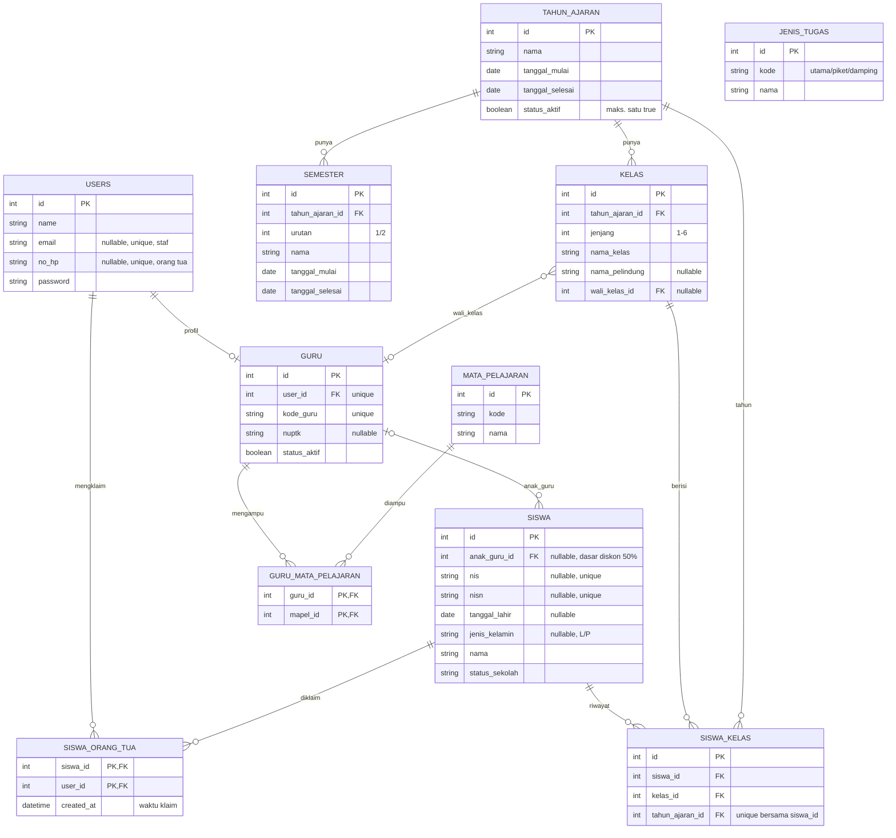
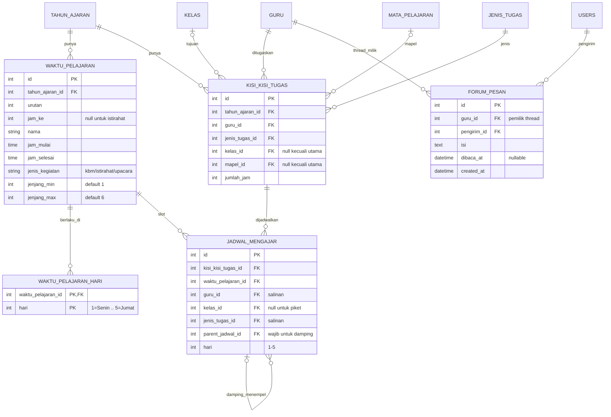

# Product Requirement Document (PRD)
## Aplikasi Jurnal Guru, Jadwal Guru, dan Les Tambahan & Ekstrakurikuler
**Klien:** SD Plus Gembala Baik — Yayasan Pendidikan Gembala Baik, Pontianak
**Versi:** 1.9 — menetapkan skema final Modul Jadwal Guru (B.3) berdasarkan data riil sekolah (jadwal bel per jenjang, kisi-kisi & jadwal sirkulasi 2026/2027), melengkapi kolom data master hasil implementasi (NUPTK, NISN, tanggal lahir, nama pelindung kelas), mengonfirmasi multirole, serta memperbarui status implementasi dan pola kerja pengembang
**Tanggal:** 27 Oktober 2026
**Tim Pengembang:** 2 orang (pembagian modul dijelaskan di Bagian B; Pengembang 1 sebagai penanggung jawab skema database)

---

## Ringkasan Perubahan v1.9

| # | Perubahan | Bagian terdampak |
|---|---|---|
| 1 | Kolom data master hasil implementasi: `guru.nuptk` (menggantikan `nip`), `siswa.nisn`, `siswa.tanggal_lahir`, `siswa.jenis_kelamin`, `kelas.nama_pelindung` | A4 Diagram 1 |
| 2 | Excel data siswa dari TU ternyata ekspor Dapodik (NIS, NISN, tanggal lahir lengkap); hanya kolom yang dipakai FR yang disimpan; NISN menjadi kunci pencocokan impor | A4 (Catatan v1.9), FR-28, A6 #21 |
| 3 | Skema final Modul Jadwal Guru: `waktu_pelajaran` mendapat dimensi jenjang; `kisi_kisi_tugas` tanpa `guru_damping_id` & `keterangan`; `hari` bertipe angka 1–5; aturan validasi di kode | B.3, A4 Diagram 3, A6 #7, #16 |
| 4 | Jadwal bel berbeda per jenjang: kelas 1–2 = 49 jam/minggu, kelas 3–6 = 53 jam/minggu; damping saat ini hanya kelas 1–2 dan pasangannya fleksibel | B.3 FR-2, FR-4 |
| 5 | Multirole dikonfirmasi: saat ini Angela memegang role guru, waka_kurikulum, dan bendahara | A4 (Catatan v1.9), A6 #15 |
| 6 | Status implementasi: migration, model, dan seeder data riil Diagram 1 selesai; dev tanpa Docker (`composer run dev`); database development terpisah per pengembang | A5 |
| 7 | Excel data siswa (berisi NIK, alamat, data keluarga) tidak boleh di-commit ke repository | A5 |

---

## Ringkasan Perubahan v1.8

| # | Perubahan | Bagian terdampak |
|---|---|---|
| 1 | `siswa.kelas_id` dihapus → tabel baru `siswa_kelas` (riwayat kelas per tahun ajaran), karena aplikasi dipakai bertahun-tahun | A4 Diagram 1 |
| 2 | `siswa.orang_tua_id` dihapus → tabel baru `siswa_orang_tua` (satu siswa bisa diklaim lebih dari satu akun orang tua, mis. ayah & ibu) | A4 Diagram 1, B.1 FR-1b |
| 3 | Data siswa awal tahun diimpor TU dari Excel (nama & kelas saja); orang tua registrasi sendiri lalu **mengklaim** anaknya — klaim langsung aktif, TU mengoreksi bila salah klaim | B.1 User Flow, FR-1b, FR-28 |
| 4 | `siswa.nis` nullable (NIS baru terbit ±Oktober) | A4 Diagram 1 |
| 5 | `tagihan.periode_laporan_id` diganti `tagihan.bulan_tagihan` — tagihan bulan mendatang boleh dibuat lebih awal sehingga pembayaran di muka (mis. 4 bulan) dan kelebihan transfer selalu punya tagihan tujuan; `periode_laporan` ditambah kolom `bulan` | A4 Diagram 2, A6 #17, FR-9, FR-21 |
| 6 | Honor dari pembayaran di muka **dicicil per bulan tagihan**; tunggakan yang dibayar terlambat diakui di periode saat dibayar — dicatat lewat `alokasi_transaksi.diakui_periode_id` | A4 (Catatan v1.8), FR-16 |
| 7 | Rentang jenjang string ("1-3") diganti dua kolom angka (`jenjang_min`, `jenjang_max`); `kelas.jenjang` bertipe angka 1–6 | A4, FR-24 |
| 8 | Status baru: `transaksi.status` + `ditolak`, `tagihan.status` + `dibatalkan` | A4, A6 #13, FR-23 |
| 9 | `honor_kegiatan` memakai dua FK nullable (menutup A6 #18); `honor_flat_pengaturan.bulan` diganti `berlaku_sejak` | A4, A6 |
| 10 | Kolom tambahan: `guru.status_aktif`, `pengajar_ekskul.status_aktif`, `semester.urutan`, `jenis_tugas.kode`; constraint satu tahun ajaran aktif | A4 |
| 11 | Konvensi teknis database (penamaan tabel, tipe uang, enum, soft delete, FK) dan status proyek | A5 |
| 12 | Penetapan skema database oleh Pengembang 1 (Pengembang 2 mengikuti) | A4, A5 |

---

## Ringkasan Perubahan v1.7

| # | Perubahan | Bagian terdampak |
|---|---|---|
| 1 | ERD dilengkapi dan dipecah menjadi 3 diagram: (1) data master bersama, (2) Modul Les & Ekstrakurikuler, (3) Modul Jadwal Guru + Jurnal Guru — agar tiap pengembang punya ERD sendiri | A4, B.3 |
| 2 | Tabel baru: `semester`, `periode_pendaftaran`, `jadwal_ekskul`, `tagihan`, `alokasi_transaksi`, `periode_laporan`, `laporan_harian`, `honor_kegiatan`, `honor_detail` (sebelumnya belum ada atau hanya disebut namanya) | A4 |
| 3 | `tagihan` + `alokasi_transaksi` memisahkan kewajiban bayar dari uang yang masuk; `transaksi` tidak lagi menunjuk satu pendaftaran (satu transfer bisa melunasi banyak tagihan) | A4 (Catatan v1.7), B.1 FR-9, FR-15, FR-21–23 |
| 4 | `pendaftaran` memakai dua FK nullable (`les_tambahan_id`, `ekstrakurikuler_id`) dengan CHECK tepat satu terisi, menggantikan `tipe_kegiatan` + `kegiatan_id` polimorfik | A4, Catatan v1.3, B.1 FR-27 |
| 5 | `siswa.anak_guru_id` sebagai dasar diskon 50% anak guru (FR-9) | A4 |
| 6 | `users.role` dihapus; role memakai `spatie/laravel-permission` (multi-role) | A3, A4, A6 #15, A7 |
| 7 | `periode_laporan` menggantikan "bulan" untuk laporan bulanan, tutup buku, dan status "Sudah Diketahui" honor; `penyesuaian_dana` memakai FK periode; `skema_honor.berlaku_sejak` | A4, B.1 |
| 8 | Penamaan tabel diselaraskan dengan ERD: `pendaftaran_les_ekskul` → `pendaftaran`, `transaksi_pembayaran` → `transaksi`, `ekstrakurikuler_pengajar` → `ekskul_pengajar`; `honor_pengajar` tidak jadi tabel (rekap dihitung dari `honor_detail`) | Seluruh dokumen |
| 9 | Kepemilikan tabel per pengembang dan pola kerja dua pengembang (satu repo, fondasi dulu, branch per orang) | A4, A5 |
| 10 | Keputusan terbuka baru A6 #17–#20; A6 #7 dan #15 diperbarui | A6 |

---

## Ringkasan Perubahan v1.6

| # | Perubahan | Bagian terdampak |
|---|---|---|
| 1 | Laporan bulanan hanya bisa di-approve Bendahara jika **seluruh** transaksi transfer periode itu sudah `terverifikasi` TU **dan** `disetujui` Bendahara (menutup A6 #10) | A3, A4 (Catatan v1.6), B.1 FR-14b, A6 |
| 2 | Role baru **Waka Kurikulum** mengelola Modul Jadwal Guru; Bendahara tidak lagi mengelola jadwal (menutup A6 #12) | A2, A3, A4 (`users.role`), A7, B.3 |
| 3 | TU **tidak mengunggah bukti transfer** ke aplikasi (hemat penyimpanan database); kolom `bukti_transfer` dihapus | A2, A3, A4, B.1 FR-7 |
| 4 | 4 jenis honor flat dinyatakan final (menutup A6 #11) | A6 |
| 5 | Draf skema database Modul Jadwal Guru berdasarkan 4 mockup Pengembang 2; kuota jam kelas dihitung dari `waktu_pelajaran` | B.3 |
| 6 | Keputusan terbuka baru A6 #13–#16 | A6 |
| 7 | Koreksi kecil: "4 modul utama" di A2 menjadi "3 modul utama" (tabelnya memang berisi 3 modul) | A2 |

---

# BAGIAN A — FONDASI BERSAMA

## A1. Latar Belakang & Tujuan

Yayasan Pendidikan Gembala Baik saat ini menjalankan beberapa proses secara manual di SD Plus Gembala Baik:

- Pencatatan transaksi harian & rekap bulanan untuk les tambahan dan ekstrakurikuler masih menggunakan buku tulis dan Excel terpisah.
- Verifikasi pembayaran transfer dilakukan lewat chat pribadi antar staf, rawan bukti transfer hilang atau tidak terkirim.
- Pendaftaran les tambahan & ekstrakurikuler menggunakan Google Form, rawan pendaftaran dobel dan sulit melacak revisi data.
- Belum ada kanal resmi bagi guru untuk menyampaikan masukan/keluhan ke kepala sekolah.
- Sistem jadwal mengajar guru dari vendor sebelumnya hanya mendukung jam mengajar utama, tidak mendukung jam piket dan jam damping.

Tujuan aplikasi ini adalah mendigitalisasi keempat proses di atas dalam satu sistem terpadu, dengan validasi otomatis untuk mengurangi kesalahan pencatatan manual.

## A2. Ruang Lingkup

**3 modul utama:**

| Modul | Deskripsi Singkat | Penanggung Jawab |
|---|---|---|
| Les & Ekstrakurikuler | Pendaftaran + pencatatan transaksi & rekap bulanan | Pengembang 1 |
| Jurnal Guru | Forum privat guru–kepala sekolah + lihat jadwal pribadi | Pengembang 1 |
| Jadwal Guru | Kisi-kisi tugas mengajar + penjadwalan (utama, piket, damping) — dikelola oleh role Waka Kurikulum (lihat A3 & Catatan v1.6) | Pengembang 2 |

**Out of scope untuk versi ini:**
- Pembayaran langsung di aplikasi (payment gateway) — direncanakan fase berikutnya
- **Unggah bukti transfer ke aplikasi** *(baru, v1.6)* — TU tidak mengunggah bukti transfer ke aplikasi demi menghemat penyimpanan database; bukti dari orang tua diperiksa di luar aplikasi, aplikasi hanya mencatat status verifikasi/approval
- Notifikasi real-time / chat langsung pada forum guru
- Auto-scheduling untuk jam piket & damping (cukup manual di versi ini)
- **Bina Karakter & Pramuka** — kegiatan wajib, auto-assign per jenjang kelas (bukan pilihan pendaftaran), dibiayai dari kas sekolah terpisah; honor flat penerimanya kini **dapat diatur di aplikasi** oleh Kepala Sekolah (lihat FR-25b, baru v1.5) meski dananya tetap dari kas sekolah terpisah — **tidak** tercatat di `pendaftaran` sama sekali, murni tampilan informasi di sisi orang tua — lihat A4 & FR-24
- Perhitungan/pembagian honor flat non-persentase (Pramuka, Bina Karakter, Olimpiade, Pembuat Soal Les) tidak memakai skema persentase — nominal & penerima diatur manual oleh Kepala Sekolah di halaman Skema Honor (lihat FR-25b, baru v1.5), namun keputusan *berapa* nominalnya tetap kebijakan sekolah di luar logika aplikasi

## A3. Role & Permission

| Role | Les & Ekskul – Pendaftaran | Les & Ekskul – Transaksi | Les & Ekskul – Honor | Jurnal Guru | Jadwal Guru |
|---|---|---|---|---|---|
| **Kepala Sekolah** | Lihat semua | Lihat laporan (read-only) | Atur skema persen honor, atur honor flat (Olimpiade/Bina Karakter/Pramuka/Pembuat Soal Les — nominal & guru penerima, lihat FR-25b), tentukan guru pendamping per ekstrakurikuler, lihat rekap honor 3-layer & tandai "Sudah Diketahui" | Lihat & balas semua thread | Lihat semua jadwal |
| **TU** | Input & kelola pendaftaran, kelola status berhenti/pindah & penyesuaian dana | Input transaksi (cash/transfer; tanpa unggah bukti transfer — lihat Catatan v1.6), ajukan laporan untuk approval | – | – | – |
| **Bendahara** | – | Approve transaksi transfer secara individual (rekonsiliasi mutasi rekening, di luar verifikasi TU — lihat FR-8b), tambahkan transaksi transfer yang belum tercatat TU ke tanggal tertentu (lihat FR-8c), lihat rincian transaksi per hari dalam laporan bulanan (lihat FR-13), approve laporan bulanan **hanya setelah seluruh transaksi transfer periode tsb selesai — lihat FR-14b** (memicu tutup buku) | Approval bulanan memicu perhitungan honor otomatis; tidak ada input manual dari Bendahara di sini | – | – *(v1.6: dipindah ke Waka Kurikulum)* |
| **Waka Kurikulum** *(baru, v1.6)* | – | – | – | – | **Kelola penuh** — isi Master Waktu Pelajaran, susun Kisi-Kisi Tugas (matriks guru×kelas×mapel), lakukan Pembagian Jadwal (drag-drop penjadwalan utama/damping/piket), lihat Hasil Jadwal per kelas/guru — lihat Catatan v1.6 & B.3 |
| **Guru** | – | – | – | Kirim pesan privat ke kepala sekolah, lihat thread sendiri | Lihat jadwal mengajar sendiri |
| **Orang Tua** | Daftarkan anak, lihat status pendaftaran | Lihat status pembayaran & tunggakan anak | – | – | – |

*Catatan v1.7: role dikelola lewat `spatie/laravel-permission` (kolom `users.role` dihapus), sehingga satu pengguna dapat memegang lebih dari satu role — lihat A4 dan A6 #15.*

## A4. ERD & Data Entitas *(v1.7: dilengkapi)*

ERD dibagi menjadi **3 diagram** agar terbaca dan sesuai pembagian kerja dua pengembang. Relasi lintas diagram memakai nama tabel yang sama. Diagram digambar di akhir bagian ini; daftar kolom per tabel ada di bawah.

| Diagram | Isi | Pemilik |
|---|---|---|
| 1. Data master bersama | `users`, `guru`, `mata_pelajaran`, `guru_mata_pelajaran`, `tahun_ajaran`, `semester`, `kelas`, `siswa`, `siswa_kelas`, `siswa_orang_tua`, `jenis_tugas` | Fondasi bersama — dikerjakan lebih dulu oleh Pengembang 1; perubahan skema ditetapkan Pengembang 1 dan diinformasikan ke Pengembang 2 (lihat A5) |
| 2. Modul Les & Ekstrakurikuler | pendaftaran, tagihan, transaksi, laporan, dan honor | Pengembang 1 |
| 3. Modul Jadwal Guru + Jurnal Guru | tabel jadwal (B.3) dan `forum_pesan` (B.2) | Pengembang 2 untuk tabel jadwal; Pengembang 1 untuk `forum_pesan` |

### Diagram 1 — Data master bersama

- **users** — id, name, email (nullable, unique — login staf), no_hp (nullable, unique — login orang tua), password; CHECK minimal salah satu dari email/no_hp terisi *(v1.8)*. *(v1.7: kolom `role` dihapus. Role — kepala_sekolah / tu / bendahara / waka_kurikulum / guru / orang_tua — dikelola `spatie/laravel-permission`, satu pengguna boleh memegang lebih dari satu role; lihat A6 #15)*
- **guru** — id, user_id (FK, unique — relasi 1–1), kode_guru (unique), nuptk (nullable, unique), **status_aktif** (boolean, default true — *baru, v1.8*; diskon anak guru FR-9 hanya berlaku jika guru masih aktif), soft delete
- **mata_pelajaran** — id, kode, nama
- **guru_mata_pelajaran** *(pivot N–N, PK komposit)* — guru_id (FK), mapel_id (FK)
- **tahun_ajaran** — id, nama (unique, mis. "2026/2027"), tanggal_mulai, tanggal_selesai, status_aktif *(v1.8: partial unique index menjamin hanya satu tahun ajaran aktif)*
- **semester** *(baru, v1.7)* — id, tahun_ajaran_id (FK), **urutan** (1/2 — *baru, v1.8*; unique bersama tahun_ajaran_id), nama (mis. Semester 1 / Semester 2), tanggal_mulai, tanggal_selesai *(dipakai FR-10 untuk menentukan "pergantian semester" dan "bulan pertama semester berjalan")*
- **kelas** — id, tahun_ajaran_id (FK), jenjang (angka 1–6, CHECK — *v1.8*), nama_kelas (unique bersama tahun_ajaran_id, mis. "1A"), **nama_pelindung** (nullable — *baru, v1.9*; mis. "Gregory", sehingga nama rombel lengkap "1A Gregory"), wali_kelas_id (FK → guru, nullable), soft delete
- **siswa** — id, **anak_guru_id** (FK → guru, nullable — *baru, v1.7*; diisi hanya jika siswa adalah anak guru SD Plus, menjadi dasar diskon 50% di FR-9; NULL untuk siswa lain, termasuk anak guru unit yayasan lain dan anak pengajar ekskul eksternal), nis (nullable, unique — *v1.8*: NIS baru terbit ±Oktober), **nisn** (string, nullable, unique — *baru, v1.9*; string karena bisa diawali angka 0), **tanggal_lahir** (date, nullable — *baru, v1.9*), **jenis_kelamin** (char 1, L/P, nullable — *baru, v1.9*), nama, status_sekolah (aktif/pindah_sekolah/lulus), soft delete. *(v1.8: `kelas_id` dan `orang_tua_id` dihapus, dipindah ke `siswa_kelas` dan `siswa_orang_tua`)*
- **siswa_kelas** *(baru, v1.8)* — id, siswa_id (FK), kelas_id (FK), tahun_ajaran_id (FK — disalin dari kelas agar bisa di-unique); unique(siswa_id, tahun_ajaran_id) *(riwayat kelas siswa per tahun ajaran; kenaikan kelas = tambah baris baru, bukan menimpa)*
- **siswa_orang_tua** *(pivot N–N, baru, v1.8)* — siswa_id (FK), user_id (FK → users), created_at (waktu klaim); PK komposit *(hasil klaim anak oleh orang tua, langsung aktif tanpa verifikasi — TU menghapus baris bila klaim salah; satu siswa bisa punya lebih dari satu akun orang tua)*
- **jenis_tugas** — id, **kode** (unique: utama/piket/damping — *baru, v1.8*; dipakai kode program, bukan id), nama (Mengajar Utama, Piket, Damping) — dimiliki Diagram 1 tetapi dipakai oleh Modul Jadwal Guru

### Diagram 2 — Modul Les & Ekstrakurikuler (Pengembang 1)

*Kegiatan & pendaftaran:*

- **periode_pendaftaran** *(baru, v1.7)* — id, tahun_ajaran_id (FK), tanggal_mulai, tanggal_selesai *(jendela pendaftaran orang tua, mis. 15–22 Juli pada mockup; pengaruhnya pada input manual TU (FR-6) lihat A6 #19)*
- **les_tambahan** — id, kelas_id (FK), tahun_ajaran_id (FK), biaya *(pengajar = wali_kelas dari kelas terkait, tidak disimpan terpisah; tanpa kolom kuota)*
- **ekstrakurikuler** — id, nama, biaya, kuota, tahun_ajaran_id (FK), guru_pendamping_id (FK → guru, nullable), kategori_pendamping (seni/olahraga, nullable — diisi manual oleh Kepala Sekolah per kegiatan), **parent_ekstrakurikuler_id** (FK → `ekstrakurikuler.id` sendiri, nullable — diisi hanya jika baris ini adalah kelas paralel dari kegiatan induk; baris induk selalu NULL di kolom ini — lihat A4 catatan kelas paralel & B.1 FR-26/FR-27), **wajib_otomatis** (boolean, default false — true khusus untuk kegiatan seperti Bina Karakter/Pramuka yang auto-assign per jenjang kelas, lihat FR-24), **jenjang_wajib_min** & **jenjang_wajib_max** (angka, nullable — *v1.8: menggantikan string `jenjang_wajib` "1-3"*; hanya diisi jika `wajib_otomatis` = true, menentukan kelas mana yang otomatis di-assign), **honor_flat** (boolean, default false — true untuk kegiatan seperti Olimpiade yang tetap terdaftar & berkuota tapi honornya di luar `skema_honor` persentase, ditentukan manual Kepala Sekolah — lihat FR-25)
- **jadwal_ekskul** *(baru, v1.7)* — id, ekstrakurikuler_id (FK), hari, jam_mulai, jam_selesai, jenjang_min & jenjang_max (angka, nullable — *v1.8: menggantikan string "1-3"*; diisi jika jam berbeda per jenjang, mis. Basket), lokasi *(satu kegiatan bisa punya lebih dari satu baris; dipakai FR-5 untuk deteksi bentrok jadwal)*
- **pengajar_ekskul** — id, nama, jenis (internal/eksternal), guru_id (FK → guru, nullable, unique — satu guru tidak tercatat dua kali), no_hp, **status_aktif** (boolean — *baru, v1.8*) *(pengajar eksternal tidak memerlukan akun login; banyak pengajar ekstra berasal dari luar sekolah)*
- **ekskul_pengajar** *(pivot N–N, PK komposit)* — ekstrakurikuler_id, pengajar_ekskul_id *(satu kegiatan bisa punya lebih dari 1 pengajar, mis. English Club 6 orang; honor pengajar dibagi rata sesuai jumlah baris di sini)*
- **pendaftaran** *(sebelumnya `pendaftaran_les_ekskul`)* — id, siswa_id (FK), les_tambahan_id (FK, nullable), ekstrakurikuler_id (FK, nullable) — **CHECK tepat satu dari keduanya terisi** *(v1.7: menggantikan `tipe_kegiatan` + `kegiatan_id` polimorfik)*, tanggal_daftar, status (aktif/berhenti/pindah), tanggal_efektif_berhenti (nullable), pindah_ke_id (FK ke `pendaftaran.id` sendiri, nullable, diisi hanya jika status = pindah). *Satu siswa bisa memiliki banyak baris sekaligus — contoh: les tambahan + ekstra basket + ekstra renang + ekstra English Club, masing-masing baris independen dengan status sendiri-sendiri.*
- **penyesuaian_dana** — id, pendaftaran_id (FK → `pendaftaran`), jenis_penyesuaian (alih_kegiatan/kelebihan_transfer/kegiatan_tidak_berlangsung/refund_berhenti), periode_asal_id (FK → `periode_laporan`), periode_tujuan_id (FK → `periode_laporan`, nullable, kosong jika jenisnya refund), nominal, status (selesai/proses/berhasil — makna berbeda tergantung `jenis_penyesuaian`: alih_kegiatan & kegiatan_tidak_berlangsung selalu langsung "selesai", refund_berhenti bisa "proses" dulu baru "berhasil"), tanggal_proses, diproses_oleh (FK → users, TU yang input), keterangan (nullable, catatan bebas)

*Tagihan, transaksi & laporan:*

- **tagihan** *(baru, v1.7)* — id, pendaftaran_id (FK), **bulan_tagihan** (date, selalu tanggal 1 — *v1.8: menggantikan `periode_laporan_id`*), nominal (biaya penuh kegiatan), diskon (potongan dalam rupiah, mis. 50% anak guru — FR-9), status (belum/lunas/**dibatalkan** — *v1.8*; dibatalkan untuk kegiatan tidak berlangsung FR-23); unique(pendaftaran_id, bulan_tagihan) *(yang harus dibayar = nominal − diskon; tagihan bulan mendatang boleh dibuat lebih awal saat orang tua bayar di muka — lihat Catatan v1.8 & A6 #17)*
- **periode_laporan** *(baru, v1.7 — menggantikan istilah "bulan" pada laporan bulanan & tutup buku)* — id, **bulan** (date tanggal 1, unique — *baru, v1.8*; mis. periode 22 Jul–22 Agu = bulan Agustus), tanggal_mulai, tanggal_selesai (periode custom, mis. 22 Jul–22 Agu), status (terbuka/diajukan/ditutup), ditutup_oleh (FK → users, Bendahara), ditutup_at, honor_diketahui_oleh (FK → users, nullable, Kepala Sekolah), honor_diketahui_at *(status "Sudah Diketahui" FR-20 disimpan di sini karena berlaku sekaligus untuk 3 layer rekap honor)*
- **laporan_harian** *(baru, v1.7)* — id, periode_laporan_id (FK), tanggal, status (draft/diajukan/disetujui/ditolak), diajukan_oleh (FK → users, TU), disetujui_oleh (FK → users, Bendahara, nullable) *(satu baris per hari per periode; FR-12)*
- **transaksi** *(sebelumnya `transaksi_pembayaran`; v1.7: tidak lagi menunjuk satu pendaftaran, terhubung ke tagihan lewat `alokasi_transaksi`)* — id, siswa_id (FK), laporan_harian_id (FK — laporan harian untuk tanggal transaksi; untuk transaksi retroaktif FR-8c lihat A6 #20), tanggal, metode (cash/transfer), nominal, status (terverifikasi/pending/**ditolak** — cash selalu langsung `terverifikasi`; transfer mulai dari `pending` sampai diverifikasi TU; `ditolak` ditambahkan v1.8 untuk transfer tidak valid, alurnya lihat A6 #13), catatan_transfer (nullable, teks pendek — *usulan v1.6, belum dikonfirmasi, lihat A6 #14*; menggantikan kolom `bukti_transfer` yang dihapus karena bukti tidak lagi diunggah ke aplikasi), diinput_oleh (FK → users), **sumber_input** (tu/bendahara — default `tu`; diisi `bendahara` khusus untuk transaksi transfer yang ditambahkan langsung oleh Bendahara dari hasil cek mutasi rekening, lihat FR-8c), **status_approval_bendahara** (belum_dicek/disetujui, nullable — hanya relevan untuk metode transfer, lihat FR-8b; NULL untuk transaksi cash karena cash tidak melalui lapisan approval ini), **tanggal_approval_bendahara** (nullable), **diapprove_oleh** (FK → users, nullable, staf Bendahara yang approve)
- **alokasi_transaksi** *(pivot, baru, v1.7)* — transaksi_id (FK), tagihan_id (FK), nominal, **diakui_periode_id** (FK → `periode_laporan`, nullable — *baru, v1.8*; diisi saat tutup buku, menandai periode honor yang mengakui alokasi ini; NULL = belum masuk honor); PK komposit *(satu transaksi bisa melunasi beberapa tagihan — beberapa kegiatan sekaligus atau bayar di muka multi-bulan; satu tagihan bisa dilunasi beberapa transaksi)*

*Honor:*

- **skema_honor** — id, tipe_kegiatan (ekstrakurikuler/les_tambahan), jenis_pengajar (internal/eksternal, nullable — khusus ekstrakurikuler), persen_pengajar, persen_guru_pendamping (nullable), persen_kas_sekolah, persen_yayasan (nullable — khusus les_tambahan), persen_penanggung_jawab, persen_bendahara, persen_admin_tu, persen_admin_it, **berlaku_sejak** *(baru, v1.7 — tanggal mulai berlaku; perubahan persen menambah baris baru sehingga riwayat tersimpan)* *(dikelola Kepala Sekolah, bisa diubah kapan saja; perubahan hanya berlaku untuk perhitungan bulan berikutnya karena bulan yang sudah dihitung tersimpan sebagai snapshot — lihat `honor_kegiatan` di B.1)*
- **honor_kegiatan** *(baru, v1.7 — sebelumnya hanya disebut nama)* — id, periode_laporan_id (FK), les_tambahan_id (FK, nullable), ekstrakurikuler_id (FK → kegiatan induk, nullable) — CHECK tepat satu terisi *(v1.8: menggantikan `tipe_kegiatan` + `kegiatan_id` polimorfik, menutup A6 #18)*, total_pendapatan, snapshot_persen (json — salinan persentase `skema_honor` yang dipakai) *(satu baris per kegiatan per periode; dibuat otomatis setelah approval laporan bulanan, FR-16)*
- **honor_detail** *(baru, v1.7)* — id, honor_kegiatan_id (FK, nullable), honor_flat_pengaturan_id (FK, nullable), penerima_user_id (FK → users, nullable), penerima_pengajar_id (FK → pengajar_ekskul, nullable), peran (mis. pengajar, guru_pendamping, kas_sekolah, yayasan, penanggung_jawab, bendahara, admin_tu, admin_it), nominal *(satu baris per penerima per sumber honor. Sumber nominal: persentase (`honor_kegiatan_id`) atau flat (`honor_flat_pengaturan_id`) — tepat satu terisi. Penerima: staf/guru (`penerima_user_id`) atau pengajar eksternal (`penerima_pengajar_id`) — keduanya NULL untuk porsi Kas Sekolah dan Yayasan. Rekap 3 layer FR-19 adalah query dari tabel ini)*
- **honor_flat_jenis** *(baru, v1.5)* — id, nama (Olimpiade / Bina Karakter / Pramuka / Pembuat Soal Les), keterangan (nullable) *(daftar tetap 4 jenis untuk versi ini, ditambah manual di database bila ada jenis baru di masa depan — bukan CRUD dinamis dari UI)*
- **honor_flat_pengaturan** *(baru, v1.5)* — id, honor_flat_jenis_id (FK), tahun_ajaran_id (FK), **berlaku_sejak** (date — *v1.8: menggantikan `bulan`*, pola sama dengan `skema_honor`; perubahan nominal/penerima menambah baris baru), nominal_per_guru, diatur_oleh (FK → users, Kepala Sekolah) *(satu baris per jenis honor flat per periode; nominal ini yang diisi manual Kepala Sekolah di halaman Skema Honor — lihat FR-25b)*
- **honor_flat_penerima** *(pivot N–N, baru v1.5)* — honor_flat_pengaturan_id (FK), guru_id (FK → guru) *(daftar guru yang dipilih Kepala Sekolah untuk menerima honor flat jenis & periode tsb; setiap guru yang dipilih mendapat `nominal_per_guru` penuh — bukan dibagi rata antar penerima, berbeda dengan honor kelas paralel di FR-16b)*

### Diagram 3 — Modul Jadwal Guru + Jurnal Guru

- **Tabel jadwal:** `waktu_pelajaran`, `waktu_pelajaran_hari`, `kisi_kisi_tugas`, `jadwal_mengajar` — kolom lengkap, constraint, dan aturan validasi ada di B.3 (skema final v1.9, ditetapkan Pengembang 1; diimplementasikan Pengembang 2)
- **forum_pesan** — id, guru_id (FK — pemilik thread), pengirim_id (FK → users), isi, dibaca_at (nullable — penanda "pesan baru"), created_at — rincian di B.2 (Pengembang 1)


**Catatan tambahan v1.9 — Data Riil & Implementasi Diagram 1:**

1. **Data siswa dari Dapodik.** Excel data siswa dari TU (`Siswa_kls_I_-_VI_T_P_2026-2027.xls`) ternyata ekspor Dapodik (Sheet1 "Daftar Peserta Didik", 378 siswa per Oktober 2026) dengan NIS (kolom NIPD), NISN, dan tanggal lahir lengkap; nomor HP orang tua hanya ada untuk sebagian siswa (117 dari 378), sehingga alur klaim anak (FR-1b) tetap diperlukan. Aplikasi hanya menyimpan kolom yang dipakai FR: nama, NIS, NISN, tanggal lahir, jenis kelamin, dan kelas. NIK, No. KK, agama, alamat, penghasilan, dan nama orang tua **tidak disimpan** — data sensitif yang tidak dipakai FR mana pun; sumber resmi data lengkap tetap Dapodik. Siswa kelas 1 baru di awal tahun ajaran (Juli) mungkin belum punya NIS/NISN, sehingga kedua kolom tetap nullable. Impor membaca Sheet1 (format baku Dapodik, kelas di kolom "Rombel Saat Ini"), bukan sheet per kelas yang judul dan nama kolomnya tidak seragam.
2. **Nama rombel.** Setiap kelas punya nama pelindung (mis. "1A Gregory", "5C Padre Pio"); disimpan di `kelas.nama_pelindung` agar unique constraint tetap memakai "1A". Saat impor, teks rombel dipecah di spasi pertama.
3. **Data riil guru & mapel** (`Jadwal_TA__2026-2027.xlsx`) dipakai sebagai seeder: 22 guru beserta kode guru, wali kelas, dan mapel; staf (kepala sekolah, TU). Mapel Kurikulum Merdeka dan Pearson dicatat terpisah (`MTK` vs `MATH`, `IPAS` vs `SCI`) karena diajar guru berbeda dengan jumlah jam berbeda. Kode mapel mengikuti jadwal sirkulasi sekolah: `AGAMA`, `PC` (Pendidikan Pancasila), `BI`, `MTK`, `IPAS`, `SBdP` (Seni Budaya), `MUSIK`, `PJOK`, `TIK`, `MAND`, `ENG`, `SCI`, `MATH`, `KT` (Kerja Tugas — dipegang wali kelas di kelasnya sendiri). Data Excel diketik manual sehingga ejaan nama dapat dikoreksi kemudian tanpa perubahan skema.
4. **Multirole (dikonfirmasi).** Satu pengguna dapat memegang lebih dari satu role. Saat ini Angela (kode guru A) memegang role `guru`, `waka_kurikulum`, dan `bendahara` (mengurus uang les & ekstra). Portal yang ditampilkan dipilih lewat dropdown "Ganti Peran". *Catatan untuk klien:* Bendahara yang juga penerima honor ikut menyetujui laporan bulanan yang memicu perhitungan honornya sendiri (FR-16) — wajar untuk sekolah kecil, tetapi disarankan rekap honor tetap dilihat Kepala Sekolah.

**Catatan tambahan v1.8 — Finalisasi ERD Tahap Awal:**

1. **Riwayat kelas & klaim orang tua.** Aplikasi dipakai bertahun-tahun, sehingga kelas siswa disimpan per tahun ajaran di `siswa_kelas` (tidak ditimpa saat kenaikan kelas). Di awal tahun ajaran TU mengimpor data siswa dari Excel (hanya nama dan kelas, tanpa nomor HP orang tua; NIS baru terbit ±Oktober). Orang tua registrasi dengan nomor HP lalu mengklaim anaknya dari data yang sudah ada — bukan membuat data siswa baru — sehingga pendaftaran dobel (A1) tidak terulang. Klaim langsung aktif; TU mengoreksi bila ada salah klaim. Karena ayah dan ibu bisa registrasi dengan nomor masing-masing, relasi siswa–orang tua dibuat N–N (`siswa_orang_tua`).
2. **Bulan tagihan terpisah dari periode laporan.** `periode_laporan` adalah periode pembukuan (kapan uang masuk); `tagihan.bulan_tagihan` adalah bulan kegiatan yang ditagih. Orang tua umumnya membayar satu bulan, tetapi ada yang langsung membayar beberapa bulan (mis. 4 bulan) — sistem membuat baris tagihan untuk bulan-bulan mendatang tersebut lalu mengalokasikan transaksinya. Kelebihan transfer (FR-21) juga selalu punya tagihan tujuan, sehingga tidak ada saldo mengambang.
3. **Pengakuan honor (keputusan v1.8).** Honor dari pembayaran di muka **dicicil per bulan tagihan** — pembayaran 4 bulan di Agustus tidak dibagikan seluruhnya di honor Agustus. Rumus: *honor periode X = alokasi ke tagihan bulan X yang dibayar sampai tutup buku X + alokasi ke tagihan bulan-bulan sebelumnya (tunggakan) yang dibayar selama periode X.* Contoh: tagihan Basket Agustus belum dibayar, lalu di September orang tua membayar Agustus + September — honor pengajar Basket periode September dihitung dari Agustus + September. Teknisnya, saat tutup buku semua alokasi yang `diakui_periode_id`-nya masih NULL dan memenuhi rumus di atas diisi id periode tersebut; perhitungan honor (FR-16) cukup mengambil alokasi dengan `diakui_periode_id` = periode itu, sehingga tidak ada uang yang terhitung dua kali atau terlewat. Bulan yang dibayar di muka tetapi belum diakui juga membuat refund (FR-22) bersih karena belum dibagikan sebagai honor.
4. **Rentang jenjang sebagai angka.** `kelas.jenjang` bertipe angka 1–6; rentang jenjang (`ekstrakurikuler`, `jadwal_ekskul`) memakai pasangan kolom `*_min`/`*_max` sehingga query cukup `BETWEEN` dan tervalidasi database.
5. **Status tambahan disiapkan lebih awal.** `transaksi.status` = `ditolak` dan `tagihan.status` = `dibatalkan` ditambahkan sekarang meski alur A6 #13 belum final, agar tidak perlu migration ulang.

**Catatan tambahan v1.7 — Penyempurnaan ERD:**

ERD v1.6 belum menggambar sebagian tabel yang disebut di teks, dan belum cukup untuk menghitung beberapa FR (tunggakan, diskon, semester, bentrok jadwal ekskul). Perubahan v1.7:

1. **Tagihan dipisah dari transaksi.** `tagihan` = kewajiban bayar per pendaftaran per periode; `transaksi` = uang yang masuk per siswa; `alokasi_transaksi` menghubungkan keduanya. Satu transfer orang tua bisa melunasi beberapa tagihan (beberapa kegiatan sekaligus, atau bayar di muka multi-bulan), dan `transaksi` tidak lagi menunjuk satu pendaftaran. Pemetaan usulan ke FR: FR-9 membuat dan menghitung `tagihan` (diskon 50% lewat `siswa.anak_guru_id`); FR-15 — tunggakan = tagihan berstatus `belum`, "bulan terakhir dibayar" = periode tagihan lunas terakhir; FR-21 — kelebihan transfer = sisa nominal transaksi yang dialokasikan ke tagihan periode berikutnya (tidak ada saldo mengambang); FR-22 dan FR-23 — dicatat di `penyesuaian_dana` (dengan `periode_asal_id`/`periode_tujuan_id`) dan, bila perlu, dialokasikan ke tagihan periode tujuan. Kapan baris `tagihan` dibuat: lihat A6 #17.
2. **Periode laporan.** `periode_laporan` menggantikan istilah "bulan" pada laporan bulanan dan tutup buku (periode custom, mis. 22 Jul–22 Agu). Statusnya (terbuka/diajukan/ditutup) dipakai FR-14 dan FR-14b. Status "Sudah Diketahui" honor (FR-20) disimpan di tabel ini karena berlaku sekaligus untuk 3 layer rekap. `laporan_harian` (satu baris per hari per periode) memuat transaksi hari itu dan menjadi objek approval TU → Bendahara (FR-12).
3. **Honor.** `honor_kegiatan` menyimpan hasil hitung per kegiatan induk per periode (kelas paralel sudah digabung, FR-16b) beserta snapshot persentase; `honor_detail` memecahnya per penerima, dari sumber persentase atau flat. Rekap 3 layer FR-19 adalah query dari `honor_detail`, sehingga tidak ada tabel `honor_pengajar` terpisah. Porsi Kas Sekolah dan Yayasan tidak punya penerima orang, sehingga kedua kolom penerima pada barisnya NULL.
4. **Pendaftaran dengan dua FK.** `pendaftaran` memakai `les_tambahan_id` dan `ekstrakurikuler_id` (nullable, CHECK tepat satu terisi) menggantikan `tipe_kegiatan` + `kegiatan_id` polimorfik, sehingga integritas FK terjaga. Pemindahan ke kelas paralel (FR-27) berarti mengubah `ekstrakurikuler_id` dari baris induk ke baris kelas paralel.
5. **Jadwal ekskul, semester, periode pendaftaran.** `jadwal_ekskul` menyimpan hari, jam, dan lokasi per kegiatan (dengan `jenjang` bila jamnya berbeda per jenjang, mis. Basket) sebagai dasar deteksi bentrok FR-5. `semester` menjadi dasar aturan "pergantian semester" FR-10. `periode_pendaftaran` menyimpan jendela pendaftaran orang tua (mis. 15–22 Juli pada mockup).
6. **Role lewat spatie.** Kolom `users.role` dihapus; role disimpan di tabel bawaan `spatie/laravel-permission` sehingga satu pengguna bisa memegang lebih dari satu role (lihat A6 #15).
7. **Penyesuaian penamaan.** Nama tabel diselaraskan dengan ERD: `pendaftaran_les_ekskul` → `pendaftaran`, `transaksi_pembayaran` → `transaksi`, `ekstrakurikuler_pengajar` → `ekskul_pengajar`. Penyebutan nama lama di versi sebelumnya (v1.0–v1.6) setara dengan nama baru ini.

**Catatan tambahan v1.6 — Waka Kurikulum sebagai Pengelola Jadwal Guru (menggantikan penetapan Bendahara di v1.5):**

Sejak v1.6, pengelola aktif Modul Jadwal Guru adalah role baru **Waka Kurikulum** (role `waka_kurikulum`), bukan Bendahara. Cakupan hak aksesnya sama dengan yang sempat ditetapkan untuk Bendahara di v1.5: mengisi Master Waktu Pelajaran, menyusun Kisi-Kisi Tugas, melakukan Pembagian Jadwal (jam mengajar utama, alokasi piket, alokasi damping), dan melihat Hasil Jadwal. Bendahara kembali hanya mengelola Modul Les & Ekskul. Ini keputusan klien (menutup A6 #12). Dampak pada mockup: perlu portal/sidebar Waka Kurikulum sendiri (badge role & warna baru, opsi baru di dropdown "Ganti Peran"), keempat halaman jadwal dipindah dari sidebar Bendahara, dan navigasi gabungan di `bendahara-approval.html` dihapus.

**Catatan tambahan v1.6 — Bukti Transfer Tidak Diunggah ke Aplikasi:**

TU tidak mengunggah bukti transfer ke aplikasi, untuk mengurangi beban penyimpanan database. Konsekuensi: (1) kolom `bukti_transfer` dihapus dari `transaksi`; (2) verifikasi TU (FR-8) tetap berjalan, hanya saja bukti yang dikirim orang tua diperiksa di luar aplikasi dan aplikasi hanya mencatat hasilnya (`pending` → `terverifikasi`); (3) rekonsiliasi Bendahara terhadap mutasi rekening (FR-8b/8c) tidak berubah; (4) aplikasi tidak menyimpan jejak bukti — audit hanya lewat status transaksi dan mutasi rekening. Risiko "bukti hilang" (lihat A1) belum sepenuhnya hilang karena bukti tetap berada di luar aplikasi — lihat A6 #14.

**Catatan tambahan v1.6 — Syarat Approval Laporan Bulanan:**

Approval Bendahara di level transaksi (FR-8b) tetap tidak menghalangi TU mengajukan laporan (lihat Catatan v1.4), **tetapi** sejak v1.6 menghalangi Bendahara menyetujui laporan bulanan: approval laporan bulanan (yang memicu tutup buku dan perhitungan honor) hanya dapat dilakukan jika **semua** transaksi transfer pada periode itu sudah `terverifikasi` oleh TU dan `disetujui` oleh Bendahara. Transfer yang masih `pending` di TU juga dihitung sebagai belum selesai. Transaksi cash tidak terdampak. Lihat FR-14b; efek sampingnya (transfer tidak valid dapat mengunci tutup buku) dibahas di A6 #13.

**Catatan tambahan v1.3 — Kelas Paralel Ekstrakurikuler:**

Beberapa ekstrakurikuler (mis. English Club, Dancing Club) memiliki peminat yang banyak sehingga dipecah menjadi beberapa kelas paralel oleh pengajarnya sendiri (mis. English Club → Starter/Mover/Flyer; Dancing Club → Class A/B/C). Pembagian ini **tidak ditentukan di awal oleh sistem**, melainkan oleh pengajar setelah melihat jumlah pendaftar.

- Setiap kelas paralel disimpan sebagai baris `ekstrakurikuler` tersendiri (dengan kuota, jadwal, ruangan masing-masing), yang menunjuk ke baris induk lewat `parent_ekstrakurikuler_id`.
- Baris **induk** (mis. "English Club — Jumat") adalah satu-satunya yang ditampilkan & dipilih orang tua saat pendaftaran; baris **paralel** tidak muncul di form pendaftaran ortu.
- Alur dua tahap: (1) orang tua daftar ke kegiatan induk lewat `pendaftaran.ekstrakurikuler_id` = id induk; (2) TU, setelah koordinasi dengan pengajar, memindahkan `ekstrakurikuler_id` pendaftaran tersebut ke id kelas paralel yang sesuai — lihat FR-26 & FR-27.
- Kuota & cek bentrok jadwal (FR-4, FR-5) dievaluasi di level kelas paralel setelah siswa di-assign; sebelum di-assign, kuota yang relevan adalah total gabungan seluruh kelas paralel di bawah induk yang sama.

**Catatan tambahan v1.3 — Kegiatan Wajib Otomatis vs Kegiatan Berkuota Honor-Flat:**

Ada dua kasus kegiatan di luar skema honor persentase biasa, dengan penanganan sistem yang berbeda:

| | Bina Karakter & Pramuka | Olimpiade (MTK/IPA/IPS) |
|---|---|---|
| Sifat pendaftaran | Wajib, auto-assign per jenjang kelas | Pilihan, ada kuota/limit pendaftar |
| Tercatat di `pendaftaran`? | **Tidak** | **Ya** (biaya = 0) |
| Tampilan di sisi Orang Tua | Read-only, info "Kegiatan Wajib (Otomatis)" | Pilihan aktif seperti ekskul lain, tapi gratis |
| Kolom penanda di `ekstrakurikuler` | `wajib_otomatis` = true, `jenjang_wajib_min`/`jenjang_wajib_max` diisi | `honor_flat` = true, `biaya` = 0 |
| Honor | Flat, di luar `skema_honor`; nominal & guru penerima kini **diatur di aplikasi** oleh Kepala Sekolah lewat `honor_flat_pengaturan` (lihat FR-25b, baru v1.5), dana tetap dari kas sekolah terpisah | Flat, di luar `skema_honor`; nominal & guru penerima diatur di aplikasi yang sama (FR-25b) |

**Catatan tambahan v1.4 — Dua Lapis Verifikasi Transaksi Transfer:**

Transaksi transfer melewati dua lapis pengecekan independen, dengan tujuan yang berbeda:

1. **Verifikasi TU** (FR-8, tidak berubah) — TU mencocokkan bukti transfer yang dikirim orang tua terhadap tagihan, lalu ubah status dari `pending` menjadi `terverifikasi`. Ini terjadi harian, real-time, dan tidak menunggu Bendahara — laporan harian/bulanan TU tetap bisa diajukan seperti biasa.
2. **Approval Bendahara** (FR-8b, baru) — Bendahara mencocokkan transaksi transfer yang sudah `terverifikasi` TU terhadap mutasi rekening bank yang sebenarnya, sebagai pengecekan independen kedua. Ini bisa terjadi kapan saja (rekonsiliasi berkala, tidak harus harian) dan **tidak menghalangi** alur kerja TU — approval Bendahara murni menambah lapisan `status_approval_bendahara` pada transaksi yang sudah ada, tanpa mengubah status `terverifikasi` dari TU.

Kedua lapis ini menjawab kebutuhan berbeda: verifikasi TU mencegah kesalahan input harian (nominal salah, ortu belum bayar tapi klaim sudah), sementara approval Bendahara mendeteksi kasus dimana bukti transfer yang dikirim ortu tidak sesuai/tidak jujur terhadap mutasi rekening asli.

Untuk kasus **transfer yang sama sekali tidak diketahui TU** (ortu transfer tapi tidak mengirim bukti ke TU), Bendahara dapat langsung menambahkan baris `transaksi` baru (FR-8c) ke tanggal transaksi yang sesuai (bisa retroaktif ke tanggal manapun dalam periode berjalan, karena Bendahara biasanya cek mutasi tidak setiap hari). Transaksi ini otomatis muncul di rincian harian TU untuk tanggal tersebut (lihat FR-13), sehingga tetap transparan meski TU tidak menginputnya sendiri.

**Catatan tambahan v1.5 — Perhitungan Honor Kelas Paralel (Digabung Lintas Hari):**

Honor untuk ekstrakurikuler berkelas-paralel (mis. English Club, Dancing Club) **tidak** dihitung per kelas paralel secara terpisah, melainkan digabung dari **seluruh kelas paralel di bawah induk yang sama** — termasuk lintas hari jika kegiatan induknya tersedia di lebih dari satu hari (mis. English Club Jumat + English Club Sabtu tetap satu pool honor yang sama, karena orang tua selalu mendaftar & membayar atas nama "English Club", bukan atas nama kelas paralel spesifik). Alurnya:

1. Jumlahkan seluruh pembayaran dari semua siswa di semua kelas paralel di bawah induk yang sama (lintas hari jika ada).
2. Hitung porsi persentase (`skema_honor`) dari total gabungan tersebut, menghasilkan total porsi pengajar untuk kegiatan tersebut.
3. Bagi rata total porsi pengajar itu ke seluruh pengajar yang mengajar minimal satu kelas paralel di bawah induk tersebut (lihat `ekskul_pengajar` — satu pengajar yang mengajar 2 kelas paralel berbeda tetap dihitung satu kali dalam pembagian, bukan dua kali).

Ini berbeda dengan honor flat (Olimpiade/Bina Karakter/Pramuka/Pembuat Soal Les di FR-25b) yang justru **tidak** dibagi — setiap guru yang dipilih menerima nominal penuh yang sama.

**Catatan tambahan v1.5 — Generalisasi Honor Flat (Pembuat Soal Les ditambahkan):**

Sebelumnya (v1.3) honor flat Bina Karakter/Pramuka/Olimpiade disebut sebagai kasus khusus yang "di luar scope aplikasi". Sejak v1.5, mekanismenya digeneralisasi menjadi satu pola yang sama dan **masuk ke dalam aplikasi** lewat tabel `honor_flat_jenis`/`honor_flat_pengaturan`/`honor_flat_penerima` (lihat A4), mencakup 4 jenis: Olimpiade, Bina Karakter, Pramuka, dan **Pembuat Soal Les** (baru ditambahkan v1.5 — honor untuk guru yang membuat soal ujian les tambahan). Untuk masing-masing jenis, Kepala Sekolah mengatur satu nominal per guru (dengan nilai default yang dapat diubah) dan memilih guru-guru penerimanya lewat multi-select; setiap guru yang dipilih menerima nominal penuh tersebut (flat per guru, bukan dibagi rata) — lihat FR-25b.

Catatan: "Pendamping Ekstra" yang muncul di rekap honor internal sekolah **bukan** jenis honor flat baru — istilah ini merujuk pada peran Guru Pendamping (5%) yang sudah ada di `skema_honor`, hanya berbeda penamaan di laporan rekap.

**ERD v1.7 — lengkap, dibagi tiga diagram sesuai pembagian kerja:**

**Diagram 1: Data master bersama**



**Diagram 2: Modul Les & Ekstrakurikuler**

```mermaid
erDiagram
    TAHUN_AJARAN ||--o{ PERIODE_PENDAFTARAN : punya
    TAHUN_AJARAN ||--o{ LES_TAMBAHAN : berlaku
    TAHUN_AJARAN ||--o{ EKSTRAKURIKULER : berlaku
    KELAS ||--o| LES_TAMBAHAN : punya
    EKSTRAKURIKULER |o--o{ EKSTRAKURIKULER : kelas_paralel
    EKSTRAKURIKULER ||--o{ JADWAL_EKSKUL : jadwal
    EKSTRAKURIKULER }o--o| GURU : pendamping
    EKSTRAKURIKULER ||--o{ EKSKUL_PENGAJAR : diajar
    PENGAJAR_EKSKUL ||--o{ EKSKUL_PENGAJAR : mengajar
    PENGAJAR_EKSKUL }o--o| GURU : jika_internal

    SISWA ||--o{ PENDAFTARAN : mendaftar
    PENDAFTARAN }o--o| LES_TAMBAHAN : salah_satu
    PENDAFTARAN }o--o| EKSTRAKURIKULER : salah_satu
    PENDAFTARAN |o--o| PENDAFTARAN : pindah_ke
    PENDAFTARAN ||--o{ PENYESUAIAN_DANA : punya
    PENDAFTARAN ||--o{ TAGIHAN : ditagih

    PERIODE_LAPORAN ||--o{ LAPORAN_HARIAN : berisi
    PERIODE_LAPORAN |o--o{ ALOKASI_TRANSAKSI : mengakui_honor
    LAPORAN_HARIAN ||--o{ TRANSAKSI : memuat
    SISWA ||--o{ TRANSAKSI : membayar
    TRANSAKSI ||--o{ ALOKASI_TRANSAKSI : dialokasikan
    TAGIHAN ||--o{ ALOKASI_TRANSAKSI : dilunasi
    USERS ||--o{ TRANSAKSI : input_approve
    USERS ||--o{ PENYESUAIAN_DANA : diproses

    PERIODE_LAPORAN ||--o{ HONOR_KEGIATAN : menghasilkan
    LES_TAMBAHAN |o--o{ HONOR_KEGIATAN : salah_satu
    EKSTRAKURIKULER |o--o{ HONOR_KEGIATAN : salah_satu
    HONOR_KEGIATAN ||--o{ HONOR_DETAIL : dibagi
    HONOR_FLAT_JENIS ||--o{ HONOR_FLAT_PENGATURAN : diatur
    TAHUN_AJARAN ||--o{ HONOR_FLAT_PENGATURAN : berlaku
    HONOR_FLAT_PENGATURAN ||--o{ HONOR_FLAT_PENERIMA : penerima
    GURU ||--o{ HONOR_FLAT_PENERIMA : menerima
    HONOR_FLAT_PENGATURAN ||--o{ HONOR_DETAIL : hasil_flat
    USERS |o--o{ HONOR_DETAIL : penerima_staf
    PENGAJAR_EKSKUL |o--o{ HONOR_DETAIL : penerima_eksternal

    PERIODE_PENDAFTARAN {
        int id PK
        int tahun_ajaran_id FK
        date tanggal_mulai
        date tanggal_selesai
    }
    LES_TAMBAHAN {
        int id PK
        int kelas_id FK
        int tahun_ajaran_id FK
        decimal biaya
    }
    EKSTRAKURIKULER {
        int id PK
        int tahun_ajaran_id FK
        int parent_ekstrakurikuler_id FK "null = induk"
        int guru_pendamping_id FK "nullable"
        string nama
        decimal biaya
        int kuota
        string kategori_pendamping "seni/olahraga"
        boolean wajib_otomatis
        int jenjang_wajib_min "nullable"
        int jenjang_wajib_max "nullable"
        boolean honor_flat
    }
    JADWAL_EKSKUL {
        int id PK
        int ekstrakurikuler_id FK
        string hari
        time jam_mulai
        time jam_selesai
        int jenjang_min "nullable, mis. Basket"
        int jenjang_max "nullable"
        string lokasi
    }
    PENGAJAR_EKSKUL {
        int id PK
        int guru_id FK "nullable, unique"
        string nama
        string jenis "internal/eksternal"
        string no_hp
        boolean status_aktif
    }
    EKSKUL_PENGAJAR {
        int ekstrakurikuler_id PK, FK
        int pengajar_ekskul_id PK, FK
    }
    PENDAFTARAN {
        int id PK
        int siswa_id FK
        int les_tambahan_id FK "nullable"
        int ekstrakurikuler_id FK "nullable, CHECK tepat satu terisi"
        int pindah_ke_id FK "nullable"
        date tanggal_daftar
        string status "aktif/berhenti/pindah"
        date tanggal_efektif_berhenti
    }
    PERIODE_LAPORAN {
        int id PK
        date bulan "unique, tanggal 1"
        date tanggal_mulai
        date tanggal_selesai
        string status "terbuka/diajukan/ditutup"
        int ditutup_oleh FK
        datetime ditutup_at
        int honor_diketahui_oleh FK "nullable"
        datetime honor_diketahui_at
    }
    TAGIHAN {
        int id PK
        int pendaftaran_id FK
        date bulan_tagihan "tanggal 1, unique bersama pendaftaran_id"
        bigint nominal
        bigint diskon
        string status "belum/lunas/dibatalkan"
    }
    LAPORAN_HARIAN {
        int id PK
        int periode_laporan_id FK
        date tanggal
        string status "draft/diajukan/disetujui/ditolak"
        int diajukan_oleh FK
        int disetujui_oleh FK
    }
    TRANSAKSI {
        int id PK
        int siswa_id FK
        int laporan_harian_id FK
        int diinput_oleh FK
        int diapprove_oleh FK "nullable"
        date tanggal
        string metode "cash/transfer"
        decimal nominal
        string status "terverifikasi/pending/ditolak"
        string sumber_input "tu/bendahara"
        string status_approval_bendahara "nullable, hanya transfer"
        datetime tanggal_approval_bendahara
        string catatan_transfer "nullable, usulan A6 14"
    }
    ALOKASI_TRANSAKSI {
        int transaksi_id PK, FK
        int tagihan_id PK, FK
        bigint nominal
        int diakui_periode_id FK "nullable, diisi saat tutup buku"
    }
    PENYESUAIAN_DANA {
        int id PK
        int pendaftaran_id FK
        int diproses_oleh FK
        string jenis_penyesuaian
        int periode_asal_id FK
        int periode_tujuan_id FK "nullable"
        decimal nominal
        string status "selesai/proses/berhasil"
        date tanggal_proses
        text keterangan
    }
    SKEMA_HONOR {
        int id PK
        string tipe_kegiatan "ekstrakurikuler/les_tambahan"
        string jenis_pengajar "nullable"
        decimal persen_pengajar
        decimal persen_guru_pendamping
        decimal persen_kas_sekolah
        decimal persen_yayasan
        decimal persen_penanggung_jawab
        decimal persen_bendahara
        decimal persen_admin_tu
        decimal persen_admin_it
        date berlaku_sejak
    }
    HONOR_KEGIATAN {
        int id PK
        int periode_laporan_id FK
        int les_tambahan_id FK "nullable"
        int ekstrakurikuler_id FK "nullable, induk; CHECK tepat satu"
        bigint total_pendapatan
        json snapshot_persen
    }
    HONOR_DETAIL {
        int id PK
        int honor_kegiatan_id FK "nullable"
        int honor_flat_pengaturan_id FK "nullable"
        int penerima_user_id FK "nullable"
        int penerima_pengajar_id FK "nullable"
        string peran
        decimal nominal
    }
    HONOR_FLAT_JENIS {
        int id PK
        string nama "Olimpiade/Bina Karakter/Pramuka/Pembuat Soal Les"
        string keterangan
    }
    HONOR_FLAT_PENGATURAN {
        int id PK
        int honor_flat_jenis_id FK
        int tahun_ajaran_id FK
        int diatur_oleh FK
        date berlaku_sejak
        bigint nominal_per_guru
    }
    HONOR_FLAT_PENERIMA {
        int honor_flat_pengaturan_id PK, FK
        int guru_id PK, FK
    }
```



**Diagram 3: Modul Jadwal Guru + Jurnal Guru**



*Catatan ERD v1.7 (diperbarui v1.8):*
- *Tabel bawaan `spatie/laravel-permission` (`roles`, `model_has_roles`, dst.) dibuat otomatis oleh package dan tidak digambar.*
- *Kolom FK ke `users` (mis. `diproses_oleh`, `diatur_oleh`, `ditutup_oleh`, `diajukan_oleh`) tercantum di definisi kolom, tetapi sebagian garis relasinya tidak digambar agar diagram tidak terlalu padat.*
- *`skema_honor` tidak punya garis relasi karena dicocokkan lewat `tipe_kegiatan`/`jenis_pengajar` saat aplikasi berjalan; sejak v1.8 `honor_kegiatan` memakai dua FK nullable seperti `pendaftaran`.*
- *`jenis_tugas` dimiliki Diagram 1 tetapi dipakai oleh Diagram 3. Pada Diagram 2 dan 3, entitas yang muncul tanpa atribut (mis. `GURU`, `KELAS`, `SISWA`, `USERS`) didefinisikan di Diagram 1.*
- *Kolom pada pivot yang ditulis `PK, FK` membentuk primary key komposit.*

- *Kolom uang ditulis `decimal` pada diagram lama; sejak v1.8 seluruh kolom nominal memakai bilangan bulat rupiah (`bigint`, lihat konvensi A5).*

*Detail kolom dan aturan per tabel ada pada daftar entitas di atas; constraint tambahan (CHECK "tepat satu terisi" pada `pendaftaran`, `honor_kegiatan`, dan `honor_detail`; CHECK email/no_hp pada `users`; CHECK jenjang 1–6; partial unique tahun ajaran aktif; unique pada tabel jadwal) diterapkan di migration memakai `DB::statement`, karena tidak didukung Schema Builder Laravel.*

## A5. Arsitektur & Keputusan Teknis

- **Pola arsitektur:** Modular monolith — 1 aplikasi, 1 database, 1 sistem login, tapi kode dipecah per domain (`app/Domains/LesEkskul`, `app/Domains/JurnalGuru`, `app/Domains/JadwalGuru`) agar 2 developer bisa bekerja paralel tanpa saling tabrak.
- **Backend:** Laravel 13, dimulai dari React starter kit resmi (Inertia, Fortify, Wayfinder, Pest) *(status proyek v1.8)*.
- **Frontend:** React, diintegrasikan lewat **Inertia.js** (bukan REST API terpisah) — routing & auth session tetap di Laravel, React hanya sebagai lapisan tampilan. Dipilih karena aplikasi ini adalah website application dan tim baru belajar React.
- **Autentikasi:** Laravel Fortify (bawaan starter kit). Staf login dengan email, orang tua dengan nomor HP — konfigurasi login Fortify perlu disesuaikan agar menerima keduanya.
- **Session, cache, queue:** driver `database` (tabel di Supabase).
- **Antisipasi mobile app di masa depan:** logika bisnis tiap modul ditulis di Service/Action class terpisah dari Controller, supaya kalau nanti dibutuhkan API untuk mobile app, tinggal tambah route API + Sanctum tanpa menulis ulang logika bisnis.
- **Role & Permission:** direkomendasikan menggunakan package `spatie/laravel-permission`.
- **Database:** Supabase (hosted Postgres, region ap-southeast-1, koneksi lewat pooler port 5432), diakses langsung oleh Laravel via koneksi `pgsql` standar — bukan lewat fitur Auth/Realtime bawaan Supabase.
  - Free tier Supabase: 500 MB database, 1 GB file storage, 5 GB egress, tanpa backup otomatis, project auto-pause setelah 7 hari tanpa aktivitas.
  - Direkomendasikan menyiapkan backup terjadwal sendiri (mis. `pg_dump` via GitHub Actions) sebelum data produksi sungguhan masuk.
  - Upgrade ke Supabase Pro (untuk backup otomatis & tanpa pause) adalah keputusan biaya operasional yang perlu didiskusikan dengan klien saat aplikasi masuk tahap produksi.
- **Dev environment (diperbarui v1.9):** tahap awal tanpa Docker — aplikasi dijalankan langsung di Windows dengan `composer run dev` (PHP 8.4, Composer, Node; ekstensi `pdo_pgsql` & `pgsql` aktif di `php.ini`). Karena database sudah di Supabase dan session/cache/queue memakai driver `database`, Laravel Sail belum memberi manfaat berarti. Docker dipertimbangkan nanti untuk Postgres lokal per pengembang atau untuk deployment (mis. Render).
- **Deployment aplikasi:** direkomendasikan Laravel Cloud atau Render untuk pengalaman deploy pertama kali (minim konfigurasi server manual), tetap bisa terhubung ke database Supabase eksternal. Biaya hosting termasuk hal yang perlu didiskusikan dengan klien.
- **Pola kerja dua pengembang (usulan v1.7, diperbarui v1.9):** satu repository — bukan dua aplikasi terpisah yang digabung di akhir, supaya migration, login, dan role tidak ditulis dua kali dengan bentuk berbeda. *Database development terpisah per pengembang* (project Supabase sendiri atau Postgres lokal), karena `migrate:fresh` oleh satu orang akan menghapus tabel dan data orang lain, dan migration dari branch yang berbeda akan mengacaukan tabel `migrations`. Project Supabase yang ada dapat dijadikan database bersama/staging. Data dev diseragamkan lewat seeder: `php artisan migrate:fresh --seed`.
  1. *Fondasi dulu* (perkiraan 1–2 hari, berdua atau satu orang): migration Diagram 1, seeder data contoh, login, dan role (`spatie/laravel-permission`); di-merge ke branch utama. *Status v1.9: migration, model, dan seeder Diagram 1 selesai dikerjakan Pengembang 1 — lihat "Status implementasi" di bawah.*
  2. *Kerja paralel:* Pengembang 1 di `app/Domains/LesEkskul` dan `app/Domains/JurnalGuru`, Pengembang 2 di `app/Domains/JadwalGuru`; satu Git branch per orang, merge ke branch utama secara rutin (mis. tiap fitur selesai).
  3. *Tabel master* (Diagram 1) ditetapkan dan diubah oleh Pengembang 1 sebagai penanggung jawab skema; setiap perubahan diinformasikan ke Pengembang 2 sebelum di-merge.
  4. *Forum Jurnal Guru* (B.2 FR-2 s/d FR-4) tidak menunggu Modul Jadwal Guru; FR-1 (lihat jadwal sendiri) memakai data seeder sampai skema `jadwal_mengajar` final (A6 #7).

- **Status implementasi (v1.9):**
  - Migration Diagram 1 + tabel `spatie/laravel-permission` sudah berjalan di Supabase.
  - Model Diagram 1 di `app/Models`: `TahunAjaran` (scope `aktif()`), `Semester`, `Guru`, `MataPelajaran`, `Kelas` (accessor `nama_lengkap` → "1A Gregory"), `Siswa` (cast enum `StatusSekolah`, relasi `kelasTahunAktif`, method `berhakDiskonAnakGuru()`), `SiswaKelas` (event `saving` menyalin `tahun_ajaran_id` dari kelas — gunakan `SiswaKelas::create`, bukan `attach`/`insert`), `JenisTugas` (helper `byKode()`); `User` ditambah trait `HasRoles` dan relasi `guru()`, `anak()`.
  - Seeder: role (kepala_sekolah, tu, bendahara, waka_kurikulum, guru, orang_tua), `jenis_tugas`, 14 mata pelajaran, tahun ajaran 2026/2027 + 2 semester, 15 kelas, staf (kepala sekolah, 2 TU), dan 22 guru beserta mapel & wali kelas. Akun dev memakai domain `@sdplus.test` dengan password `password`. Data siswa belum di-seed — masuk lewat fitur impor (FR-28).
- **Keamanan data dev (v1.9):** file Excel data siswa (berisi NIK, alamat, data keluarga) dan file data riil lainnya **tidak boleh di-commit** ke repository; bagikan antar-pengembang lewat jalur pribadi dan tambahkan `*.xls*` ke `.gitignore`. Isi `.env` juga tidak pernah dibagikan lewat repository; `.env.example` hanya berisi nama variabel tanpa nilai rahasia.

- **Konvensi database (v1.8, wajib diikuti kedua pengembang):**
  1. *Nama tabel* bahasa Indonesia, snake_case, tunggal (mis. `guru`, `siswa`). Karena Eloquent menebak nama jamak bahasa Inggris, setiap model wajib menulis `protected $table`, dan setiap FK ditulis lengkap, mis. `constrained('guru')`.
  2. *Uang* disimpan sebagai bilangan bulat rupiah (`unsignedBigInteger`), tanpa desimal.
  3. *Enum* (status, jenis, metode) disimpan sebagai string, dipetakan ke PHP Enum (`app/Enums`) lewat cast di model — bukan tipe enum Postgres, agar nilai baru tidak memerlukan migration.
  4. *Soft delete* untuk data master yang dirujuk data keuangan (`siswa`, `guru`, `kelas`); FK dari data keuangan memakai perilaku default (restrict), bukan cascade. Cascade hanya untuk tabel pivot murni.
  5. *Data acuan* dicari lewat kolom `kode` (mis. `jenis_tugas.kode = 'piket'`), bukan lewat id, karena id bisa berbeda antara database lokal dan produksi.

## A6. Daftar Keputusan Terbuka

| # | Item | Perlu Diputuskan Oleh | Status |
|---|---|---|---|
| 1 | ~~Aturan prorata untuk siswa yang berhenti/gabung les tambahan di tengah bulan~~ | Klien | **Selesai — lihat B.1** |
| 2 | ~~Detail aturan "uang ekstra dialihkan ke uang buku"~~ | — | **Dihapus — tidak dibutuhkan, kebutuhan sudah tercakup oleh mekanisme auto-deduct/refund di B.1** |
| 3 | Perlu tidaknya waiting list otomatis untuk ekstrakurikuler yang kuotanya penuh | Klien / Tim | Terbuka |
| 4 | Payment gateway untuk pembayaran transfer (fase 2) | Klien | Terbuka |
| 5 | Upgrade Supabase Pro & pilihan platform hosting produksi | Klien | Terbuka |
| 6 | Detail tambahan Modul Jurnal Guru (mis. lampiran file di forum) | Tim | Terbuka |
| 7 | ~~Detail final Modul Jadwal Guru~~ | Pengembang 2 & Klien | **Selesai (v1.9) — skema final ditetapkan Pengembang 1 di B.3** |
| 8 *(baru, v1.3)* | Apakah siswa yang belum di-assign TU ke kelas paralel (status transisi, lihat FR-27) tetap dianggap "aktif" & bisa membayar tagihan, atau perlu status sementara terpisah | Tim | Terbuka |
| 9 *(baru, v1.3)* | Apakah kelas paralel bisa berubah jumlah/nama di tengah tahun ajaran (mis. pengajar minta pecah jadi 4 kelas karena makin ramai), dan bagaimana menangani siswa yang sudah ter-assign saat itu terjadi | Klien | Terbuka |
| 10 *(baru, v1.4)* | ~~Apakah laporan bulanan boleh di-approve Bendahara meski masih ada transaksi transfer yang belum di-approve~~ | Klien | **Selesai (v1.6) — tidak boleh; semua transaksi transfer (termasuk yang masih `pending` di TU) harus selesai dulu, lihat FR-14b** |
| 11 *(baru, v1.5)* | ~~Apakah 4 jenis honor flat sudah final~~ | Klien | **Selesai (v1.6) — 4 jenis (Olimpiade/Bina Karakter/Pramuka/Pembuat Soal Les) final** |
| 12 *(baru, v1.5)* | ~~Peran Bendahara sebagai pengelola aktif Jadwal Guru~~ | Klien | **Selesai (v1.6) — dibuat role baru Waka Kurikulum** |
| 13 *(baru, v1.6)* | Jalur penyelesaian transaksi transfer yang tidak valid (mis. ortu mengaku sudah transfer tapi tidak ada di mutasi rekening). Dengan aturan FR-14b, transfer yang tidak pernah `terverifikasi`/`disetujui` akan mengunci tutup buku selamanya. Perlu status tambahan (mis. `ditolak`/`dibatalkan`), siapa yang berwenang menetapkannya, dan bagaimana tagihan siswa kembali menjadi belum lunas | Klien / Tim | Terbuka — *v1.8: status `ditolak` sudah disiapkan di skema; yang belum diputuskan adalah siapa yang menetapkan dan alurnya* |
| 14 *(baru, v1.6)* | Tempat & penanggung jawab penyimpanan bukti transfer di luar aplikasi (agar tidak kembali ke masalah "bukti hilang" di A1), serta perlu tidaknya kolom teks opsional `catatan_transfer` (nama pengirim/nomor referensi) di `transaksi` | Klien / Tim | Terbuka |
| 15 *(baru, v1.6)* | Role Waka Kurikulum: (a) apakah satu orang boleh memegang lebih dari satu role (mis. Waka Kurikulum yang juga guru dan punya jadwal sendiri) — *usulan v1.7: ya — kolom `users.role` dihapus dan role dikelola `spatie/laravel-permission` yang mendukung multi-role; perlu konfirmasi klien*; (b) apakah Waka Kurikulum perlu akses ke Jurnal Guru/forum; (c) apakah Kepala Sekolah tetap hanya melihat jadwal | Klien / Tim | **(a) Selesai (v1.9): multirole dikonfirmasi — saat ini Angela memegang role guru, waka_kurikulum, dan bendahara**; (b) dan (c) masih terbuka |
| 16 *(baru, v1.6)* | ~~Apakah waktu pelajaran sama untuk semua jenjang kelas?~~ | Klien / Pengembang 2 | **Selesai (v1.9) — tidak sama: kelas 1–2 = 49 jam, kelas 3–6 = 53 jam per minggu; `waktu_pelajaran` mendapat kolom `jenjang_min`/`jenjang_max`** |
| 17 *(baru, v1.7)* | Kapan baris `tagihan` dibuat. Usulan v1.8: (a) otomatis saat `periode_laporan` baru dibuka, untuk semua pendaftaran `aktif`, dengan `bulan_tagihan` = bulan periode tsb; (b) pendaftaran baru di tengah periode langsung dibuatkan tagihan bulan berjalan (bayar penuh, FR-9); (c) saat orang tua bayar di muka, tagihan bulan-bulan mendatang dibuat saat transaksi dicatat | Tim | Terbuka — *skema sudah mendukung, tinggal konfirmasi* |
| 18 *(baru, v1.7)* | ~~`honor_kegiatan.kegiatan_id` dibiarkan polimorfik atau dipecah menjadi dua FK nullable~~ | Tim | **Selesai (v1.8) — dua FK nullable + CHECK tepat satu** |
| 19 *(baru, v1.7)* | Asumsi ERD v1.7: (a) `skema_honor.berlaku_sejak`; (b) CHECK "tepat satu terisi"; (c) `tagihan.nominal` = biaya penuh, `tagihan.diskon` = potongan dalam rupiah; (d) apakah `periode_pendaftaran` membatasi pendaftaran orang tua (TU tetap boleh input manual, FR-6); (e) pengajar internal menerima honor lewat `penerima_user_id`, eksternal lewat `penerima_pengajar_id` | Tim | **(a), (b), (c), (e) Selesai (v1.8)**; (d) masih terbuka |
| 21 *(baru, v1.8)* | Pencocokan siswa lama saat impor Excel tahun ajaran berikutnya. *Usulan v1.9:* dicocokkan lewat NISN (unik nasional dan sudah lengkap di ekspor Dapodik); siswa tanpa NISN (mis. kelas 1 baru) dicocokkan lewat nama + tanggal lahir; TU meninjau hasil pencocokan sebelum disimpan agar riwayat `siswa_kelas` tidak terputus | Tim | Terbuka |
| 22 *(baru, v1.8)* | Penanda siswa sebagai "anak guru" (`siswa.anak_guru_id`): siapa yang mengisi (TU saat impor, atau guru mengklaim lewat akun guru), mengingat Excel impor tidak memuat informasi ini | Klien / Tim | Terbuka |
| 23 *(baru, v1.9)* | Konfirmasi tanggal lahir anak saat orang tua mengklaim (FR-1b) — usulan untuk mengurangi salah klaim karena klaim langsung aktif tanpa verifikasi TU; perlu dipastikan tidak merepotkan orang tua | Tim | Terbuka |
| 20 *(baru, v1.7)* | Transaksi retroaktif Bendahara (FR-8c) ke tanggal yang laporan hariannya sudah `disetujui`: laporan dibuka kembali, atau transaksi masuk ke laporan hari berjalan dengan `tanggal` aslinya | Klien / Tim | Terbuka |

## A7. Glosarium

- **Les Tambahan** — sesi belajar tambahan per kelas, diajar oleh wali kelas kelas tersebut.
- **Ekstrakurikuler** — kegiatan pilihan lintas kelas, bisa diajar guru internal maupun pengajar dari luar sekolah.
- **Piket** — tugas guru di luar mengajar (mis. mengawasi koridor, mengurus siswa terlambat), terikat pada slot waktu tertentu, tidak terikat kelas/mapel.
- **Damping** — guru pendamping yang menemani guru utama di kelas & jam yang sama. *(v1.9)* Pasangannya ditentukan Waka Kurikulum secara fleksibel saat menyusun jadwal; saat ini hanya untuk kelas 1–2.
- **Kisi-Kisi Tugas** *(baru, v1.9)* — rencana beban kerja guru per tahun ajaran (siapa mengajar apa, di kelas mana, berapa jam per minggu) sebelum ada hari dan jamnya; menjadi target bagi Pembagian Jadwal.
- **Kerja Tugas (KT)** *(baru, v1.9)* — jam pelajaran yang dipegang wali kelas di kelasnya sendiri (4 jam/minggu di kelas 1–2, 2 jam/minggu di kelas 3–6); dicatat sebagai mata pelajaran berkode `KT`.
- **Nama Pelindung** *(baru, v1.9)* — nama santo/santa yang melekat pada setiap rombel (mis. "1A Gregory"); disimpan di `kelas.nama_pelindung`.
- **Tutup Buku** — mekanisme penutupan pencatatan bulanan, pembayaran setelah tanggal tutup buku dianggap masuk bulan berikutnya.
- **Wali Kelas** — guru penanggung jawab satu kelas, juga bertugas sebagai pengajar les tambahan kelas tersebut.
- **Prorata** — perhitungan biaya secara proporsional sesuai durasi keikutsertaan aktual, bukan tarif bulan penuh. *(Catatan: setelah klarifikasi klien di v1.2, sistem ini **tidak** memakai prorata untuk siswa baru gabung tengah bulan — tetap bayar penuh; istilah ini dipertahankan di glosarium karena masih relevan untuk memahami mengapa aturan itu perlu ditegaskan.)*
- **Skema Honor** — aturan persentase pembagian pendapatan kegiatan les/ekstrakurikuler ke berbagai pihak (pengajar, guru pendamping, kas sekolah, yayasan, penanggung jawab, pengelola), bisa diubah kapan saja oleh Kepala Sekolah.
- **Guru Pendamping (Ekstrakurikuler)** — guru tambahan yang mendampingi kegiatan tertentu (kategori seni atau olahraga), ditentukan manual oleh Kepala Sekolah, mendapat 5% dari total pembayaran kegiatan tersebut.
- **Penanggung Jawab** — porsi 7% (ekstrakurikuler) / 1% (les tambahan) dari total pembayaran untuk pihak penanggung jawab kegiatan.
- **Pengelola** — porsi honor untuk Bendahara, Admin TU, dan Admin IT, masing-masing dengan persentase tersendiri di dalam `skema_honor`.
- **Penyesuaian Dana** — mekanisme sistem untuk menyelesaikan selisih uang akibat kelebihan transfer, pemberhentian, perpindahan kegiatan, atau kegiatan yang tidak berlangsung; selalu diselesaikan lewat pengalihan ke bulan berikutnya atau refund — sistem tidak pernah menyimpan saldo lebih sebagai kredit mengambang.
- **Kegiatan Wajib Otomatis** *(baru, v1.3)* — ekstrakurikuler yang otomatis diikuti seluruh siswa pada jenjang kelas tertentu tanpa proses pendaftaran (mis. Bina Karakter untuk kelas 1-3, Pramuka untuk kelas 4-6); ditandai lewat kolom `wajib_otomatis` & `jenjang_wajib_min`/`jenjang_wajib_max`, tidak tercatat di `pendaftaran`.
- **Kegiatan Berkuota Honor-Flat** *(baru, v1.3)* — ekstrakurikuler gratis (biaya = 0) yang tetap melalui alur pendaftaran & pembatasan kuota normal, namun honor pengajarnya flat dan ditentukan manual Kepala Sekolah, di luar `skema_honor` persentase (mis. Olimpiade MTK/IPA/IPS); ditandai lewat kolom `honor_flat`.
- **Kelas Paralel** *(baru, v1.3)* — pembagian satu ekstrakurikuler induk menjadi beberapa kelas terpisah (jadwal/ruangan/kuota masing-masing) karena jumlah peminat tinggi, ditentukan oleh pengajar kegiatan tersebut; orang tua mendaftar ke kegiatan induk, TU yang kemudian meng-assign siswa ke kelas paralel spesifik. Direpresentasikan lewat kolom `parent_ekstrakurikuler_id` pada tabel `ekstrakurikuler`.
- **Approval Bendahara (Transaksi)** *(baru, v1.4)* — lapisan verifikasi kedua khusus transaksi transfer, terpisah dari verifikasi TU; Bendahara mencocokkan transaksi yang sudah `terverifikasi` TU terhadap mutasi rekening bank yang sebenarnya. Direpresentasikan lewat kolom `status_approval_bendahara` pada tabel `transaksi`, tidak menghalangi alur kerja TU.
- **Honor Flat** *(digeneralisasi, v1.5)* — honor tetap (bukan persentase) untuk 4 jenis kegiatan: Olimpiade, Bina Karakter, Pramuka, dan Pembuat Soal Les; nominal per guru & daftar guru penerima diatur Kepala Sekolah lewat `honor_flat_pengaturan`/`honor_flat_penerima`; setiap guru penerima mendapat nominal penuh (tidak dibagi), berbeda dengan pembagian honor kelas paralel.
- **Pembuat Soal Les** *(baru, v1.5)* — jenis honor flat baru untuk guru yang membuat soal ujian les tambahan; menggunakan mekanisme pengaturan yang sama dengan Olimpiade/Bina Karakter/Pramuka (lihat FR-25b).
- **Pendamping Ekstra** *(baru, v1.5)* — istilah alternatif untuk Guru Pendamping (5%) yang muncul di rekap honor final; bukan jenis honor baru, hanya penamaan berbeda pada laporan.
- **Waka Kurikulum** *(baru, v1.6)* — role baru yang mengelola penuh Modul Jadwal Guru (Master Waktu Pelajaran, Kisi-Kisi Tugas, Pembagian Jadwal, Hasil Jadwal); menggantikan penetapan Bendahara di v1.5. Direpresentasikan lewat role `waka_kurikulum` pada `spatie/laravel-permission` (v1.7).
- **Tagihan** *(baru, v1.7; diperbarui v1.8)* — kewajiban bayar satu pendaftaran untuk satu bulan tagihan (nominal dikurangi diskon); dilunasi lewat `alokasi_transaksi`. Tunggakan = tagihan bulan yang sudah lewat dan belum lunas.
- **Bulan Tagihan** *(baru, v1.8)* — bulan kegiatan yang ditagihkan (`tagihan.bulan_tagihan`), berbeda dari periode laporan yang merupakan periode pembukuan uang masuk.
- **Pengakuan Honor** *(baru, v1.8)* — penetapan periode honor tempat sebuah alokasi pembayaran dihitung (`alokasi_transaksi.diakui_periode_id`); pembayaran di muka diakui per bulan tagihan, tunggakan diakui di periode saat dibayar.
- **Klaim Anak** *(baru, v1.8)* — tindakan orang tua menautkan akunnya ke data siswa hasil impor TU; langsung aktif, dapat dikoreksi TU.
- **Alokasi Transaksi** *(baru, v1.7)* — pembagian nominal satu transaksi ke satu atau lebih tagihan (mis. satu transfer untuk beberapa kegiatan atau beberapa bulan).
- **Periode Laporan** *(baru, v1.7)* — rentang tanggal custom (mis. 22 Jul–22 Agu = periode bulan Agustus) yang menjadi dasar laporan bulanan, tutup buku, dan honor; status terbuka/diajukan/ditutup. *(v1.8: tidak lagi menjadi dasar tagihan — lihat Bulan Tagihan.)*

---

# BAGIAN B — PER MODUL

## B.1 Modul Les & Ekstrakurikuler (Pengembang 1)

**Deskripsi & Tujuan**
Menangani pendaftaran les tambahan & ekstrakurikuler, plus pencatatan transaksi pembayaran harian dan rekap bulanan — menggantikan pencatatan manual dengan alur tercatat rapi, verifikasi cash/transfer jelas, dan rekap otomatis per periode custom.

**User Flow**

*Sub-alur Pendaftaran:*
Di awal tahun ajaran TU mengimpor data siswa dari ekspor Dapodik (FR-28). Orang tua registrasi & login (no HP) → klaim anak dari data siswa yang sudah ada (langsung aktif, FR-1b; anak yang belum ada di data diinput TU) → sistem tampilkan info kegiatan wajib otomatis (Bina Karakter/Pramuka, read-only, sesuai jenjang kelas anak — lihat FR-24) → orang tua pilih ekstrakurikuler/les tambahan tahun ajaran aktif dari kegiatan yang tersedia untuk dipilih, termasuk kegiatan berkuota honor-flat seperti Olimpiade (bisa lebih dari satu kegiatan sekaligus, masing-masing tercatat sebagai baris `pendaftaran` terpisah; untuk ekstrakurikuler yang punya kelas paralel, orang tua hanya melihat & memilih kegiatan induknya — lihat FR-26) → sistem cek duplikasi (siswa + kegiatan yang sama) & cek kuota (khusus ekstrakurikuler, termasuk kegiatan berkuota honor-flat) & cek bentrok jadwal → TU bisa input manual untuk yang telat/luring → khusus kegiatan berkelas-paralel, TU assign siswa dari kegiatan induk ke kelas paralel spesifik setelah koordinasi dengan pengajar (lihat FR-27).

*Sub-alur Transaksi & Rekap:*
Cash di loket → TU input, langsung approved. Transfer → ortu kirim bukti (di luar aplikasi — bukti tidak diunggah, lihat Catatan v1.6) → TU catat status "pending" → TU cocokkan ke mutasi rekening → ubah "verified". Laporan harian: sistem generate laporan untuk approval TU → Bendahara (Kepala Sekolah bisa melihat laporan, bukan approver). Bulanan: rekap per periode custom + mekanisme tutup buku → setelah Bendahara approve laporan bulanan (hanya bisa jika seluruh transaksi transfer periode itu sudah terverifikasi TU dan disetujui Bendahara — FR-14b), sistem otomatis hitung pembagian honor per kegiatan berdasarkan `skema_honor` yang berlaku (termasuk penggabungan lintas kelas paralel, lihat FR-16b), lalu rekap per orang menggabungkan honor persentase dan honor flat (Olimpiade/Bina Karakter/Pramuka/Pembuat Soal Les, lihat FR-25b) dalam 3 layer tampilan → Kepala Sekolah lihat rekap honor & tandai "Sudah Diketahui" (tanpa opsi tolak di aplikasi; koreksi dilakukan langsung ke Bendahara secara luring). Orang tua login untuk cek status & tunggakan.

*Sub-alur Pemberhentian, Perpindahan & Penyesuaian Dana:*
TU mengubah status baris `pendaftaran` siswa dari `aktif` menjadi `berhenti` atau `pindah` sesuai aturan tiap tipe kegiatan (lihat FR-10 & FR-11). Setiap kali perubahan ini berdampak pada uang yang sudah dibayar (alih kegiatan, kegiatan tidak berlangsung, kelebihan transfer, atau refund akibat berhenti), sistem mencatat satu baris baru di `penyesuaian_dana` yang terhubung ke pendaftaran terkait, sehingga riwayat penyesuaian dana per siswa per kegiatan selalu bisa ditelusuri tanpa perlu tabel riwayat terpisah.

**Functional Requirements**

- FR-1: Orang tua registrasi (no HP) & login
- FR-1b *(baru, v1.8)*: Orang tua mengklaim anaknya dengan memilih dari data siswa hasil impor (mis. cari nama + kelas); klaim langsung aktif tanpa verifikasi; satu siswa dapat diklaim lebih dari satu akun orang tua (mis. ayah & ibu); TU dapat melihat dan menghapus klaim yang salah
- FR-2: Daftarkan anak ke les tambahan (otomatis sesuai kelas) dan/atau ekstrakurikuler pilihan — satu anak bisa terdaftar di banyak kegiatan sekaligus (les tambahan + beberapa ekstrakurikuler berbeda)
- FR-3: Deteksi duplikasi pendaftaran anak ke kegiatan yang sama (kombinasi siswa + kegiatan); izinkan anak berbeda dengan no HP sama, dan izinkan satu anak terdaftar di banyak kegiatan berbeda
- FR-4: Cegah pendaftaran ekstrakurikuler yang sudah penuh kuota (berlaku juga untuk kegiatan berkuota honor-flat seperti Olimpiade; untuk kegiatan berkelas-paralel, kuota yang dicek sebelum di-assign TU adalah kuota gabungan seluruh kelas paralel di bawah kegiatan induk yang sama — lihat FR-26)
- FR-5: Deteksi bentrok jadwal ekstrakurikuler untuk anak yang sama
- FR-6: TU input pendaftaran manual (kasus telat/luring)
- FR-7: TU catat transaksi cash (auto-approved) atau transfer (status pending; bukti transfer **tidak** diunggah ke aplikasi — lihat Catatan v1.6)
- FR-8: TU ubah status transfer pending → verified
- FR-8b *(baru, v1.4)*: Bendahara dapat meng-approve transaksi transfer secara individual (`status_approval_bendahara` dari `belum_dicek` menjadi `disetujui`) sebagai lapisan verifikasi kedua di luar verifikasi TU (lihat FR-8 dan Catatan v1.4), berdasarkan pengecekan mandiri ke mutasi rekening bank; hanya berlaku untuk transaksi transfer yang statusnya sudah `terverifikasi` TU; tidak berlaku untuk transaksi cash (auto-approved, tidak melalui lapisan ini); approval ini dapat dilakukan kapan saja dan tidak menghalangi TU mengajukan laporan
- FR-8c *(baru, v1.4)*: Bendahara dapat menambahkan transaksi transfer baru secara langsung ke tanggal tertentu (retroaktif dalam periode berjalan), untuk kasus transfer yang tidak dikirimkan buktinya ke TU sama sekali; transaksi ini ditandai `sumber_input` = `bendahara` dan otomatis berstatus `terverifikasi` + `status_approval_bendahara` = `disetujui` (karena sumbernya sudah dari mutasi rekening asli); transaksi ini akan muncul di rincian transaksi harian pada tanggal yang dipilih, sehingga tetap terlihat oleh TU (lihat FR-13)
- FR-9: Hitung tagihan otomatis per anak per bulan tagihan (lihat A6 #17 untuk waktu pembuatan; pembayaran di muka membuat tagihan bulan-bulan mendatang), termasuk diskon 50% untuk anak dari guru yang bekerja di SD Plus (berlaku untuk les tambahan **dan** ekstrakurikuler; tidak berlaku untuk guru unit yayasan lain maupun pengajar ekskul eksternal); siswa yang baru gabung di tengah bulan tetap membayar penuh 1 bulan (tanpa prorata)
- FR-10: Tangani pemberhentian les tambahan/ekstrakurikuler:
  - **Les tambahan** — dapat diberhentikan kapan saja; jika diberhentikan pada bulan yang sudah dibayar, pembayaran bulan tersebut hangus (tidak direfund)
  - **Ekstrakurikuler** — pemberhentian/perpindahan hanya efektif pada pergantian semester, **kecuali** di bulan pertama semester berjalan, di mana pemberhentian/perpindahan tengah semester masih diizinkan
- FR-11: Tangani perpindahan kegiatan (les tambahan maupun ekstrakurikuler, mengikuti batasan waktu di FR-10):
  - Jika biaya kegiatan lama dan kegiatan baru **sama**, dan bulan berjalan sudah lunas dibayar → saldo bulan tersebut langsung dialihkan ke kegiatan baru
  - Jika biaya kegiatan lama dan kegiatan baru **berbeda** → tidak dapat langsung pindah bulan itu juga; kegiatan lama harus diselesaikan/dilunasi dulu sampai akhir bulan berjalan, kegiatan baru baru efektif mulai bulan berikutnya
- FR-12: Generate laporan harian untuk approval TU → Bendahara, dapat dilihat Kepala Sekolah
- FR-13: Generate rekap bulanan periode custom + honor pengajar — ditampilkan sebagai rincian per hari (bukan satu baris ringkasan), setiap hari dapat dibuka untuk melihat transaksi individualnya (konsisten dengan tampilan yang sudah ada di sisi TU); total pemasukan bulanan dihitung otomatis dari penjumlahan transaksi yang tercatat, **tidak** dapat diedit manual sebagai angka bebas — koreksi hanya dilakukan lewat transaksi individual (lihat FR-8b, FR-8c)
- FR-14: Mekanisme tutup buku bulanan
- FR-14b *(baru, v1.6)*: Bendahara hanya dapat meng-approve laporan bulanan (dan memicu tutup buku, FR-14) jika **seluruh** transaksi transfer pada periode tersebut sudah selesai, yaitu berstatus `terverifikasi` oleh TU **dan** `status_approval_bendahara` = `disetujui`. Transaksi transfer yang masih `pending` di TU atau masih `belum_dicek` di Bendahara menghalangi approval; tombol "Setujui & Tutup Buku" dinonaktifkan beserta keterangan jumlah transaksi yang tersisa. Transaksi cash tidak terdampak. Lihat A6 #13 untuk jalur transfer yang tidak valid
- FR-15: Orang tua lihat status pembayaran & tunggakan
- FR-16: Sistem hitung otomatis pembagian honor per kegiatan (ekstrakurikuler & les tambahan) berdasarkan `skema_honor` yang berlaku, dipicu setelah Bendahara approve laporan bulanan. *(v1.8)* Dasar perhitungan adalah alokasi pembayaran yang diakui di periode tersebut: tagihan bulan berjalan yang sudah dibayar + tunggakan bulan sebelumnya yang dibayar dalam periode ini; pembayaran di muka untuk bulan mendatang belum dihitung (dicicil per bulan tagihan) — lihat Catatan v1.8 poin 3
- FR-16b *(baru, v1.5)*: Untuk ekstrakurikuler berkelas-paralel, sistem menjumlahkan pembayaran dari seluruh kelas paralel di bawah induk yang sama (termasuk lintas hari bila induk tersedia di lebih dari satu hari) sebelum menghitung persentase `skema_honor`, lalu membagi rata porsi pengajar dari hasil tersebut ke seluruh pengajar unik yang mengajar minimal satu kelas paralel di bawah induk itu (satu pengajar yang mengajar lebih dari satu kelas paralel tetap dihitung sekali dalam pembagian) — lihat Catatan v1.5
- FR-17: Kepala Sekolah atur persentase `skema_honor` per tipe kegiatan (dan jenis pengajar internal/eksternal untuk ekstrakurikuler), berlaku sejak diubah — tidak mengubah perhitungan bulan-bulan sebelumnya
- FR-18: Kepala Sekolah tentukan guru pendamping (opsional) & kategori seni/olahraga per ekstrakurikuler, secara manual per kegiatan
- FR-19: Sistem rekap honor per orang per bulan, menggabungkan seluruh peran orang tersebut (pengajar di satu atau lebih kegiatan, guru pendamping, dan/atau posisi pengelola) — ditampilkan dalam **3 layer** *(diperjelas, v1.5)*: (1) rekap per kegiatan dengan breakdown persentase, (2) rekap per orang per kegiatan (matrix, menunjukkan kontribusi tiap kegiatan sebelum digabung), (3) rekap final per orang (total seluruh kategori honor termasuk honor flat, siap untuk pencairan)
- FR-20: Kepala Sekolah lihat rekap honor per kegiatan & per orang (3 layer, lihat FR-19), lalu tandai "Sudah Diketahui" (murni acknowledgment, tanpa opsi tolak/revisi di aplikasi) — satu status konfirmasi berlaku untuk seluruh 3 layer sekaligus, bukan per layer
- FR-21 *(baru)*: Sistem deteksi kelebihan pembayaran transfer (nominal masuk lebih besar dari tagihan) → kelebihan tersebut otomatis mengurangi tagihan bulan berikutnya untuk kegiatan yang sama; tidak ada opsi refund tunai untuk kasus ini
- FR-22 *(baru)*: Sistem proses refund untuk pembayaran di muka (multi-bulan) saat siswa berhenti di tengah periode yang sudah dibayar — bulan-bulan **setelah** bulan pemberhentian yang sudah terlanjur dibayar akan direfund; bulan pemberhentian itu sendiri tidak direfund (mengikuti aturan hangus di FR-10). Refund memiliki status proses (`proses` → `berhasil`) yang dikelola TU
- FR-23 *(baru)*: TU dapat menandai satu kegiatan spesifik (satu les tambahan atau satu ekstrakurikuler tertentu, bukan per kategori) sebagai "tidak berlangsung" pada bulan tertentu → pembayaran yang sudah dilakukan untuk kegiatan tersebut di bulan itu otomatis dialihkan menjadi pelunasan bulan berikutnya; kegiatan lain yang tetap berjalan normal pada bulan yang sama tidak terpengaruh
- FR-24 *(baru, v1.3)*: Sistem tampilkan kegiatan wajib otomatis (Bina Karakter untuk kelas 1-3, Pramuka untuk kelas 4-6) sebagai informasi read-only di halaman orang tua, berdasarkan `jenjang_wajib_min`/`jenjang_wajib_max` pada baris `ekstrakurikuler` yang `wajib_otomatis` = true dan kelas anak yang login; kegiatan ini **tidak** memerlukan aksi pendaftaran dari orang tua dan **tidak** menghasilkan baris di `pendaftaran`
- FR-25 *(baru, v1.3)*: Sistem tangani kegiatan berkuota honor-flat (mis. Olimpiade MTK/IPA/IPS) dengan alur pendaftaran, deteksi duplikasi, dan cek kuota yang identik dengan ekstrakurikuler biasa (lihat FR-2 s/d FR-5), dibedakan hanya lewat `biaya` = 0 dan `honor_flat` = true pada baris `ekstrakurikuler`-nya; kegiatan ini **tetap** tercatat di `pendaftaran` dan ikut proses laporan/rekap pendaftaran, namun **tidak** ikut perhitungan otomatis `skema_honor` (FR-16) — nominal honornya diatur lewat mekanisme terpisah di FR-25b
- FR-25b *(baru, v1.5)*: Kepala Sekolah dapat mengatur honor flat untuk 4 jenis kegiatan (Olimpiade, Bina Karakter, Pramuka, Pembuat Soal Les) di halaman Skema Honor: untuk masing-masing jenis, isi satu nominal per guru (dengan nilai default yang dapat diubah) dan pilih guru-guru penerima lewat multi-select checkbox; setiap guru yang dipilih menerima nominal penuh tersebut (flat per guru, bukan dibagi rata antar penerima — berbeda dengan FR-16b); perubahan nominal/penerima tersimpan sebagai `honor_flat_pengaturan` per periode, mengikuti pola snapshot yang sama seperti `skema_honor` (lihat FR-17)
- FR-26 *(baru, v1.3)*: Untuk ekstrakurikuler yang memiliki kelas paralel (mis. English Club, Dancing Club), sistem hanya menampilkan & mengizinkan pendaftaran ke baris `ekstrakurikuler` induk (`parent_ekstrakurikuler_id` = NULL) di sisi orang tua; baris-baris kelas paralel (`parent_ekstrakurikuler_id` menunjuk ke induk) tidak muncul di form pendaftaran orang tua
- FR-27 *(baru, v1.3)*: TU dapat memindahkan pendaftaran siswa dari kegiatan induk berkelas-paralel ke salah satu kelas paralel spesifiknya (mengubah `pendaftaran.ekstrakurikuler_id` dari id induk menjadi id kelas paralel terpilih), dengan validasi kuota kelas paralel tujuan; dilakukan lewat modal/section tambahan pada halaman Kelola Pendaftaran TU
- FR-28 *(baru, v1.8; diperbarui v1.9)*: TU mengimpor data siswa dari ekspor Dapodik di awal tahun ajaran (Sheet1 "Daftar Peserta Didik": nama, NIS/NIPD, NISN, tanggal lahir, jenis kelamin, "Rombel Saat Ini" mis. "1A Gregory"), menghasilkan baris `siswa` (bila baru) dan `siswa_kelas` untuk tahun ajaran aktif; kolom sensitif (NIK, KK, alamat, dll.) diabaikan; NIS/NISN yang belum ada dapat dilengkapi kemudian; pencocokan siswa lama lihat A6 #21

**Data yang Dimiliki:** `periode_pendaftaran`, `les_tambahan`, `ekstrakurikuler`, `jadwal_ekskul`, `pengajar_ekskul`, `ekskul_pengajar`, `pendaftaran` (kini mencakup status aktif/berhenti/pindah), `penyesuaian_dana` (mencatat alih kegiatan, kelebihan transfer, kegiatan tidak berlangsung, dan refund berhenti), `tagihan`, `transaksi`, `alokasi_transaksi`, `laporan_harian`, `periode_laporan` (termasuk status tutup buku dan status "Sudah Diketahui" honor), `skema_honor`, `honor_kegiatan` (snapshot hasil hitung per kegiatan per periode), `honor_detail` (honor per penerima — sumber rekap 3 layer), `honor_flat_jenis`/`honor_flat_pengaturan`/`honor_flat_penerima` — selengkapnya di Diagram 2 (A4)

**Dependency:** ke data master bersama (Diagram 1 di A4: users, guru, siswa, siswa_kelas, siswa_orang_tua, kelas, tahun_ajaran, semester) — tidak ada dependency ke 2 modul lain

**Kasus Khusus:**
- Siswa berhenti/masuk tengah bulan (lihat FR-9, FR-10)
- Orang tua membayar beberapa bulan sekaligus (mis. 4 bulan) — tagihan bulan mendatang dibuat dan dilunasi, honor diakui per bulan tagihan (lihat Catatan v1.8)
- Tunggakan bulan lalu dibayar bersama bulan berjalan — keduanya masuk honor periode berjalan (lihat Catatan v1.8)
- Ayah dan ibu registrasi dengan nomor HP berbeda dan mengklaim anak yang sama — keduanya valid (FR-1b)
- Pindah ekstra dengan biaya sama vs berbeda (lihat FR-11)
- Anak guru SD Plus bayar 50% (les tambahan & ekstrakurikuler)
- Kelebihan transfer & kombinasi kelebihan transfer + pemberhentian dalam satu siklus pembayaran (lihat FR-21, FR-22) — sistem tidak pernah menyimpan saldo mengambang, selalu diselesaikan lewat auto-deduct bulan berikutnya atau refund
- Ortu tidak kirim bukti transfer sama sekali ke TU, tapi uang tetap masuk rekening — ditangani lewat FR-8c (Bendahara input manual retroaktif dari mutasi rekening)
- Transaksi transfer sudah `terverifikasi` TU tapi ternyata tidak cocok dengan mutasi rekening asli (bukti dipalsukan/salah) — perlu ditelusuri manual oleh Bendahara di luar aplikasi; sistem hanya menampilkan status `belum_dicek` selama belum di-approve Bendahara, tidak ada mekanisme otomatis mendeteksi ketidakcocokan
- Bendahara belum sempat approve transaksi transfer individual sebelum TU mengajukan laporan bulanan — TU tetap boleh mengajukan laporan (lihat Catatan v1.4), tetapi Bendahara baru dapat menyetujui laporan bulanan setelah semua transfer periode itu selesai (lihat FR-14b)
- Transfer yang tidak valid (tidak ada di mutasi rekening) tidak pernah bisa `terverifikasi`/`disetujui` sehingga mengunci tutup buku — belum ada jalur penyelesaiannya (lihat A6 #13)
- Ekstrakurikuler dengan lebih dari 1 pengajar (honor dibagi rata); khusus kegiatan berkelas-paralel, pembagian dihitung dari total gabungan seluruh kelas paralel lintas hari, bukan per kelas paralel sendiri-sendiri (lihat FR-16b)
- `skema_honor` diubah di tengah tahun ajaran (tidak memengaruhi bulan yang sudah dihitung karena tersimpan sebagai snapshot)
- Kegiatan spesifik libur/tidak berlangsung sebulan penuh sementara kegiatan lain tetap berjalan normal (lihat FR-23) — granularitas per kegiatan, bukan per kategori les/ekskul
- Kegiatan wajib otomatis (Bina Karakter/Pramuka) tidak pernah muncul di rekap pendaftaran/transaksi karena memang tidak tercatat di `pendaftaran` (lihat FR-24), namun honornya tetap muncul di rekap honor lewat mekanisme honor flat (FR-25b)
- Kegiatan berkuota honor-flat (Olimpiade) muncul di rekap pendaftaran seperti ekskul biasa, tapi dikecualikan dari perhitungan `skema_honor` persentase (FR-16) — honornya masuk lewat jalur honor flat terpisah (FR-25b) di layer rekap final (FR-19)
- Siswa terdaftar di kegiatan induk berkelas-paralel tapi belum di-assign TU ke kelas paralel manapun (status transisi sebelum FR-27 dijalankan) — perlu indikator jelas di UI TU supaya tidak terlewat
- Satu guru menerima honor flat dari lebih dari satu jenis sekaligus dalam periode yang sama (mis. jadi pengajar Bina Karakter sekaligus Pembuat Soal Les) — rekap final (FR-19 layer 3) menjumlahkan seluruh jenis honor flat yang diterima orang tersebut, ditampilkan sebagai kolom terpisah per jenis sebelum dijumlah ke total akhir

**Out of Scope versi ini:** payment gateway (lihat A6 #4), waiting list otomatis (lihat A6 #3)

---

## B.2 Modul Jurnal Guru (Pengembang 1)

**Deskripsi & Tujuan:** Forum privat guru ↔ kepala sekolah, plus tampilan jadwal mengajar pribadi guru.

**User Flow:** Guru login → lihat jadwal mengajarnya (read-only, dari Modul Jadwal Guru) → tulis pesan/keluhan ke forum privatnya. Kepala sekolah login → lihat semua thread per guru → balas.

**Functional Requirements**

- FR-1: Guru lihat jadwal mengajarnya sendiri
- FR-2: Guru kirim pesan ke forum privat
- FR-3: Kepala sekolah lihat & balas semua thread
- FR-4: Guru hanya akses thread miliknya sendiri

**Data yang Dimiliki:** `forum_pesan` (id, guru_id — pemilik thread, pengirim_id, isi, dibaca_at, created_at); digambar di Diagram 3 (A4)

**Dependency:** butuh baca data jadwal dari Modul Jadwal Guru — format integrasi (query langsung/service) perlu disepakati dengan Pengembang 2

**Kasus Khusus:** belum ada detail lain dari wawancara — kemungkinan perlu digali lagi bila ada requirement tambahan

**Out of Scope:** notifikasi real-time/chat langsung — cukup model post & reply dulu (lihat A6 #6)

---

## B.3 Modul Jadwal Guru (Pengembang 2, dioperasikan oleh role Waka Kurikulum) — skema final v1.9

**Deskripsi & Tujuan:** Kisi-kisi pembagian tugas + penjadwalan aktual, termasuk jenis tugas piket & damping yang tidak didukung sistem vendor lama. Seluruh alur dioperasikan oleh role Waka Kurikulum.

**User Flow:** Waka Kurikulum login → atur Waktu Pelajaran (slot jam, hari berlaku, rentang jenjang) → isi Kisi-Kisi Tugas (matriks guru × kelas: jam mengajar utama per mapel; jam damping & piket per guru tanpa kelas) → Pembagian Jadwal: tempatkan "kartu" kisi-kisi ke papan hari × jam (kartu damping ditumpuk pada slot yang sudah terisi guru utama) → lihat Hasil Jadwal per kelas/guru.

**Konsep:** *Kisi-kisi* adalah **target** — rencana beban kerja setahun (siapa mengajar apa, di kelas mana, berapa jam per minggu), belum ada hari/jam. Setiap baris kisi-kisi menghasilkan "kartu" sebanyak `jumlah_jam`. *Jadwal* adalah **realisasi** — setiap kartu yang ditempatkan ke papan hari × jam menjadi satu baris `jadwal_mengajar`. Contoh: Ayu mengajar B. Indonesia 6 jam di 1A = 1 baris kisi-kisi; setelah 4 kartu ditempatkan = 4 baris jadwal, sisa 2 kartu (dihitung, tidak disimpan).

**Functional Requirements**

- FR-1: Master waktu pelajaran per tahun ajaran yang dapat diatur sendiri oleh Waka Kurikulum (tambah/ubah/hapus slot, hari berlaku, rentang jenjang). Slot yang sudah dipakai di jadwal tidak dapat dihapus, hanya diubah jamnya (UI menampilkan peringatan)
- FR-2: Kisi-kisi mengajar utama, tervalidasi kuota jam per kelas — kuota dihitung otomatis dari jumlah slot KBM mingguan yang berlaku untuk jenjang kelas tsb (saat ini kelas 1–2 = 49 jam, kelas 3–6 = 53 jam), tidak disimpan
- FR-3: Alokasi piket per guru (jumlah jam per minggu), ditempatkan ke slot tanpa kelas/mapel; tidak ada area piket
- FR-4: Alokasi damping per guru (jumlah jam per minggu, tanpa kelas di kisi-kisi). Saat penjadwalan, damping wajib ditumpuk pada slot yang sudah terisi guru utama; pasangannya ditentukan bebas oleh Waka Kurikulum. Saat ini damping hanya untuk kelas 1–2 — aturan ini diterapkan di UI, tidak dikunci di database
- FR-5: Penjadwalan manual & auto-scheduling untuk jam mengajar utama
- FR-6: Validasi anti-bentrok: satu guru hanya satu tugas per slot (lintas utama/damping/piket — guru tidak pernah piket dan mengajar di slot yang sama); satu kelas hanya satu guru utama dan satu guru damping per slot
- FR-7: Sisa alokasi per baris kisi-kisi (`jumlah_jam` − jumlah jadwal terpasang) ditampilkan; dihitung, tidak disimpan
- FR-8: Export/import Excel sebagai checkpoint *(opsional)*

**Data yang Dimiliki:** `waktu_pelajaran`, `waktu_pelajaran_hari`, `kisi_kisi_tugas`, `jadwal_mengajar`

**Dependency:** dibaca oleh Modul Jurnal Guru; memakai data master `tahun_ajaran`, `guru`, `kelas`, `mata_pelajaran`, `guru_mata_pelajaran`, `jenis_tugas` (Diagram 1, sudah tersedia beserta seeder data riil)

**Data riil untuk seeder & pengujian** *(dibagikan lewat jalur pribadi, tidak di-commit — lihat A5)*:
- `Jam_Belajar_SD_Plus.xlsx` → seeder `waktu_pelajaran`. Jam 1–9 & istirahat 1–2 berlaku jenjang 1–6 Senin–Jumat; jam 10 berlaku jenjang 1–6 Senin–Kamis; istirahat 3 & jam 11 (45 menit) berlaku jenjang 3–6 Senin–Kamis. "Pulang/Extra" hari Jumat tidak disimpan (kegiatan ekstra diurus Modul Les & Ekskul). Label istirahat kelas 1–2 di Excel yang bergeser per hari adalah efek autofill — jamnya sama dengan kelas 3–6.
- `Jadwal_TA__2026-2027.xlsx`, sheet "Rekap Pemb. Tugas" → data uji kisi-kisi; sheet "2026-2027" → data uji jadwal (tanda `*` = damping, `KT` = Kerja Tugas oleh wali kelas)

**Kasus Khusus:** guru dengan banyak mapel di kelas sama/beda; jadwal bel berbeda per jenjang (kelas 3–6 punya istirahat 3 dan jam ke-11 di Senin–Kamis); guru damping ditumpuk pada slot guru utama

**Out of Scope:** auto-scheduling untuk piket & damping

**Status Mockup UI:** 4 halaman sudah dibuat Pengembang 2. Perlu disesuaikan: (a) dipindah ke portal Waka Kurikulum; (b) hapus opsi "Pasangkan dgn Damping" di form Tambah Alokasi Tugas; (c) hapus kolom/teks "Area Piket"; (d) kuota di header kolom kelas mengikuti jenjang (49/53); (e) damping tidak boleh berdiri sendiri tanpa guru utama.

### Skema Database Final *(v1.9)*

```
waktu_pelajaran
  id, tahun_ajaran_id (FK), urutan (urutan tampil),
  jam_ke (null untuk istirahat/upacara), nama ("Jam 1", "Istirahat 1"),
  jam_mulai (time), jam_selesai (time),
  jenis_kegiatan (kbm / istirahat / upacara),
  jenjang_min, jenjang_max (default 1 dan 6)
  CHECK (jenjang_min <= jenjang_max)
  -- durasi tidak disimpan, dihitung dari jam_mulai & jam_selesai

waktu_pelajaran_hari
  waktu_pelajaran_id (FK, cascade), hari (tinyint 1=Senin .. 5=Jumat)
  PK (waktu_pelajaran_id, hari)

kisi_kisi_tugas
  id, tahun_ajaran_id (FK), guru_id (FK), jenis_tugas_id (FK),
  kelas_id (FK, null kecuali utama), mapel_id (FK, null kecuali utama),
  jumlah_jam
  UNIQUE NULLS NOT DISTINCT (tahun_ajaran_id, guru_id, jenis_tugas_id, kelas_id, mapel_id)
  CHECK ((kelas_id IS NULL) = (mapel_id IS NULL))

jadwal_mengajar
  id, kisi_kisi_tugas_id (FK), waktu_pelajaran_id (FK, restrict), hari (tinyint 1–5),
  guru_id, jenis_tugas_id      -- disalin dari kisi-kisi lewat event saving di model
  kelas_id                     -- utama: dari kisi-kisi; damping: dari parent; piket: null
  parent_jadwal_id (FK ke diri sendiri, cascade; wajib untuk damping)
  unique (guru_id, hari, waktu_pelajaran_id)
  unique (kelas_id, hari, waktu_pelajaran_id, jenis_tugas_id)
```

*`UNIQUE NULLS NOT DISTINCT` (Postgres 15+, tersedia di Supabase) diperlukan karena baris piket & damping punya `kelas_id`/`mapel_id` NULL — tanpa itu Postgres menganggap NULL selalu berbeda sehingga baris piket yang sama bisa masuk dua kali. Constraint ini dan CHECK ditulis lewat `DB::statement`. Pada `jadwal_mengajar`, NULL yang dianggap berbeda justru diinginkan: beberapa guru boleh piket di slot yang sama.*

**Aturan yang divalidasi di kode** (tidak bisa di database karena butuh join):
1. Baris utama wajib punya `kelas_id` & `mapel_id`; baris damping & piket keduanya null.
2. Baris jadwal damping wajib menempel ke baris berjenis utama, dengan `hari` & `waktu_pelajaran_id` yang sama dengan parent-nya.
3. Slot harus berlaku untuk hari itu (ada di `waktu_pelajaran_hari`) dan untuk jenjang kelasnya (`jenjang` di antara `jenjang_min`–`jenjang_max`).
4. Jumlah baris jadwal per baris kisi-kisi tidak boleh melebihi `jumlah_jam`.
5. Jenis tugas dicari lewat `JenisTugas::byKode('utama' | 'damping' | 'piket')`, bukan id.
6. Kolom salinan di `jadwal_mengajar` (`guru_id`, `jenis_tugas_id`, `kelas_id`) diisi otomatis lewat event `saving` di model — pola sama dengan `SiswaKelas` yang menyalin `tahun_ajaran_id` dari `kelas`. Karena itu baris jadwal dibuat lewat `JadwalMengajar::create(...)`, bukan `insert()` massal.

*Catatan v1.9: `guru_damping_id` dan `keterangan` dihapus dari `kisi_kisi_tugas`; `waktu_pelajaran` mendapat dimensi jenjang; `hari` bertipe angka (sama dengan `dayOfWeekIso` di Carbon). Disarankan `jadwal_ekskul.hari` di Diagram 2 memakai format yang sama.*

*ERD Modul Jadwal Guru: lihat Diagram 3 di A4.*

**Aturan turunan (tidak disimpan sebagai kolom):**
- *Sisa alokasi* kartu = `jumlah_jam` di `kisi_kisi_tugas` dikurangi jumlah baris `jadwal_mengajar` yang menunjuk ke baris tersebut.
- *Kuota jam kelas* (mis. "48/53 Jam") = jumlah slot KBM per minggu di `waktu_pelajaran` (dihitung lewat `waktu_pelajaran_hari`); jumlah terjadwal dihitung dari `jadwal_mengajar`. Isi kisi-kisi ditolak jika melebihi kuota.
- *Slot "Kosong"* pada Hasil Jadwal per guru = slot di `waktu_pelajaran` yang tidak punya baris `jadwal_mengajar` untuk guru tersebut.
- Hapus baris utama menghapus baris damping yang menempel (`parent_jadwal_id` cascade), meniru perilaku mockup Pembagian Jadwal.
- Modul Jurnal Guru (B.2 FR-1) membaca jadwal pribadi guru langsung dari `jadwal_mengajar` (hari, slot waktu, kelas, jenis tugas).

**Hal yang perlu dibahas dengan Pengembang 2:**
1. Persetujuan menggabungkan `alokasi_piket` dan `alokasi_damping` ke `kisi_kisi_tugas` + `jadwal_mengajar` (menyimpang dari draf nama tabel di PRD v1.5).
2. Data mockup tidak konsisten dengan aturan kuota: header kelas menulis 53 jam, sedangkan total Hasil Jadwal kelas 1A hanya 49 jam; halaman Waktu Pelajaran juga baru berisi 3 slot KBM. Mockup perlu diselaraskan dengan `waktu_pelajaran` sebagai satu-satunya sumber (lihat juga A6 #16).
3. Waktu istirahat berbeda antar mockup (Waktu Pelajaran: 08:45–09:15 setelah jam 3; Hasil Jadwal: 08:10–08:40 setelah jam 2).
4. Area piket: cukup teks `keterangan` atau perlu tabel master area piket (mockup memakai "Koridor Lt. 1", "Koridor Utama", dan satu kolom "Area Piket").
5. Pasangan damping: di mockup masih hardcode per guru (`MASTER_PASANGAN`), sedangkan skema ini menyimpannya per baris kisi-kisi (`guru_damping_id`) — pilih salah satu.
6. Aturan anti-bentrok `unique(guru_id, hari, waktu_pelajaran_id)` berlaku lintas jenis tugas (seorang guru tidak boleh mengajar, damping, dan piket di slot yang sama) — konfirmasi apakah memang demikian.
7. Validasi damping: apakah damping hanya boleh ditempatkan jika slot tersebut sudah punya guru utama (sesuai FR-4), padahal mockup memperbolehkan menjatuhkan damping sendirian.
