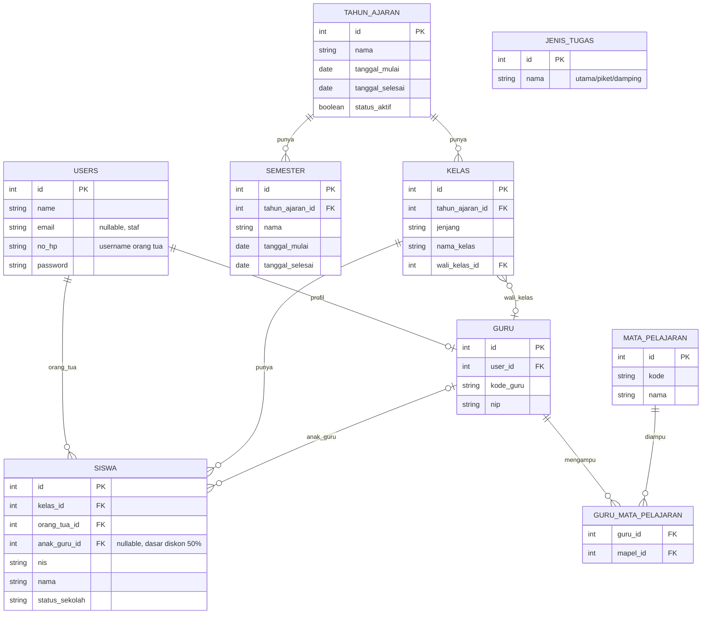
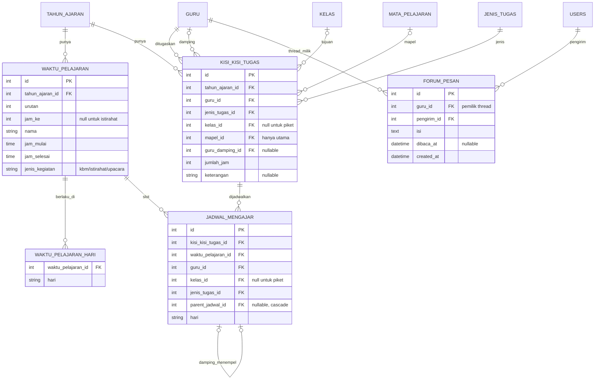

Ini draf ERD lengkapnya, saya bagi tiga diagram supaya terbaca. Relasi lintas diagram memakai nama tabel yang sama.

**Diagram 1: Data master bersama**

**Diagram 2: Modul Les & Ekstrakurikuler**

```mermaid
erDiagram
    TAHUN_AJARAN ||--o{ PERIODE_PENDAFTARAN : punya
    TAHUN_AJARAN ||--o{ LES_TAMBAHAN : berlaku
    TAHUN_AJARAN ||--o{ EKSTRAKURIKULER : berlaku
    KELAS ||--o| LES_TAMBAHAN : punya
    EKSTRAKURIKULER |o--o{ EKSTRAKURIKULER : kelas_paralel
    EKSTRAKURIKULER ||--o{ JADWAL_EKSKUL : jadwal
    EKSTRAKURIKULER }o--o| GURU : pendamping
    EKSTRAKURIKULER ||--o{ EKSKUL_PENGAJAR : diajar
    PENGAJAR_EKSKUL ||--o{ EKSKUL_PENGAJAR : mengajar
    PENGAJAR_EKSKUL }o--o| GURU : jika_internal

    SISWA ||--o{ PENDAFTARAN : mendaftar
    PENDAFTARAN }o--o| LES_TAMBAHAN : salah_satu
    PENDAFTARAN }o--o| EKSTRAKURIKULER : salah_satu
    PENDAFTARAN |o--o| PENDAFTARAN : pindah_ke
    PENDAFTARAN ||--o{ PENYESUAIAN_DANA : punya
    PENDAFTARAN ||--o{ TAGIHAN : ditagih

    PERIODE_LAPORAN ||--o{ TAGIHAN : periode
    PERIODE_LAPORAN ||--o{ LAPORAN_HARIAN : berisi
    LAPORAN_HARIAN ||--o{ TRANSAKSI : memuat
    SISWA ||--o{ TRANSAKSI : membayar
    TRANSAKSI ||--o{ ALOKASI_TRANSAKSI : dialokasikan
    TAGIHAN ||--o{ ALOKASI_TRANSAKSI : dilunasi
    USERS ||--o{ TRANSAKSI : input_approve
    USERS ||--o{ PENYESUAIAN_DANA : diproses

    PERIODE_LAPORAN ||--o{ HONOR_KEGIATAN : menghasilkan
    HONOR_KEGIATAN ||--o{ HONOR_DETAIL : dibagi
    HONOR_FLAT_JENIS ||--o{ HONOR_FLAT_PENGATURAN : diatur
    TAHUN_AJARAN ||--o{ HONOR_FLAT_PENGATURAN : berlaku
    HONOR_FLAT_PENGATURAN ||--o{ HONOR_FLAT_PENERIMA : penerima
    GURU ||--o{ HONOR_FLAT_PENERIMA : menerima
    HONOR_FLAT_PENGATURAN ||--o{ HONOR_DETAIL : hasil_flat
    USERS |o--o{ HONOR_DETAIL : penerima_staf
    PENGAJAR_EKSKUL |o--o{ HONOR_DETAIL : penerima_eksternal

    PERIODE_PENDAFTARAN {
        int id PK
        int tahun_ajaran_id FK
        date tanggal_mulai
        date tanggal_selesai
    }
    LES_TAMBAHAN {
        int id PK
        int kelas_id FK
        int tahun_ajaran_id FK
        decimal biaya
    }
    EKSTRAKURIKULER {
        int id PK
        int tahun_ajaran_id FK
        int parent_ekstrakurikuler_id FK "null = induk"
        int guru_pendamping_id FK "nullable"
        string nama
        decimal biaya
        int kuota
        string kategori_pendamping "seni/olahraga"
        boolean wajib_otomatis
        string jenjang_wajib "mis. 1-3"
        boolean honor_flat
    }
    JADWAL_EKSKUL {
        int id PK
        int ekstrakurikuler_id FK
        string hari
        time jam_mulai
        time jam_selesai
        string jenjang "nullable, mis. Basket 1-3"
        string lokasi
    }
    PENGAJAR_EKSKUL {
        int id PK
        int guru_id FK "nullable"
        string nama
        string jenis "internal/eksternal"
        string no_hp
    }
    EKSKUL_PENGAJAR {
        int ekstrakurikuler_id FK
        int pengajar_ekskul_id FK
    }
    PENDAFTARAN {
        int id PK
        int siswa_id FK
        int les_tambahan_id FK "nullable"
        int ekstrakurikuler_id FK "nullable, CHECK tepat satu terisi"
        int pindah_ke_id FK "nullable"
        date tanggal_daftar
        string status "aktif/berhenti/pindah"
        date tanggal_efektif_berhenti
    }
    PERIODE_LAPORAN {
        int id PK
        date tanggal_mulai
        date tanggal_selesai
        string status "terbuka/diajukan/ditutup"
        int ditutup_oleh FK
        datetime ditutup_at
        int honor_diketahui_oleh FK "nullable"
        datetime honor_diketahui_at
    }
    TAGIHAN {
        int id PK
        int pendaftaran_id FK
        int periode_laporan_id FK
        decimal nominal
        decimal diskon
        string status "belum/lunas"
    }
    LAPORAN_HARIAN {
        int id PK
        int periode_laporan_id FK
        date tanggal
        string status "draft/diajukan/disetujui/ditolak"
        int diajukan_oleh FK
        int disetujui_oleh FK
    }
    TRANSAKSI {
        int id PK
        int siswa_id FK
        int laporan_harian_id FK
        int diinput_oleh FK
        int diapprove_oleh FK "nullable"
        date tanggal
        string metode "cash/transfer"
        decimal nominal
        string status "terverifikasi/pending"
        string sumber_input "tu/bendahara"
        string status_approval_bendahara "nullable, hanya transfer"
        datetime tanggal_approval_bendahara
        string catatan_transfer "nullable, usulan A6 #14"
    }
    ALOKASI_TRANSAKSI {
        int transaksi_id FK
        int tagihan_id FK
        decimal nominal
    }
    PENYESUAIAN_DANA {
        int id PK
        int pendaftaran_id FK
        int diproses_oleh FK
        string jenis_penyesuaian
        int periode_asal_id FK
        int periode_tujuan_id FK "nullable"
        decimal nominal
        string status "selesai/proses/berhasil"
        date tanggal_proses
        text keterangan
    }
    SKEMA_HONOR {
        int id PK
        string tipe_kegiatan "ekstrakurikuler/les_tambahan"
        string jenis_pengajar "nullable"
        decimal persen_pengajar
        decimal persen_guru_pendamping
        decimal persen_kas_sekolah
        decimal persen_yayasan
        decimal persen_penanggung_jawab
        decimal persen_bendahara
        decimal persen_admin_tu
        decimal persen_admin_it
        date berlaku_sejak
    }
    HONOR_KEGIATAN {
        int id PK
        int periode_laporan_id FK
        string tipe_kegiatan
        int kegiatan_id "induk, polimorfik"
        decimal total_pendapatan
        json snapshot_persen
    }
    HONOR_DETAIL {
        int id PK
        int honor_kegiatan_id FK "nullable"
        int honor_flat_pengaturan_id FK "nullable"
        int penerima_user_id FK "nullable"
        int penerima_pengajar_id FK "nullable"
        string peran
        decimal nominal
    }
    HONOR_FLAT_JENIS {
        int id PK
        string nama "Olimpiade/Bina Karakter/Pramuka/Pembuat Soal Les"
        string keterangan
    }
    HONOR_FLAT_PENGATURAN {
        int id PK
        int honor_flat_jenis_id FK
        int tahun_ajaran_id FK
        int diatur_oleh FK
        string bulan "nullable"
        decimal nominal_per_guru
    }
    HONOR_FLAT_PENERIMA {
        int honor_flat_pengaturan_id FK
        int guru_id FK
    }
```

**Diagram 3: Modul Jadwal Guru + Jurnal Guru**

**Ringkasan logika:**
- **Role:** kolom `users.role` dibuang. Role memakai tabel bawaan `spatie/laravel-permission` (`roles`, `model_has_roles`), jadi satu orang bisa punya banyak role (menjawab A6 #15a). Tabel ini tidak saya gambar karena dibuat otomatis oleh package.
- **Pembayaran:** `TAGIHAN` = apa yang harus dibayar per pendaftaran per periode. `TRANSAKSI` = uang yang masuk. `ALOKASI_TRANSAKSI` menghubungkan keduanya. Tunggakan tinggal query tagihan yang belum lunas, dan kelebihan transfer dialokasikan ke tagihan bulan depan.
- **Honor:** `HONOR_KEGIATAN` menyimpan hasil hitung per kegiatan (dengan snapshot persen). `HONOR_DETAIL` memecahnya per penerima, dari persentase atau flat. Rekap 3 layer tinggal query dari tabel ini. Porsi Kas Sekolah dan Yayasan tidak punya penerima orang, jadi kedua kolom penerima di barisnya NULL.
- **Asumsi yang masih perlu disepakati:** `TAGIHAN` dibuat otomatis tiap periode baru untuk semua pendaftaran aktif. `SKEMA_HONOR` memakai `berlaku_sejak` supaya riwayat perubahan persen tersimpan. `PENDAFTARAN` memakai dua FK nullable, dengan CHECK tepat satu terisi, menggantikan `kegiatan_id` polimorfik.
- **Belum tercakup:** jalur transfer tidak valid (A6 #13) belum punya status tambahan di `TRANSAKSI`, karena menunggu keputusan klien.

Satu hal yang perlu kamu putuskan sebelum membuat migration: `HONOR_KEGIATAN.kegiatan_id` masih polimorfik (tanpa FK). Menurutmu lebih baik dipecah jadi dua kolom FK nullable seperti di `PENDAFTARAN`, atau dibiarkan polimorfik karena tabel ini hanya snapshot hasil hitung?